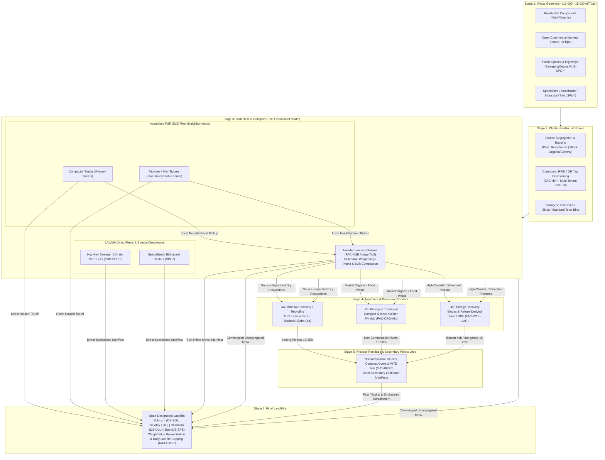

# PRD: LAWMA Authority Workspace & Public Portal (`Workspace`)

**Document Version:** 2.0 (Unified Cross-System Specification)  
**Codebase Base:** `LAWMA v2` (`/workspace`, Public Site) + `LAWMA-360` (`tls-entry.js`, `tls-lifecycle.js`, `hub.js`, `modules.js`)  
**Pilot Scope:** Alimosho–Orile Agege–Agege TLS Lagos West Corridor (6 Alimosho LCDAs + `Papa Ashafa II` in Orile Agege + `FAC-AGE` Agege TLS + `DS-SOL` Solous II)  
**Canonical Data Contract:** `hub-contract.ts` v2 (`APPS = ["customer", "partner", "operator", "lawma"]`)  

---

## 1. Product Vision & Cross-System Boundaries

`Workspace` is the **regulator, clearinghouse, and public transparency portal** for Lagos waste management under the **Ministry of the Environment and Water Resources**, grounded in the **2017 Environmental Management and Protection Law (EMPL)** and the **Polluter-Pay Policy** (~12,000–15,000 metric tons/day baseline). It enforces Lagos's **split operational model** (PSPs execute neighborhood logistics; LAWMA oversees **public spaces**, **specialized waste**, and **regulatory enforcement**) across all **6 waste-lifecycle stages**, and must **never** act as a decoupled billing portal like PUMAU/Visionscape:
- **Upstream Intake:** Receives citizen/USSD/WhatsApp reports (`PUB-*`) and public web submissions (`ReportFlow.tsx`).
- **Partner & Fleet Governance:** Issues/suspends/revokes PSP ward franchises (`PAR-*`), sets corridor rules, and reconciles 80/20 weekly remittances.
- **Operator & Facility Verification:** Ingests offline-first pickup scans (`OPR-*`), TLS weighbridge/stock ledgers (`FAC-AGE`), and disposal site queue/scale tickets (`DS-SOL`, `DS-OLU`, `DS-EPE`).
- **Unified Rule:** Every module uses **Canonical IDs** shared verbatim across `Partner`, `Operator`, and `Resident`:
  - Wards/LCDAs: `LCDA-ALI-AGO` (Agbado/Oke-Odo), `LCDA-ALI-AYO` (Ayobo/Ipaja), `LCDA-ALI-COR` (Alimosho Core: Akowonjo–Egbeda), `LCDA-ALI-EGB` (Egbe/Idimu), `LCDA-ALI-IKO` (Ikotun/Igando), `LCDA-ALI-MOS` (Mosan-Okunola incl. Gowon Estate), plus `LCDA-ORA-PA2` (`Papa Ashafa II`, Orile Agege — Revoked PSP Continuity Zone).
  - Facilities: `FAC-AGE` (Agege TLS + segregated Medical Bay), `DS-SOL` (Solous II — 100 compactors/day capacity cap), `DS-OLU` (Olusosun), `DS-EPE` (Epe), `FAC-ORG-ALI` (Alimosho Biological Treatment — Organic Compost & BSF Hub), `FAC-WTE-LAG` (Energy Recovery — Biogas/RDF/WTE), plus `PUB-SPC-*` (Public Spaces / Highway Sweeping Zones) and `SPL-*` (Specialized Medical/Industrial/Marine Waste Centers).

---

---

## 1.1 The Statutory 6-Stage Solid Waste Lifecycle & Mass-Balance Clearinghouse

Under the **2017 EMPL** and the **Polluter-Pay Policy**, Lagos manages **12,000–15,000 MT/day** of municipal solid waste (MSW). Workspace operates as the central regulatory clearinghouse ensuring that no waste disappears between generation and final engineered disposal.

### The Closed Mass-Balance Equation
$$\sum 	ext{Mass}_{	ext{Generated}} = 	ext{Mass}_{	ext{Direct Landfill}} + 	ext{Mass}_{	ext{Recycled}} + 	ext{Mass}_{	ext{Biological}} + 	ext{Mass}_{	ext{Energy}} + 	ext{Mass}_{	ext{In-Transit}}$$
Where:
$$	ext{Mass}_{	ext{Landfill Total}} = 	ext{Mass}_{	ext{Direct Landfill}} + \sum 	ext{Mass}_{	ext{Residues (MAT-RES-*) Bonds}}$$

---

## 1.2 Multi-Year Transformation Phasing & Engineering Rollout

From the **LAWMA Digital Platform Transformation (2026–2029)** master roadmap:

| Phase | Timeline | Engineering & Infrastructure Deliverables | Capital & Operational Targets |
| :--- | :--- | :--- | :--- |
| **Phase 0: Reconnaissance** | Months -2 to 0 | Technical baseline audit, site surveys of Agege TLS & Solous II, AWS/Azure active-passive sandbox setup, and security compliance verification. | Baseline verification; sandbox integrations. |
| **Phase 1: Foundation & Pilot** | Months 0 to 12 | Core identity registry (LASRRA integration), compound split-billing engine, 100 compactor GPS/OBD-II telematics pilot, Alimosho pilot corridor deployment, and 80/20 escrow clearinghouse. | 100 vehicles telematics ($25,000 / ₦33.75M), fintech webhooks ($15,000), LASRRA setup ($10,000). |
| **Phase 2: Scale, TLS & Enforcement** | Months 12 to 24 | Statewide expansion to all 57 LGAs/LCDAs, 400 compactor telematics units, 1,500 rugged Android handhelds for tricycle micro-collectors, 5 TLS automated weighbridge scale indicators ($5,000/site), WhatsApp Cloud API ($15,000) & USSD gateway ($20,000) live. | 400 compactors ($100,000), 1,500 handhelds ($270,000), 5 TLS scales ($25,000). |
| **Phase 3: Smart City & Ecosystem** | Months 24 to 36 | Predictive AI routing, Pakam/Scrapays API synchronization, source-sorting gamification, and Epe / Harvest Waste WTE corridor telemetry. | AI inference, GIS spatial analytics, multi-region sync. |

---

## 1.3 Hardware & Edge Telematics Specifications

1. **Heavy Compactor OBD-II / GPS Units ($250/unit):**
   - Quad-band 4G LTE with 2G fallback (EGPRS 900/1800).
   - Real-time CAN bus telemetry: fuel level, engine RPM, ignition state, hydraulic PTO (Power Take-Off) engagement sensor (detects compactor blade cycling vs idle driving).
   - High-gain external GPS/GLONASS antenna with 10Hz sampling.
2. **Tricycle & Field Crew Rugged Handhelds ($180/unit):**
   - Ruggedized Android 14 mobile computers, IP67 dust/water resistant, 1.5m drop-to-concrete spec.
   - Dedicated 1D/2D zebra-grade hardware barcode imager (<100ms scan decode in direct tropical sunlight).
   - Removable 5000mAh hot-swappable battery with 14-hour continuous operating shift rating.
3. **Automated TLS Weighbridge Scale Indicators ($5,000/site):**
   - Digital load-cell indicators with optical barrier axle-sensors and automated license plate recognition (ALPR).
   - Isolated RS-232/RS-485 serial-to-IP edge bridges pushing gross/tare weight directly into `tls-entry.js` state machine.

## 2. Personas & Role-Based Access (`personaPages` / RBAC)

Preserves all existing `journeyRoles` in `modules.js` and `tls-lifecycle.js`, adding explicit production RBAC boundaries:

| Role Key | Display Label | Default Route | Read/Write Permissions |
| :--- | :--- | :--- | :--- |
| `management` | Executive / MD / Commissioner | `overview` | Full oversight, PSP `Active`/`Suspended`/`Revoked` changes, `Move work`, compliance decisions, SLA policy thresholds, SitRep exports. |
| `admin` | Workspace Admin | `systems` | `USR-*` access register, partner category config, `hub-contract.ts` v2 webhook keys, audit log inspection. |
| `operations` | Collection & Public-Space Ops | `fleet` | Fleet map (Compactors + Tricycles + LGA Pool + Public-Space Highway/Median Sweepers `PUB-SPC-*`), route dispatch (`ASN-*`), corridor blackspot triage. |
| `facility` | TLS / Disposal Operator | `facility` | Check-in, weighbridge ticketing, bay assignment, stocktake (`STK-*`), outbound transfer dispatch (`MAN-*`), queue waits. |
| `receiving` | Destination Operator | `facility` | `DS-SOL` / `DS-OLU` / `DS-EPE` / `FAC-ORG-ALI` / `FAC-WTE-LAG` manifest & `MAT-RES-*` process-reject receipt confirmation (`accepted`/`rejected`/`alternative`). |
| `auditor` | TLS & Finance Auditor | `facility` | Read-only immutable access to TLS ledger, stocktake variances, escalation logs, and 80/20 escrow settlements. |
| `enforcement` | Enforcement & Audit Lead | `enforcement` | Camera flags (`ENF-*`), Waste Police/KAI digital citation verification, appeal adjudication (human-reviewed; no silent auto-fines). |
| `recovery` | Resource Recovery Lead | `recovery` | Material batches (`MAT-*`), Biological compost/BSF (`FAC-ORG-ALI`), Energy Recovery (`FAC-WTE-LAG`), `MAT-RES-*` residual manifests, private dry-recycler partner receipts (`Wecyclers`/`Pakam`/`Scrapays`). |
| `care` | Citizen Care & Liaison | `care` | `PUB-*` & `REQ-*` tickets (`ALARM_ACK_LIMIT_MIN = 30`), 5-way jurisdiction routing (`FHA`/`LGA`/`LAWMA Public Spaces & Enforcement`/`Specialized Waste`/`PSP`), SLA escalation. |
| `finance` | Revenue & Escrow Officer | `remittances` | Monthly compound billing ledgers, Escrow Hold/Release audits, `80/20` Friday 5 PM (`REMITTANCE_DEADLINE`) partner settlement, `SPL-*` 2017 EMPL direct invoices. |
| `commercial` | Market, Industrial & Special Waste Desk | `commercial` | `MKT-*` / `BUS-*` contracts, daily market sweeping schedules, mandatory organic separation compliance, `COM-*` invoices, `SPL-*` Medical/Industrial/Marine manifests. |
| *(Deprecated in Workspace Prod)* | `partner`, `psp`, `crew`, `resident` | — | **Boundary Decision:** Retained in demo preview switcher with explicit banner linking to dedicated `Partner`, `Operator`, and `Resident` apps so teams do not confuse regulatory preview with dedicated client apps. |

---

## 3. Complete Functional Module Specifications

### Module 1: Executive Overview, Backlog & LGA Cleanliness Competition (`overview`, `scenarios`)
- **Existing Foundation:** Executive KPIs, `hubBacklogPanel`, deterministic replayable scenarios (`scenarios`).
- **Additions & Requirements:**
  1. **Alimosho Pilot Live Strip:** Real-time rollup across the 7 pilot zones showing *(a)* Compound Scan Completion % vs. Scheduled, *(b)* `DS-SOL` Daily Compactor Intake (`X / 100` trucks/day), *(c)* `FAC-AGE` TLS Queue & Buffer Stock (tonnes), *(d)* Open `PUB-*` Alarms > `30 min`.
  2. **LGA / LCDA Cleanliness Competition Leaderboard (`New`):** Automated monthly & daily-streak ranking across **20 LGAs & 37 LCDAs** (pilot highlights all 6 Alimosho LCDAs + Orile Agege) weighted by:
     - `40%` Verified household/compound collection completion rate (from `Operator` scans, eliminating unverified truck claims).
     - `25%` Public report clearance speed (`PUB-*` median closure vs. 24h target) & zero repeat 1–2 AM blackspot regrowth.
     - `20%` Organic & dry-material diversion rate (`MAT-*` tonnes / total collected tonnes).
     - `15%` Daily vs. monthly participation (non-sanitation-day compliance + market daily cleanup SLA).

### Module 2: Partner Network, Accreditation, Licence Risk Scorecard & Revocation (`partners`, `partner`, `partnerWork`, `compliance`)
- **Existing Foundation:** `PAR-*` directory, `Move work`, `REV-*` human compliance reviews.
- **Additions & Requirements:**
  1. **Formal Regulatory States (`Canonical across 4 Systems`):** `Active` | `Probation` | `Suspended` | `Revoked` | `Voluntary Exit`.
  2. **PSP Capacity & Licence Risk Scorecard (`New`):** Real-time composite scorecard per PSP tracking *(a)* active fleet availability vs. ward load, *(b)* Friday SLA completion rate, *(c)* verified paid-compound coverage, and *(d)* `FAC-AGE` / `DS-SOL` tip-off compliance—giving Dr. Muyiwa Gbadegesin's LAWMA reorganisation objective telemetry *before* a ward collapses for months.
  3. **1-Click Licence Revocation & Mass Continuity Playbook (`New`):** When LAWMA marks a partner `Revoked` or `Voluntary Exit` (seeded with real case `Guestimate Environmental Protection Co.` in `LCDA-ORA-PA2` *Papa Ashafa II*, alongside the 5 sister LAWMA revocations as reference templates):
     - Immediately freezes new resident signups & locks partner cash remittance withdrawals.
     - Emits `partner.status_changed` on `hub-contract.ts` v2 to `Partner`, `Operator`, and `Resident`.
     - Prompts Management to assign **Interim Coverage** within 2 hours using either *(a)* an adjacent `Active` Tier-1 PSP or *(b)* **Conference 57 LGA Pool Compactors**, preserving uninterrupted pickup schedules, preventing double-billing, and keeping resident payments inside **Approved Channels Only**.
  4. **SLA-Linked Escrow Compliance (`REV-*`):** Auto-opens a `REV-*` review if a PSP drops below `80%` compound scan completion for 2 consecutive weeks or breaches Saturday-noon SLA cutoffs across >3 streets.

### Module 3: Fleet Map, Registry & Unified Dispatch (`fleet`, `registry`, `dispatch`, `cameras`)
- **Existing Foundation:** Interactive 1,000-vehicle corridor map, vehicle/personnel register (`VEH-*`, driver permits), `ASN-*` assignments, `hub-reports` & `hub-backlog` map layers, `cameras`.
- **Additions & Requirements:**
  1. **Asset Class Support (`Canonical`):** Every vehicle in `VEH-*` carries `assetClass`: `"Compactor" | "Tricycle Micro-Collector" | "Hook-Loader / Roll-On" | "LGA Pool Truck"` plus `zoneEligibility` (narrow unpaved inner lanes -> `Tricycle Micro-Collector`; arterial/market -> `Compactor`).
  2. **Zone-Aware & Telemetry-Locked Dispatch:** Preserve existing guards (`v.status === 'No signal'` blocks dispatch; `person.status === 'Available'` required), and expand to show **LGA Pool Backup Dispatch** during blackspot raids or revoked-ward continuity.
  3. **Operator Scan Overlay:** Fleet map draws verified GPS breadcrumbs from `waste-scan-mate` stops alongside fixed corridor CCTV (`cameras`) so LAWMA sees *actual bins emptied*, not merely trucks driving through a street without stopping.
  4. **Saturday-Noon Friday-SLA Auto-Recovery Trigger (`New`):** If an estate or street's contracted weekly day (e.g., *Friday*) passes with unverified stops by **Saturday 12:00 WAT**, Workspace auto-freezes affected escrow releases and queues a backup **Conference 57 LGA / Intervention Compactor** dispatch order (`ASN-*`).
  5. **Nearest Legal Drop-off & Zone Micro-Collector Registry (`New`):** Authoritative geo-directory of temporary transfer skips, public recycling bins, MRF drop-offs, and **reformed cart pushers ("Zone Micro-Collectors")** authorized to feed inner lanes into designated transfer points instead of dumping in canals.

### Module 4: 10-Module TLS Lifecycle & Disposal Queue Governance (`facility`, `capacity`)
- **Existing Foundation:** Complete `tls-entry.js` + `tls-lifecycle.js` state machine (`Expected` -> `Checked in` -> `At weighbridge` -> `Weighed` -> `Unloading` -> `Unloaded` / `Rejected` -> `Diverted`), weighbridge outage override (`tlsReconcileWeight`), stock ledger, `STK-*` stocktake, `ADJ-*` approved adjustment, `MAN-*` outbound transfer manifests, destination receipts, close day. Plus `hubQueuePanel` (`QUEUE_WAIT_LIMIT_MIN = 45`).
- **Additions & Requirements:**
  1. **Seed Pilot Facilities Cleanly:**
     - `FAC-AGE` (**Agege TLS**): Receives Zone 1 Alimosho (*Agbado/Oke-Odo, Ayobo/Ipaja, Akowonjo–Egbeda*) + *Orile Agege (`Papa Ashafa II`)*. Outbound transfers target `DS-SOL` (primary), `DS-OLU` (overflow), or `DS-EPE`.
     - `DS-SOL` (**Solous II Disposal Site, Igando**): Direct-tip destination for Zone 2 (*Ikotun/Igando, Egbe/Idimu, Gowon Estate*) + outbound `FAC-AGE` manifests + process rejects (`MAT-RES-*`). Configured with **`dailyCompactorLimit = 100`** (matching Comm. Wahab upgrade) and live **Turnaround SLA Timer (`<= 45 min` queue target)**. When `DS-SOL` hits `>= 85%` slot saturation or `> 45 min` average wait, Workspace raises an advisory banner recommending scheduled stagger windows or `DS-OLU`/`DS-EPE` overflow to prevent 3-day queues.
     - `FAC-ORG-ALI` (**Alimosho Biological Treatment — Organic Compost & BSF Hub**): Receives source-separated market organic loads from Ikotun, Igando, and Ile-Epo.
     - `FAC-WTE-LAG` (**Energy Recovery Corridor — Biogas / RDF / Epe WTE**): First-class Branch 4C destination in `tlsMaterials` & `tls-lifecycle.js` receiving high-calorific non-recyclable RDF / organic biogas feedstock (`Harvest Waste` / anaerobic digester corridors).
  2. **Strict Non-Bypass Weigh-to-Stock Rule & Secondary Reject Loop:** Preserve existing code rule that *no waste enters TLS stock until unloading completes*, and manual outage tickets remain flagged (`manualPending = true`) until Supervisor reconciliation. Emit `tls.intake_confirmed` back to `Partner` app so PSPs get verifiable tip-off receipts tied to their 80/20 settlement. **Every recovery/treatment plant (`MAT-*`, `FAC-ORG-ALI`, `FAC-WTE-*`) must emit `MAT-RES-*` Outbound Process-Residual Manifests** for rejects, digestate, or bottom ash returning to **Landfilling (`DS-SOL`/`DS-OLU`/`DS-EPE`)** so zero mass disappears between Stages 4 and 6.

### Module 5: Citizen Reports, Drain Jurisdiction Triage & Care Desk (`publicReports`, `care`, `incidents`, `/report`)
- **Existing Foundation:** `PUB-*` 6-channel intake (`App`, `Website`, `WhatsApp`, `USSD`, `Phone call`, `Field officer`), `ALARM_ACK_LIMIT_MIN = 30`, `hubHotspots`, `REQ-*`, `INC-*`, and Public Site `ReportFlow.tsx`.
- **Additions & Requirements:**
  1. **Unified Pipeline (`ReportFlow.tsx` + Resident App + USSD/WhatsApp -> `PUB-*`):** Upgrade `ReportFlow.tsx` so instead of saving only to `localStorage` (`SITE_REPORTS_KEY`), submissions post to the unified `hub-contract.ts` v2 `report.submitted` endpoint (retaining `localStorage` as offline outbox fallback) and generate a trackable `PUB-*` reference ID via SMS/on-screen.
  2. **Drainage & Canal Jurisdiction Classifier (`New`):** Based on pinned GPS + category (`Blocked Drain` / `Canal Obstruction` / `Night Dumping Blackspot` / `Missed PSP Collection`):
     - **Gowon Estate / FESTAC boundaries:** Auto-tags **`FHA` + `LAWMA Liaison`** so residents are never bounced endlessly between federal housing and state authorities.
     - **Tertiary Street Drains:** Routes to **Host LCDA / Ministry of Environment Drainage**.
     - **1–2 AM Repeat Night Dumping Spots:** Auto-clusters reports within a `150m` radius over `72 hours` into a **Chronic Blackspot (`HOT-*`)**, surfacing night-patrol scheduling (00:30–03:30) and post-clearance 3-hour camera/patrol re-check timers.

### Module 6: Commercial Markets, 3-Branch Resource Recovery & LAWMA Direct Operations (`commercial`, `recovery`, `publicSpaces`, `specializedWaste`)
- **Existing Foundation:** `MKT-001..003`, `BUS-001..002`, daily cleanup windows, monthly `COM-*` invoices, `MAT-*` recovery batch receipts.
- **Additions & Requirements:**
  1. **Pilot Market Seeding:** Add `MKT-ALI-01` (**Ikotun Market**), `MKT-ALI-02` (**Igando Market**), and `MKT-ALI-03` (**Ile-Epo Market**) alongside existing Oshodi/Ojuwoye/Computer Village records.
  2. **All 3 Recovery Branches + Process-Reject Tracking (`New`):** Commercial & recovery ledgers track **(4A) Material Recovery (`MAT-*`)** via dry recyclers (*Wecyclers, Pakam, Scrapays, Kaltani*), **(4B) Biological Treatment (`FAC-ORG-ALI`)** composting/BSF from `organicKg` market loads, **(4C) Energy Recovery (`FAC-WTE-LAG`)** for biogas/RDF/WTE feedstock, **and (`MAT-RES-*`) secondary residual/reject manifests returning down to Landfilling (`DS-SOL`/`DS-EPE`)**.
  3. **LAWMA Public-Space & Highway Sweeping Operations (`PUB-SPC-*`, New):** Separates **LAWMA direct public-space sanitation** (state expressways, BRT corridors, pedestrian bridges, flood medians, highway street-sweeper shifts, public litter bins) from PSP neighborhood routes, syncing directly with `Operator` Public-Space Sweeper check-ins.
  4. **LAWMA Specialized Waste Directorate (`SPL-*`, New):** Dedicated manifest, chain-of-custody lock, and **2017 EMPL Polluter-Pay** direct billing for **Medical/Healthcare, Industrial Hazardous, Marine/Lagoon Debris, and E-Waste**, routed exclusively to Agege TLS's segregated medical wing or accredited hazardous treatment plants.

### Module 7: Escrow-Backed Revenue, 80/20 Remittances & Service Ledger (`finance`, `remittances`, `serviceLedger`)
- **Existing Foundation:** `PARTNER_SHARE = 0.8` (80% Partner / 20% LAWMA), `REMITTANCE_DEADLINE = 'Friday 5 pm'`, `ORD-*` service ledger, `INV-*` monthly billing.
- **Additions & Requirements *(Contradiction Resolution)*:**
  1. **Unified Billing Model (`Monthly Compound Base + Escrow Release + Optional Add-Ons`):**
     - `Workspace` enforces the canonical monthly household/compound subscription (`₦1,500–₦2,500/unit/month` residential tiers; custom `COM-*` for estates/markets) alongside optional on-demand add-ons (bulk clearance, extra 240L bin).
  2. **Scan-Verified Escrow Release:** Partner 80% share moves from `Escrow Pending` -> `Eligible for Weekly Settlement` **only when** `Operator` emits verified gate scans (`OPR-*`) or gated estate check-in, closing the loop against PSPs collecting fees without picking up waste.
  3. **Unpaid Arrears Grace & Subsidy Ledger:** Supports USSD Pay-Small-Small installments and tracks indigent/blackspot emergency LGA interventions transparently without hiding them inside PSP debts.

### Module 8: Enforcement, Anti-Extortion Audit & Citizen Safeguards (`enforcement`)
- **Existing Foundation:** `ENF-*` camera flags (`Speeding` / `Illegal tipping`), evidence viewer, formal appeal flow (`No auto-penalty` rule).
- **Additions & Requirements:**
  1. **Digital Field Citation Module (`Waste Police / KAI / LAGESC Sync`):** All statutory fines (residential unregistered dumping from `₦25,000`, drain/canal dumping up to `₦250,000`, corporate up to `₦1,000,000`) logged by field teams via `Operator` Enforcement Mode appear in `ENF-*` with **mandatory geotagged photo, officer ID, and LASG/Remita Bill Reference**.
  2. **Anti-Extortion Whistleblower Protection:** Zero cash-in-hand fine collection is valid; any resident report of cash extortion at roadside/blackspot auto-opens a confidential `INC-*` internal affairs audit ticket.
  3. **Cart-Pusher Transition Register (`New`):** Distinguish unregistered predatory dumping from formalizing micro-collectors enrolling into Partner-sponsored **Tricycle Micro-Collector** cohorts.

### Module 9: Public Portal, Staff Mobile & Presentation Experience (`/`, `/smartwaste360`, `/mobile`, `presentation.js`, `experience.js`)
- **Existing Foundation:** 5-language `AccessibilityPanel.tsx`, `ReportFlow.tsx`, `/mobile` phone layout (`mobile-app.js`, `appTabs`), `presentation.js` (`#productFront`, `#loginPanel`, `#signupPanel`, 70-sec film `/presentation-assets/release-film/final.mp4`), and `experience.js` (`serviceAPI` `/api/service` session polling + `screens.finance` entry overlay + 12 telemetry scenarios + Street View deep link + `"Capture stable scale reading"` widget + GIS routes `route-Alimosho.json`, `route-Agege.json`).
- **Additions & Requirements:**
  1. **Sync Protocol Unification (`serviceAPI` vs. `/api/public/messages`):** Retain `experience.js`'s `?session=` polling solely as a lightweight workshop demo bridge; in pilot/production, route all cross-app state through `/api/public/messages` (`hub-contract.ts` v2 with `OPERATOR_APP_KEY` + short-lived scoped JWT auth instead of static `x-app-key` strings). Explicitly document `experience.js`'s removal of `resident`/`psp` roles from `personaPages`.
  2. **Preserve & Extend Existing GIS Corridors:** Build Alimosho pilot live dispatching directly on top of `route-Alimosho.json` and `route-Agege.json`, keeping the weighbridge capture widget, Street View fallback, and `/mobile` bottom-tab shell (`mobile-app.js`) for field supervisors.
  3. **Public Ward PSP & Verification Lookup (`New`):** Resident enters street/LCDA (or `PAR-*` code) to verify in 3 seconds: *(a)* Assigned Licensed PSP name, logo, and status (`Active` vs `Revoked — Interim Service Active`), *(b)* Official Monthly Tariff Band, *(c)* Approved Payment Channels (stopping fake billers and revoked operators).
  4. **Public Alimosho Pilot, Sanitation Saturday & Cleanliness Scorecards (`New`):** Surface live Cleanliness Competition scores, **Last-Saturday & Daily Sanitation bagged silt-pile pickup pins**, and official announcements on `/newsroom` and `/`.

### Module 10: Cross-Cutting Facility Safety, Rainy-Season Surge, Channel Specs & NDPA 2023 Governance (`New`)
1. **Medical / Hazardous Waste Isolation (`FAC-AGE` Agege TLS):** Because Agege TLS handles medical waste alongside MSW, add `"Medical / Hazardous (Segregated)"` as a locked destination stream; contaminated residential/market loads flagged in `Operator` require mandatory `Divert` / special hazardous manifest handling in `tls-lifecycle.js` and may never mix into `FAC-ORG-ALI`.
2. **Dumpsite Scavenger / Bay Safety & Fire-Bypass Toggle (`FAC-AGE`, `DS-SOL`, `DS-OLU`):** Register accredited informal pickers (`REC-PICK-*`) inside designated perimeter MRF sorting pads away from active compactor tipping bays to prevent methane/scavenger fires; add a 1-click **`Facility Fire / Outage Reroute`** control in `Workspace` that updates `Partner` and `Operator` tip-off routes immediately.
3. **Rainy-Season Surge Mode (`2.2m–2.7m` Annual Rainfall):** Triggered during heavy May–Oct storm alerts: *(a)* enables `48h` pre-storm priority canal/drain dispatch from `PUB-*`, *(b)* adjusts weighbridge moisture tolerance in `STK-*` stocktakes, and *(c)* honors verified `flood-access` exceptions from `Operator` so Saturday-noon SLA auto-penalties do not unfairly fine stranded PSPs.
4. **Concrete USSD & WhatsApp Gateway Spec (`hubChannelsPanel`):**
   - *USSD (`< 120s` stateless menu):* `1. Verify Ward PSP Licence` -> `2. Pay Compound/Flat Share` -> `3. Check Friday Pickup / File Missed SLA` -> `4. Report Blocked Drain / Dumping (Ward Code)` -> `5. Language (EN/PCM/YO/IG/HA)`.
   - *WhatsApp Cloud API:* Accepts compressed photo + native WhatsApp Location pin directly into `PUB-*` (`FHA`/`LGA`/`LAWMA` auto-triage) and pushes gate-photo SLA receipts.
5. **NDPA 2023 Privacy & Whistleblower Protection:** Anonymize citizen reporter identities (`ANON-*` token) on `HOT-*` (1–2 AM dumping) and `INC-*` (anti-extortion whistleblowing) tickets so no phone number or street apartment leaks to field or enforcement crews.

---

## 4. Non-Functional Requirements & Acceptance Criteria

| Dimension | Requirement | Target Metric |
| :--- | :--- | :--- |
| **Offline-First Edge Sync** | `ReportFlow.tsx` and `hub-contract.ts` v2 outbox tolerate 2G/Edge intermittent dropouts; TLS `facility` operations queue locally and sync without duplicate tonnage. | `0` lost weight tickets or `PUB-*` reports on simulated offline/online toggle. |
| **SLA Alerting Latency** | Citizen alarms (`PUB-*`), Solous II `>85%` capacity warning, facility fire/outage reroutes, and PSP `Revoked` cascade propagate across connected apps. | `< 5s` via real-time subscription (`30 min` human ack SLA). |
| **Multilingual & Channel Coverage** | All public forms, USSD state trees, WhatsApp flows, and `PUB-*` notifications support English, Yorùbá, Pidgin, Igbo, and Hausa. | `100%` parity across `AccessibilityPanel.tsx`, USSD, WhatsApp, and Resident `LocalVoiceAgent`. |
| **Zero Cross-App Contradiction & NDPA** | `Workspace` IDs, `80/20` remittance math, `Active`/`Revoked` partner states, and `DS-SOL` / `FAC-AGE` facility codes match `Partner`, `Operator`, and `Resident` PRDs identically; PII anonymized on sensitive reports. | `100%` schema validation pass via Zod `hub-contract.ts` v2; `0` unmasked reporter phones on enforcement handhelds. |
