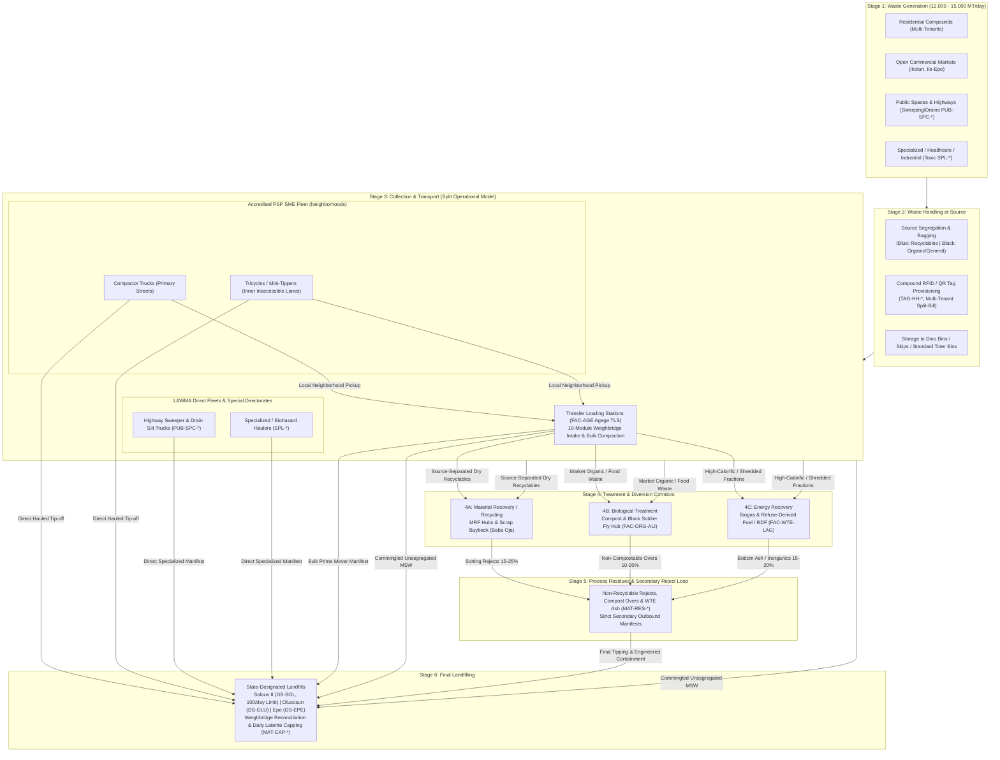

# PRD: LAWMA Authority Workspace & Public Portal (`Workspace`)

**Document Version:** 2.0 (System-Specific Specification)  
**System Role:** Regulator Command Room, Mass-Balance Clearinghouse & Public Transparency Portal  
**Target Codebase:** `LAWMA v2` (`lawma/`, `src/routes/workspace`, `public/`)  
**Deployment Target:** Authority Control Room & Public Transparency Web Portal (Vercel Nitro)  
**Pilot Scope:** Alimosho–Orile Agege–Agege TLS West Corridor (`LCDA-ALI-*`, `LCDA-ORA-PA2`, `FAC-AGE`, `DS-SOL`)  

---

## 1. System Vision & Purpose

`Workspace` is the **regulatory command room, mass-balance clearinghouse, and public transparency portal** for Lagos solid waste management under the **Ministry of the Environment and Water Resources**, grounded in the **2017 Environmental Management and Protection Law (EMPL)** and the **Polluter-Pay Policy** (~12,000–15,000 MT/day baseline). It enforces Lagos State's **split operational model**:
1. **Private Sector Operators (AWAMN PSPs):** Handle routine neighborhood logistics, tenement compounding, and market skips.
2. **LAWMA Direct Operations:** Oversees public spaces and highways (`PUB-SPC-*`), specialized hazardous/medical waste (`SPL-*`), Transfer Loading Stations (`FAC-AGE`), state landfills (`DS-SOL`), and statutory enforcement.

---

## 2. The Statutory 6-Stage Solid Waste Lifecycle & Mass-Balance Clearinghouse

### The Conservation-of-Mass Law
$$\sum 	ext{Mass}_{	ext{Generated}} = 	ext{Mass}_{	ext{Direct Landfill}} + 	ext{Mass}_{	ext{Recycled}} + 	ext{Mass}_{	ext{Biological}} + 	ext{Mass}_{	ext{Energy}} + 	ext{Mass}_{	ext{In-Transit}}$$
Where:
$$	ext{Mass}_{	ext{Landfill Total}} = 	ext{Mass}_{	ext{Direct Landfill}} + \sum 	ext{Mass}_{	ext{Residues (MAT-RES-*) Bonds}}$$

---

## 3. Core Functional Modules

### Module 1: Executive Command & Daily SitRep
- **Real-Time KPIs:** Statewide daily tonnage collected vs target, active compactor fleet count, dumpsite turnaround time averages, 80/20 escrow liquidity balance.
- **Incident Escalation:** Live alerts for uncollected wards, biohazard discoveries (`INC-BIO-*`), and illegal dumpsite reports (`PUB-*`).

### Module 2: 10-Module TLS Lifecycle Engine (`facility`, `capacity`)
- Complete state machine (`Expected` -> `Checked in` -> `At weighbridge` -> `Weighed` -> `Unloading` -> `Unloaded` / `Rejected` -> `Diverted`).
- Agege TLS (`FAC-AGE`) intake verification, bulk compaction manifest dispatch (`MAN-*`), and secondary process-reject manifests (`MAT-RES-*`).

### Module 3: Landfill Queue Governance (Solous II 100/day Cap)
- **Turnaround SLA Target:** Live countdown timer enforcing $\le 45	ext{ min}$ turnaround at Solous II (`DS-SOL`).
- **Dynamic Divert Protocol:** When `DS-SOL` hits $\ge 85\%$ capacity or queue exceeds 45 minutes, Workspace issues automated reroute orders diverting incoming compactors to Agege TLS or Olusosun (`DS-OLU`).
- **Sanitary Containment:** Tracks daily laterite capping manifests (`MAT-CAP-*`) to suppress landfill odor, fly infestation, and subsurface methane fires.

### Module 4: 80/20 Financial Escrow Clearinghouse
- Audits and releases the weekly 80% PSP remittance at Friday 5:00 PM upon verified operator pickup scans.
- Enforces statutory withholding tax and stamp duty deductions aligned with LIRS guidelines.
- Automatically freezes funds for unverified stops at Saturday 12:00 WAT.

### Module 5: Inter-LCDA Cleanliness Competition & Public Portal
- Monthly cleanliness league table ranking all 20 LGAs and 37 LCDAs based on verified pickup efficiency and rapid drainage desilting response.
- Public PSP verification portal: allows any citizen to verify licensed operators, official tariff bands, and report environmental infractions.

---

## 4. Multi-Year Implementation Phasing

| Phase | Timeline | Strategic & Infrastructure Milestones |
| :--- | :--- | :--- |
| **Phase 0: Baseline Audit** | Months -2 to 0 | Technical reconnaissance, Agege TLS & Solous II site surveys, cloud sandbox environments. |
| **Phase 1: Foundation & Pilot** | Months 0 to 12 | Core identity registry (LASRRA sync), compound billing engine, 100 compactor telematics pilot, 80/20 escrow clearinghouse. |
| **Phase 2: Statewide Scale** | Months 12 to 24 | Full 57 LGA/LCDA rollout, 400 compactors + 1,500 handhelds, 5 TLS weighbridge automation sites, WhatsApp/USSD gateways. |
| **Phase 3: Smart City Expansion**| Months 24 to 36 | Predictive AI route optimization, Pakam recycling API sync, Epe WTE corridor telemetry. |

---

## 5. Executive Governance & Sovereign Compliance Mandates

Following the Joint Executive Boardroom Audit by **Governor Dr. Kadri Obafemi Hamzat**, **Hon. Comm. Tokunbo Wahab**, **Hon. Rasheed Shabi**, and **MD Dr. Muyiwa Gbadegesin** (detailed in [`docs/executive-audit-and-mandates.md`](executive-audit-and-mandates.md)), Workspace enforces 14 non-negotiable architectural mandates:

1. **Onshore Sovereign Cloud Tier (`MANDATE-KOH-01`):** Primary database, transaction ledgers, and identity registries must terminate in the Lagos State Central Data Center (Alausa / Tier III MDXi Lekki) under NDPA 2023.
2. **LAGIS Cadastre & LASRRA Binding (`MANDATE-KOH-02`):** Every `PROP-*` property entity must bind to the official `LASG-CAD-ID` digital land parcel ID and the tenant's 10-digit LASRRA key.
3. **Treasury Single Account (TSA) Co-Banking (`MANDATE-KOH-03`):** 80/20 escrow clearinghouse operates via a designated State Co-Treasury Escrow account integrated via API with Oracle EBS Financials.
4. **Pre-Dispatch Depot Route Locking (`MANDATE-WAH-01`):** Abolish mid-transit long-distance diversions; lock northern Alimosho to Agege TLS at 5:00 AM dispatch and utilize LASU-Iba corridor holding pads.
5. **KAI Taskforce Oshodi Armed Rapid Interception (`MANDATE-WAH-02`):** Real-time automated dispatch of armed LAGESC/KAI patrol squads and vehicle impoundment tracking under EMPL Section 88.
6. **Executive Market Sealing Dashboard (`MANDATE-WAH-03`):** Tracking collective market skip containment (`MKT-EXEC-*`) and single-click ministerial sealing orders.
7. **Joint LASEPA-LAWMA Statutory Handshake (`MANDATE-SHB-01`):** Mandate digital LASEPA laboratory clearance tokens for all hazardous, toxic, chemical, and medical specialized waste (`SPL-*`, `INC-BIO-*`).
8. **Ecotoxicity & Aquifer Protection Dashboard (`MANDATE-SHB-02`):** Continuous telemetry of groundwater test boreholes around dumpsites, methane gas migration sensors, and daily 15cm laterite capping depth logs (`MAT-CAP-*`).
9. **48-Hour Operational Grace & Cure Window (`MANDATE-GBD-01`):** Replace rigid Saturday-noon freeze with a 48-hour operational grace window to prevent statewide AWAMN strikes.
10. **Zero-Downtime Local Edge Survivability (`MANDATE-GBD-02`):** Local SQLite/K3s broker issuing cryptographically signed offline scale tickets (`TCK-OFFLINE-*`) backed by 72-hour solar-inverter power.
11. **Automated Emergency Hazmat Evacuation (`MANDATE-GBD-03`):** Instant dispatch of LAWMA Specialized Medical Waste Fleet within 4 hours of any biohazard rejection, auto-billing the offending clinic via HEFAMAA.
