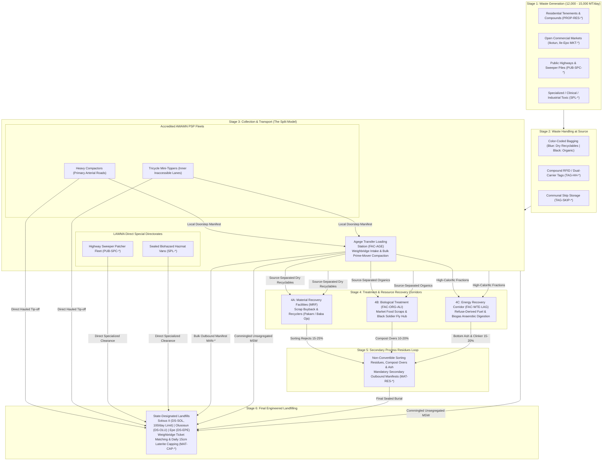

# MASTER PRODUCT REQUIREMENTS & ARCHITECTURE SPECIFICATION (PRD / PLD)
## LAWMA AUTHORITY WORKSPACE & REGULATORY CLEARINGHOUSE (`LAWMA v2`)

**System Codename:** LAWMA SmartWaste360 Authority Workspace  
**Document Classification:** Lagos State Executive Council / Tier-1 Enterprise Specification  
**Version:** 3.0 (Post-Executive Audit Comprehensive Modular Edition)  
**Primary Codebase:** `LAWMA v2` (`/workspace`, Public Portal, API Gateway)  
**Connected Ecosystem:** `LAWMA-360-crew-app` (Operator), `LAWMA-360-customer-app` (Resident), `LAWMA-360-partner-app` (Partner Hub)  
**Statutory Foundation:** 2017 Lagos State Environmental Management and Protection Law (EMPL), Nigeria Data Protection Act (NDPA 2023), Lagos State Public Finance Management Law (2011), Evidence Act (2011) Section 84  
**Executive Boardroom Sponsors:**
- **Dr. Kadri Obafemi Hamzat (KOH)** — *Executive Governor of Lagos State*
- **Hon. Tokunbo Wahab** — *Hon. Commissioner, Ministry of the Environment and Water Resources*
- **Hon. Rasheed Shabi** — *Chairman, House Committee on Environment & Parastatals, Lagos State House of Assembly*
- **Dr. Muyiwa Gbadegesin** — *Managing Director / CEO, Lagos Waste Management Authority (LAWMA)*

---

# TABLE OF CONTENTS
1. [Executive Vision & Split Operational Mandate](#1-executive-vision--split-operational-mandate)
2. [Statutory 6-Stage Solid Waste Lifecycle & Mass-Balance Clearinghouse](#2-statutory-6-stage-solid-waste-lifecycle--mass-balance-clearinghouse)
3. [Multi-Year Transformation Phasing & Capital Rollout Roadmap](#3-multi-year-transformation-phasing--capital-rollout-roadmap)
4. [Enterprise Role-Based Access Control (`personaPages` / RBAC Matrix)](#4-enterprise-role-based-access-control-personapages--rbac-matrix)
5. [The 11 Standalone Modular Product Level Documents (PLDs)](#5-the-11-standalone-modular-product-level-documents-plds)
   - [Module 1: Sovereign Cadastral Asset & Identity Registry (`MOD-01-CADASTRE`)](#module-1-sovereign-cadastral-asset--identity-registry-mod-01-cadastre)
   - [Module 2: Split-Operational Fleet & Corridor Pre-Dispatch Engine (`MOD-02-FLEET-LOGISTICS`)](#module-2-split-operational-fleet--corridor-pre-dispatch-engine-mod-02-fleet-logistics)
   - [Module 3: 10-Module TLS Lifecycle & Weighbridge Automation (`MOD-03-TLS-SCALE`)](#module-3-10-module-tls-lifecycle--weighbridge-automation-mod-03-tls-scale)
   - [Module 4: Landfill Capacity & Turnaround SLA Governance (`MOD-04-LANDFILL-GOV`)](#module-4-landfill-capacity--turnaround-sla-governance-mod-04-landfill-gov)
   - [Module 5: Co-Treasury Escrow Clearinghouse & Tax Integration (`MOD-05-FINTECH-ESCROW`)](#module-5-co-treasury-escrow-clearinghouse--tax-integration-mod-05-fintech-escrow)
   - [Module 6: KAI Taskforce Oshodi Armed Interception & Enforcement (`MOD-06-ENFORCEMENT-KAI`)](#module-6-kai-taskforce-oshodi-armed-interception--enforcement-mod-06-enforcement-kai)
   - [Module 7: Environmental Ecotoxicity & Aquifer Protection Telemetry (`MOD-07-ECOTOX-LEACHATE`)](#module-7-environmental-ecotoxicity--aquifer-protection-telemetry-mod-07-ecotox-leachate)
   - [Module 8: Joint LASEPA-LAWMA Hazardous Hazmat Directorate (`MOD-08-HAZMAT-SPL`)](#module-8-joint-lasepa-lawma-hazardous-hazmat-directorate-mod-08-hazmat-spl)
   - [Module 9: Executive Commercial Market Sealing & Collective Compliance (`MOD-09-MARKET-SEALING`)](#module-9-executive-commercial-market-sealing--collective-compliance-mod-09-market-sealing)
   - [Module 10: Multi-Channel Citizen Care, Pre-Storm Drainage & LGA Co-Regulation (`MOD-10-CITIZEN-CARE`)](#module-10-multi-channel-citizen-care-pre-storm-drainage--lga-co-regulation-mod-10-citizen-care)
   - [Module 11: Onshore Sovereign Cloud Infrastructure & Hardware TCO Sinking Fund (`MOD-11-SOVEREIGN-CLOUD-INFRA`)](#module-11-onshore-sovereign-cloud-infrastructure--hardware-tco-sinking-fund-mod-11-sovereign-cloud-infra)
6. [Cross-Cutting Non-Functional Requirements & NDPA 2023 Telemetry](#6-cross-cutting-non-functional-requirements--ndpa-2023-telemetry)
7. [Statutory Audit Gates, Legal Admissibility & Executive Sign-off Matrix](#7-statutory-audit-gates-legal-admissibility--executive-sign-off-matrix)

---

# 1. Executive Vision & Split Operational Mandate

`LAWMA v2` is the central **regulatory command room, mass-balance clearinghouse, and public transparency portal** for municipal solid waste management across Lagos State (~12,000–15,000 metric tons/day baseline). Grounded in the **2017 Environmental Management and Protection Law (EMPL)** and the **Polluter-Pay Policy**, the platform mathematically models, governs, and verifies Lagos State's **split operational model**:

```
                                      LAGOS STATE SOLID WASTE SPLIT MODEL
                                     (2017 EMPL & Polluter-Pay Foundation)
                                                       │
                           ┌───────────────────────────┴───────────────────────────┐
                           ▼                                                       ▼
            ┌─────────────────────────────┐                         ┌─────────────────────────────┐
            │     ACCREDITED PSP SMES     │                         │   LAWMA DIRECT OPERATIONS   │
            │   (Neighborhood Domestic)   │                         │  (Public Goods & Regs HQ)   │
            └──────────────┬──────────────┘                         └──────────────┬──────────────┘
                           │                                                       │
             ┌─────────────┴─────────────┐                           ┌─────────────┴─────────────┐
             ▼                           ▼                           ▼                           ▼
    ┌─────────────────┐         ┌─────────────────┐         ┌─────────────────┐         ┌─────────────────┐
    │ Routine Door-to-│         │ Open Commercial │         │ Public Spaces & │         │ Specialized &   │
    │ Door Collection │         │ Markets         │         │ Primary Highways│         │ Toxic Hazmat    │
    │ • Compactor Rts │         │ • Communal Dino │         │ • Highway Sweep │         │ • Hospital Biol │
    │ • Tricycle Hubs │         │   Skip Contain  │         │ • Canal Silt    │         │ • Chemical Ind. │
    └────────┬────────┘         └────────┬────────┘         └────────┬────────┘         └────────┬────────┘
             │ Entity: PAR-*             │                           │ Entity: PUB-SPC-*         │ Entity: SPL-*
             └─────────────┬─────────────┘                           └─────────────┬─────────────┘
                           │                                                       │
                           ▼                                                       ▼
            ┌─────────────────────────────┐                         ┌─────────────────────────────┐
            │ 80% PSP Remittance Escrow   │                         │ 20% Regulatory Clearinghouse│
            │ Direct NIP Bank Settlement  │                         │ Infrastructure Subvention   │
            └─────────────────────────────┘                         └─────────────────────────────┘
```

1. **Private Sector Operators (AWAMN PSPs):** 400+ accredited SMEs execute routine domestic door-to-door collection across all 377 wards, gated estates, and commercial market skips. They are compensated through a guaranteed weekly **80/20 escrow clearinghouse**.
2. **LAWMA Direct Operations:** Regulates standards, operates Transfer Loading Stations (`FAC-AGE`), manages state landfills (`DS-SOL`, `DS-OLU`, `DS-EPE`), cleans public spaces/highways (`PUB-SPC-*`), and coordinates emergency interventions.
3. **Primary System Rule:** Workspace is a **clearinghouse and regulator**, never a decoupled billing monopolist like the failed 2017 Visionscape/PUMAU concession. It preserves indigenous SME equity, guarantees statutory franchise exclusivity, and enforces closed mass-balance accountability.

---

# 2. Statutory 6-Stage Solid Waste Lifecycle & Mass-Balance Clearinghouse

Under Part IV of the 2017 EMPL, waste must move through a closed, accountable custody chain where zero mass is permitted to vanish between doorstep generation and final engineered disposal.



### The Conservation-of-Mass Law
Workspace mathematically validates the integrity of Lagos solid waste through the following equation:
$$\sum 	ext{Mass}_{	ext{Generated}} = 	ext{Mass}_{	ext{Direct Landfill}} + 	ext{Mass}_{	ext{Recycled}} + 	ext{Mass}_{	ext{Biological}} + 	ext{Mass}_{	ext{Energy}} + 	ext{Mass}_{	ext{In-Transit}}$$
Where total landfill burden is strictly conserved:
$$	ext{Mass}_{	ext{Landfill Total}} = 	ext{Mass}_{	ext{Direct Landfill}} + \sum 	ext{Mass}_{	ext{Residues (MAT-RES-*)}}$$

Any compactor trip with scanned household stops that fails to generate a matching weighbridge scale ticket (`TCK-AGE-*` or `TCK-SOL-*`) within a $\pm 15\%$ moisture-adjusted variance triggers an immediate **Unauthorized Canal Dumping Alert (`INC-DUMP-*`)**, automatically withholding Friday escrow releases.

---

# 3. Multi-Year Transformation Phasing & Capital Rollout Roadmap

From the official **LAWMA Digital Platform Transformation (2026–2029)** master blueprint:

```
                                      4-PHASE MULTI-YEAR ROADMAP
┌──────────────────────┬──────────────────────┬──────────────────────┬──────────────────────┐
│  PHASE 0: RECON      │  PHASE 1: PILOT      │  PHASE 2: SCALE      │  PHASE 3: SMART CITY │
│  (M-2 to M0)         │  (M0 to M12)         │  (M12 to M24)        │  (M24 to M36)        │
├──────────────────────┼──────────────────────┼──────────────────────┼──────────────────────┤
│• Site audits of      │• LASRRA & LAGIS sync │• Statewide expansion │• Predictive AI route │
│  Agege & Solous II   │• 100 Compactor IoT   │  to all 57 LGAs/LCDAs│  dynamic dispatch    │
│• Cloud baseline &    │• Alimosho West Pilot │• 400 Compactor units │• Pakam/Scrapays API  │
│  NDPA sovereignty    │• 80/20 Co-Treasury   │• 1,500 Tricycle mPOS │• Epe / Harvest Waste │
│• Security compliance │  Escrow Settlement   │• 5 TLS Scale Bridges │  WTE corridor sync   │
│• Sandbox integrations│• Mobile PWA launch   │• USSD & WhatsApp API │• Azure/Gov DR active │
└──────────────────────┴──────────────────────┴──────────────────────┴──────────────────────┘
```

### CapEx Analysis: Retrofit-First Telematics vs. New Fleet Procurement
```
                       CAPITAL EXPENDITURE (CapEx) MODEL: 200 TRUCK FLEET
┌───────────────────────────────────────────────┬───────────────────────────────────────────────┐
│ OPTION A: PROCUREMENT OF NEW "SMART FLEETS"   │ OPTION B: MODULAR RETROFIT KITS ON FLEETS     │
├───────────────────────────────────────────────┼───────────────────────────────────────────────┤
│ • Unit Cost: $135,000 – $170,000 per truck    │ • Heavy-Duty J1939 CAN-bus GPS Tracker: $85   │
│ • Naira Equivalent: ~₦216,000,000 per truck   │ • Hydraulic Blade / PTO Pressure Switch: $45  │
│ • Import Tariffs & Port Demurrage: +25%       │ • Rugged 8-inch Android Driver Tablet: $120   │
│ • 18–24 Month Import & Clearing Lead Time     │ • Cab Anti-Vibration Dock & 24V Power: $15    │
│ • Currency Risk: Billed in USD (FX drain)     │ • Local Auto-Electrician Installation: $30    │
├───────────────────────────────────────────────┼───────────────────────────────────────────────┤
│ TOTAL COST (200 TRUCKS):                      │ TOTAL COST (200 TRUCKS):                      │
│               ₦43.2 BILLION                   │                 ₦95.0 MILLION                 │
│               ($27,000,000 USD)               │                 ($59,000 USD)                 │
└───────────────────────────────────────────────┴───────────────────────────────────────────────┘
                SAVINGS TO LAGOS STATE: ₦43.1 BILLION (99.78% CapEx REDUCTION)
```

| Phase | Timeline | Engineering & Infrastructure Deliverables | Capital & Operational Budget |
| :--- | :--- | :--- | :--- |
| **Phase 0: Reconnaissance** | Months -2 to 0 | Technical baseline audit; site surveys of Solous II & Simpson TLS; RS-232 serial tap testing on Avery/Toledo scales; STO Oracle sandbox integration. | ₦85,000,000 (Baseline verification; sandbox environments). |
| **Phase 1: Alimosho LGA Beachhead Sprint** | **Months 1 to 3 (90 Days)** | **Retrofit 80 trucks (40 state-owned newly purchased LAWMA compactors + 40 AWAMN Alimosho trucks @ ₦35.6M); Solous II 100/day cap & 45-min SLA via $35 RS-232 bridge; LASU-Iba staging hub; cadastral mapping across 6 Alimosho LCDAs; 48-hr cure escrow; 5% Section 102 LCDA revenue sharing pilot.** | **₦220,000,000** *(Down from ₦850M! Financed locally in Naira).* |
| **Phase 2: Statewide Scale** | Months 4 to 15 | Ingestion of remaining 19 LGAs / 51 LCDAs; retrofit remaining 400 AWAMN trucks; 5 TLS scale bridges; USSD `*384*22#` and WhatsApp bot statewide rollout. | ₦1,150,000,000 *(Down from ₦2.4B!)* |
| **Phase 3: Smart City & WTE** | Months 16 to 36 | Automated AI predictive dispatch; integration of Epe Waste-to-Energy (WTE) facility manifests; full NDPA sovereign cloud compliance audit. | ₦850,000,000 |

---

# 4. Enterprise Role-Based Access Control (`personaPages` / RBAC Matrix)

Preserves existing `modules.js` structures while establishing production-grade security boundaries:

| Role Key | Display Label | Default Route | Permitted Workspace Capabilities |
| :--- | :--- | :--- | :--- |
| `management` | Executive / Governor / MD / Comm | `overview` | Statewide SitRep, executive market sealing orders, PSP franchise revocation, policy SLA thresholds, audit export. |
| `admin` | Systems Administrator | `systems` | User provisioning (`USR-*`), API gateway keys, HSM encryption custody, audit logs, sovereign cloud telemetry. |
| `operations` | Operations & Fleet Dispatcher | `fleet` | Fleet tracking, 5:00 AM depot route lock, corridor holding hub dispatch, pre-storm skip drop coordination. |
| `facility` | TLS & Weighbridge Operator | `facility` | Gross/tare scale capture, optical barrier axle-match, offline ticket reconciliation (`TCK-OFFLINE-*`), stock ledger. |
| `receiving` | Disposal Destination Operator | `facility` | Solous II (`DS-SOL`), Olusosun (`DS-OLU`), and Epe receipt confirmation; process-reject intake (`MAT-RES-*`). |
| `enforcement` | KAI / LAGESC & Taskforce Officer | `enforcement` | ANPR camera intercept flags (`ENF-*`), armed patrol dispatch, vehicle impoundment yard tracking (Oshodi Yard). |
| `recovery` | Resource Recovery Lead | `recovery` | Recycling batches (`MAT-*`), biological compost telemetry (`FAC-ORG-ALI`), WTE feedstock manifests (`FAC-WTE-LAG`). |
| `auditor` | STO / LIRS & State Auditor | `facility` | Read-only immutable access to Co-Treasury escrow journals, 80/20 disbursements, WHT tax withholding ledgers. |
| `ecotox` | LASEPA Environmental Scientist | `recovery` | Ground borehole water telemetry (BOD/COD/metals), methane gas migration sensors, hazardous tokens (`SPL-*`). |

---

# 5. THE 11 STANDALONE MODULAR PRODUCT LEVEL DOCUMENTS (PLDs)

---

## MODULE 1: SOVEREIGN CADASTRAL ASSET & IDENTITY REGISTRY (`MOD-01-CADASTRE`)

> 📄 **Standalone Courtroom-Grade PLD Specification:** [`docs/modules/01-MOD-CADASTRE.md`](modules/01-MOD-CADASTRE.md)  
> *Full schema, LAGIS/LASRRA APIs, GIVEN/WHEN/THEN user stories, and Section 84 Evidence Act certification gates.*

### 1. Module Context & Authority
- **Module ID:** `MOD-01-CADASTRE`
- **Lead Executive Sponsor:** Dr. Kadri Obafemi Hamzat, Executive Governor of Lagos State (`MANDATE-KOH-02`)
- **Statutory Foundation:** Lagos State Land Registration Law (2015), Lagos State Residents Registration Agency Law (2011), 2017 EMPL Section 62
- **Interfacing State Systems:** LAGIS (Lagos State Geographic Information System), Lands Bureau Cadastral Portal, LASRRA Demographic Registry, LASBCA Building Registry

### 2. Problem Space & Field Reality
- **Lagos Ground Truth:** In dense tenement compounds across Lagos (*face-me-I-face-you* buildings in Akowonjo, Agege, Mushin), 8 to 20 families live behind a single gate. Historically, billing agencies printed arbitrary paper bills addressed generically to "The Occupant, 14 Akinremi Street." 
- **The Failure Vector:** Because the bill was detached from legal land parcels, landlords claimed ignorance, tenants claimed the caretaker took their money, and when LAWMA dragged defaulters to environmental mobile courts, magistrates dismissed cases because "The Occupant" is legally non-actionable.
- **The KOH Critique:** Creating an unverified property table (`PROP-*`) within a vendor app builds an isolated data island that clashes with the state cadastre and prevents integration with the **Land Use Charge (LUC)**.

### 3. Epics, User Stories & Functional Features
- **Epic 1.1: Automated LAGIS Cadastral Ingestion:**
  - *User Story:* As a LAWMA Revenue Officer, I want every waste-billed property to bind to its official digital survey parcel ID, so that billing records are legally linked to land titles.
  - *Feature 1.1.1:* Ingests 14-digit `LASG-CAD-ID` coordinates via LAGIS REST Gateway.
  - *Feature 1.1.2:* Resolves discrepancies between street names and historical cadastral lot numbers.
- **Epic 1.2: Tenancy Fractional Unit Split-Ledger:**
  - *User Story:* As a tenant in a 12-room compound, I want to pay my exact ₦600/month share directly, so that I cannot be arrested or have my waste abandoned due to non-paying neighbors.
  - *Feature 1.2.1:* Atomizes property records into sub-units: `PROP-GOWON-41-U01` through `U12`.
  - *Feature 1.2.2:* Binds each sub-unit to the tenant's mobile phone number and **10-digit LASRRA ID**.
  - *Feature 1.2.3:* Debt Portability Engine: When a tenant vacates, arrears follow their personal LASRRA identity, exonerating the landlord.

### 4. Technical Architecture & Schemas
```typescript
export interface CadastralPropertyEntity {
  propertyId: string; // PROP-ALI-0148
  lagisCadastralId: string; // 14-digit parcel ID: LASG-CAD-2024-098231
  lasbcaBuildingPermitRef?: string; // BP-2018-9921
  address: {
    buildingNumber: string;
    streetName: string;
    wardCode: string; // LCDA-ALI-MOS
    lgaCode: string; // LGA-ALIMOSHO
    gpsCoordinates: { lat: number; lng: number };
  };
  propertyType: "tenement_compound" | "single_family" | "commercial_plaza" | "industrial_facility";
  tenancyStructure: {
    totalUnits: number;
    registeredUnits: Array<{
      unitId: string; // U01
      occupantName: string;
      occupantLasrraId: string; // 10-digit: 9821048291
      occupantPhone: string;
      fractionalTariffNgn: number;
      complianceStatus: "current" | "arrears" | "exempt";
    }>;
  };
  assignedPspId: string; // PAR-ALI-002
  activeTagId: string; // TAG-HH-ALI-0148
  updatedAt: string;
}
```

### 5. Verification & Statutory Audit Gate
- **Acceptance Gate 1:** 100% of properties billed in Phase 1 pilot corridor must validate against LAGIS digital survey boundary with $< 5	ext{m}$ geospatial variance.
- **Acceptance Gate 2:** Environmental mobile court summonses auto-populate legal cadastral parcel descriptions compliant with Section 84 of the Evidence Act.

---

## MODULE 2: SPLIT-OPERATIONAL FLEET & CORRIDOR PRE-DISPATCH ENGINE (`MOD-02-FLEET-LOGISTICS`)

> 📄 **Standalone Courtroom-Grade PLD Specification:** [`docs/modules/02-MOD-FLEET-LOGISTICS.md`](modules/02-MOD-FLEET-LOGISTICS.md)  
> *Full schema, 5:00 AM depot pre-dispatch locking, geofenced corridor state machines, and LASU-Iba staging hub protocols.*

### 2.1 Module Context & Authority
- **Module ID:** `MOD-02-FLEET-LOGISTICS`
- **Lead Executive Sponsor:** Hon. Tokunbo Wahab, Commissioner for the Environment (`MANDATE-WAH-01`)
- **Statutory Foundation:** 2017 EMPL Section 71 (Franchise Allocation), Lagos State Transport Sector Reform Law (2018)
- **Target Users:** 400+ AWAMN PSP SMEs, LAWMA Operations Control, Compactor Drivers, Tricycle Crews

### 2.2 Problem Space & Field Reality
- **Lagos Ground Truth:** Diesel in Lagos costs between ₦1,250 and ₦1,400 per liter. A 20-ton compactor burns 65–85 liters per shift. The road network connecting Northern Alimosho to dumpsites in Igando or Ojota is choked by persistent bottlenecks (Iyana-Iba, Ikotun roundabout, Oshodi-Isolo).
- **The Wahab Critique:** Algorithmic mid-transit diversions that order a driver stuck in Igando traffic to reroute to Olusosun burns 40L of diesel across 4 hours of gridlock. The driver will abandon the route, kill the telematics unit, and dump 20 tons of rotting garbage onto expressway medians.

### 2.3 Epics, User Stories & Functional Features
- **Epic 2.1: 5:00 AM Pre-Dispatch Depot Locking:**
  - *User Story:* As a Fleet Dispatcher, I want trucks assigned to specific disposal facilities *before* leaving the depot, so that no truck is diverted mid-transit through city traffic.
  - *Feature 2.1.1:* Geographic Corridor Rules: Northern Alimosho (`LCDA-ALI-AGO`, `LCDA-ALI-AYO`, `LCDA-ALI-COR`) locked to Agege TLS (`FAC-AGE`). Southern Alimosho (`LCDA-ALI-IKO`, `LCDA-ALI-EGB`, `LCDA-ALI-MOS`) assigned to Solous II (`DS-SOL`).
  - *Feature 2.1.2:* Live Google Traffic API & LASG Traffic Radio API integration locks dispatch routes based on morning road clearance.
- **Epic 2.2: LASU-Iba Corridor Holding Hub & Call-Up Protocol:**
  - *User Story:* As a Compactor Driver, I want a designated off-highway holding bay to wait for dumpsite entry, so that I do not block traffic on the expressway or burn diesel idling.
  - *Feature 2.2.1:* Designated off-expressway holding pad in LASU-Iba axis with virtual electronic queue tokens (`CALLUP-SOL-*`).
  - *Feature 2.2.2:* Trucks wait with engines off; app alerts driver 15 minutes before their weighbridge window opens.
- **Epic 2.3: Two-Tier Fleet & Zone Micro-Collector Handoff:**
  - *User Story:* As a Tricycle Micro-Collector, I want my inner-lane collections credited at consolidation skips, so that I can hand off waste to heavy compactors without road harassment.
  - *Feature 2.3.1:* Scans transfer skips (`TAG-SKIP-*`) to verify batch handoff between tricycle and 20-ton compactor.

### 2.4 Technical Architecture & State Machine
```
                       COMPACTOR DISPATCH STATE MACHINE
┌──────────────────┐       Pre-Dispatch        ┌──────────────────┐
│  At Depot (5 AM) │ ────────────────────────▶ │  Route En Route  │
└──────────────────┘       Facility Locked     └────────┬─────────┘
                                                        │
                                                        ▼
┌──────────────────┐       Gate Window Open    ┌──────────────────┐
│  Dumpsite Scale  │ ◀──────────────────────── │  Holding Hub     │
│  Intake Bay      │       Token Called        │  (Engine Off)    │
└──────────────────┘                           └──────────────────┘
```

### 2.5 Verification & Statutory Audit Gate
- **Acceptance Gate 1:** Zero mid-transit reroute orders issued across Alimosho West corridor.
- **Acceptance Gate 2:** Compactor queue wait time on active carriage lanes of LASU-Igando expressway maintained at zero minutes (all queues held off-highway).

---

## MODULE 3: 10-MODULE TLS LIFECYCLE & WEIGHBRIDGE AUTOMATION (`MOD-03-TLS-SCALE`)

> 📄 **Standalone Courtroom-Grade PLD Specification:** [`docs/modules/03-MOD-TLS-SCALE.md`](modules/03-MOD-TLS-SCALE.md)  
> *Full schema, SQLite edge broker, 72-hr solar-inverter microgrid topology, optical tripwires, and 10-module TLS tracking.*

### 3.1 Module Context & Authority
- **Module ID:** `MOD-03-TLS-SCALE`
- **Lead Executive Sponsor:** Dr. Muyiwa Gbadegesin, MD LAWMA (`MANDATE-GBD-02`)
- **Statutory Foundation:** 2017 EMPL Sections 68 & 76 (Transfer Facilities & Weighing Standards)
- **Facility Focus:** Agege Transfer Loading Station (`FAC-AGE`), Simpson TLS, Oshodi TLS

### 3.2 Problem Space & Field Reality
- **Lagos Ground Truth:** Grid electricity from Ikeja Electric and EKEDC fails multiple times daily. Lightning storms fry network switches and serial-to-IP bridges. 
- **The Gbadegesin Critique:** When weighbridge software crashes due to internet or power cuts, trucks back up onto Old Abeokuta Motor Road within 20 minutes, paralyzing transit, triggering mob riots, and forcing operators to revert to corrupt manual paper tickets.
- **The Phantom Weight Vector:** Clerks manually alter gross/tare tickets to record fake disposal runs or inflate tonnage subventions.

### 3.3 Epics, User Stories & Functional Features
- **Epic 3.1: 10-State TLS Automated Intake:**
  - *User Story:* As a TLS Weighbridge Operator, I want automated weight capture from scale load-cells, so that gross and tare weights cannot be manipulated by manual data entry.
  - *Feature 3.1.1:* Optical barrier axle-sensors verify truck positioning on scale platform before weight stabilization.
  - *Feature 3.1.2:* Automated License Plate Recognition (ALPR) cameras match truck registration against vehicle tare register.
  - *Feature 3.1.3:* State Lifecycle: `Expected` -> `Checked In` -> `At Weighbridge` -> `Weighed` -> `Unloading` -> `Unloaded` -> `Tare Weighed` -> `Dispatched`.
- **Epic 3.2: Zero-Downtime Local Edge Survivability:**
  - *User Story:* As a Facility Manager, I want weighbridges to process trucks without internet or grid power, so that operations never stop during blackouts.
  - *Feature 3.2.1:* Headless local edge broker (K3s / SQLite transactional instance) deployed on industrial mini-PC at scale cabin.
  - *Feature 3.2.2:* Issues cryptographically signed offline weight tickets (`TCK-OFFLINE-*`) via direct RS-232 thermal receipt printer.
  - *Feature 3.2.3:* Dedicated 5kVA Solar-Inverter battery backup guaranteeing 72 hours of autonomous scale operations.

### 3.4 Technical Architecture & Edge Schema
```typescript
export interface WeighbridgeTicketEntity {
  ticketId: string; // TCK-AGE-2026-11-0982
  scaleId: string; // SCALE-AGE-01
  truckId: string; // TRK-ALI-012
  partnerId: string; // PAR-ALI-002
  grossWeightKg: number;
  tareWeightKg: number;
  netWeightKg: number;
  opticalAxleMatch: boolean;
  alprPlateRead: string; // KRD-492-XA
  alprConfidence: number; // 0.98
  offlineIssued: boolean;
  offlineCryptoSignature?: string; // SHA-256 HMAC
  grossTimestamp: string;
  tareTimestamp: string;
  turnaroundMinutes: number; // Must be <= 45
  destinationManifestRef?: string; // MAN-BULK-2026-081
}
```

### 3.5 Verification & Statutory Audit Gate
- **Acceptance Gate 1:** Disconnecting facility fiber and WAN cables for 4 hours must result in zero dropped transactions, with continuous thermal ticket printing and automatic cloud reconciliation upon link recovery.
- **Acceptance Gate 2:** Manual gross/tare weight overrides strictly blocked in software; load-cell serial input locked.

---

## MODULE 4: LANDFILL CAPACITY & TURNAROUND SLA GOVERNANCE (`MOD-04-LANDFILL-GOV`)

> 📄 **Standalone Courtroom-Grade PLD Specification:** [`docs/modules/04-MOD-LANDFILL-GOV.md`](modules/04-MOD-LANDFILL-GOV.md)  
> *Full schema, Solous II 100/day hard cap token bucket, 45-min turnaround countdown, and secondary residue (MAT-RES-*) governance.*

### 4.1 Module Context & Authority
- **Module ID:** `MOD-04-LANDFILL-GOV`
- **Lead Executive Sponsors:** Hon. Tokunbo Wahab & Dr. Muyiwa Gbadegesin
- **Statutory Foundation:** 2017 EMPL Section 68 (Sanitary Landfill Operations & Waste Minimization)
- **Facility Focus:** Solous II (`DS-SOL`), Olusosun (`DS-OLU`), Epe Eco-Park (`DS-EPE`)

### 4.2 Problem Space & Field Reality
- **Lagos Ground Truth:** Dumpsites operate with limited internal tipping bays. During rainy season, heavy compactors sink into uncompacted mud, requiring excavators to tow them out, creating 12-hour turnaround delays.
- **The Wahab Hard Stop:** Solous II has a non-negotiable **100 compactor/day ceiling**. Allowing unlimited trucks causes environmental degradation, odor plumes over Alimosho communities, and traffic collapse on the expressway.

### 4.3 Epics, User Stories & Functional Features
- **Epic 4.1: Solous II 100-Truck Quota Governance:**
  - *User Story:* As LAWMA Executive Management, I want an immutable daily counter capping Solous II intake at 100 trucks, so that dumpsite lifespan is preserved and road gridlock prevented.
  - *Feature 4.1.1:* Live slot counter decrements with each gross scale ticket.
  - *Feature 4.1.2:* When counter reaches 85 trucks (85% saturation), Workspace raises yellow alert; at 100, electronic gate locks and shifts incoming trucks to pre-dispatch holding.
- **Epic 4.2: 45-Minute Turnaround SLA Engine:**
  - *User Story:* As a PSP Compactor Driver, I want to tip my load and exit the landfill within 45 minutes, so that I can complete my daily collection quota.
  - *Feature 4.2.1:* Turnaround timer starts at perimeter gate RFID tap and terminates at tare scale exit.
  - *Feature 4.2.2:* Breaches (> 45 min) auto-flag operations dispatchers and require landfill shift supervisor explanation.
- **Epic 4.3: Secondary Process-Reject Reconciliation Loop (`MAT-RES-*`):**
  - *User Story:* As an Environmental Auditor, I want sorting rejects from recycling and composting plants accounted for, so that zero industrial waste vanishes.
  - *Feature 4.3.1:* Enforces mandatory outbound residual manifests (`MAT-RES-*`) from MRFs and composting hubs returning to landfills.

### 4.4 Technical Architecture & State Machine
```
                     LANDFILL TURNAROUND TIMER LIFECYCLE
┌──────────────────┐       Gross Weight In    ┌──────────────────┐
│  Gate RFID Tap   │ ───────────────────────▶ │  Active In-Bay   │
│  Timer Starts    │       Scale Read         │  Tipping         │
└──────────────────┘                          └────────┬─────────┘
                                                       │
                                                       ▼
┌──────────────────┐       Tare Weight Out    ┌──────────────────┐
│  Gate Exit       │ ◀─────────────────────── │  Turnaround SLA  │
│  Timer Stops     │       Ticket Issued      │  Audit Check     │
└──────────────────┘                          └──────────────────┘
```

### 4.5 Verification & Statutory Audit Gate
- **Acceptance Gate 1:** Daily intake log at `DS-SOL` must never exceed 100 trucks in any 24-hour cycle.
- **Acceptance Gate 2:** Secondary rejects equation balanced: $M_{	ext{Residue}} \le 0.25 	imes M_{	ext{Treatment Intake}}$.

---

## MODULE 5: CO-TREASURY ESCROW CLEARINGHOUSE & TAX INTEGRATION (`MOD-05-FINTECH-ESCROW`)

> 📄 **Standalone Courtroom-Grade PLD Specification:** [`docs/modules/05-MOD-FINTECH-ESCROW.md`](modules/05-MOD-FINTECH-ESCROW.md)  
> *Full schema, 48-hr operational cure window, LIRS 5% WHT automated deduction receipts, and Oracle EBS GL journal integration.*

### 5.1 Module Context & Authority
- **Module ID:** `MOD-05-FINTECH-ESCROW`
- **Lead Executive Sponsors:** Dr. Kadri Obafemi Hamzat & Dr. Muyiwa Gbadegesin (`MANDATE-KOH-03`, `MANDATE-GBD-01`)
- **Statutory Foundation:** Lagos State Public Finance Management Law (2011), LIRS Withholding Tax Regulations, 2017 EMPL Section 72
- **Financial Partners:** Designated State Treasury Partner Bank, NIBSS (NIP Rails), LIRS Tax Gateway

### 5.2 Problem Space & Field Reality
- **Lagos Ground Truth:** Private waste management in Lagos is cash-starved. Operators pay daily diesel and cash loader stipends. Past attempts to centralize revenue into government accounts resulted in bureaucratic payment voucher delays lasting 6 months, bankrupting 350 operators.
- **The Strike Trigger:** Rigidly freezing an SME's weekly funds on Saturday noon over an unserviced street prompts AWAMN to declare a statewide shutdown on Monday.
- **The TSA Violation:** Operating an unregulated fintech escrow outside State Treasury scrutiny violates public finance legislation.

### 5.3 Epics, User Stories & Functional Features
- **Epic 5.1: State Co-Treasury Escrow & Oracle EBS Integration:**
  - *User Story:* As the State Accountant General, I want all waste clearinghouse collections audited via Treasury Single Account standards, so that public funds are safeguarded.
  - *Feature 5.1.1:* Domiciles collections in a ring-fenced Lagos Co-Treasury Escrow account.
  - *Feature 5.1.2:* Daily settlement journal pushed directly into **Oracle EBS Financials**.
- **Epic 5.2: 48-Hour Operational Grace & Cure Protocol:**
  - *User Story:* As a PSP Managing Director, I want a 48-hour cure window if my truck breaks down on Friday, so that my cashflow is not frozen while I repair the vehicle.
  - *Feature 5.2.1:* Saturday 12:00 WAT triggers `SLA_WARNING` notification (no financial deduction).
  - *Feature 5.2.2:* Operator has until Sunday 6:00 PM to deploy backup truck or tricycle micro-collectors.
  - *Feature 5.2.3:* Financial penalties require digital concurrence from the **LAWMA Ward Monitoring Officer**.
- **Epic 5.3: Automated 80/20 Friday 5 PM Settlement & LIRS Withholding:**
  - *User Story:* As an SME Owner, I want guaranteed weekly payments directly into my corporate bank account, so that I have working capital for Monday operations.
  - *Feature 5.3.1:* Automated settlement pipeline executes every Friday at 5:00 PM via NIBSS NIP rails.
  - *Feature 5.3.2:* Automated 5% Withholding Tax (WHT) deduction routed to LIRS, generating automated Tax Clearance Certificates (TCC).

### 5.4 Technical Architecture & Settlement Flow
```
                      FRIDAY 5:00 PM SETTLEMENT PIPELINE
┌────────────────────────────────────────────────────────────────────────┐
│               CO-TREASURY ESCROW ACCOUNT (TOTAL VERIFIED BATCH)        │
└───────────────────────────────────┬────────────────────────────────────┘
                                    │
           ┌────────────────────────┴────────────────────────┐
           ▼                                                 ▼
┌──────────────────────────────┐                  ┌──────────────────────┐
│       80% PSP NET POOL       │                  │ 20% REGULATORY POOL  │
└──────────────┬───────────────┘                  └──────────┬───────────┘
               │                                             │
    ┌──────────┴──────────┐                       ┌──────────┴───────────┐
    ▼                     ▼                       ▼                      ▼
┌──────────────┐   ┌──────────────┐        ┌──────────────┐       ┌──────────────┐
│  75% PSP SME │   │  5% LIRS WHT │        │ 15% LAWMA    │       │ 5% Host LGA  │
│  Direct NIP  │   │  Tax Ledger  │        │ Clearinghouse│       │ Conf 57 JAC  │
│  Remittance  │   │  Credit      │        │ Subvention   │       │ Allocation   │
└──────────────┘   └──────────────┘        └──────────────┘       └──────────────┘
```

### 5.5 Verification & Statutory Audit Gate
- **Acceptance Gate 1:** Automated NIP settlement execution verified at Friday 5:00 PM without human payment vouchers.
- **Acceptance Gate 2:** Zero automated cash deductions applied to broken trucks within the 48-hour cure window.

---

## MODULE 6: KAI TASKFORCE OSHODI ARMED RAPID INTERCEPTION & ENFORCEMENT (`MOD-06-ENFORCEMENT-KAI`)

> 📄 **Standalone Courtroom-Grade PLD Specification:** [`docs/modules/06-MOD-ENFORCEMENT-KAI.md`](modules/06-MOD-ENFORCEMENT-KAI.md)  
> *Full schema, KAI Oshodi sub-15 min armed dispatch, Section 84 Evidence Act crypto vault, and digital impoundment yard controls.*

### 6.1 Module Context & Authority
- **Module ID:** `MOD-06-ENFORCEMENT-KAI`
- **Lead Executive Sponsor:** Hon. Tokunbo Wahab (`MANDATE-WAH-02`)
- **Statutory Foundation:** 2017 EMPL Sections 85–92 (Offenses, Penalties & Forfeiture), Evidence Act (2011) Section 84
- **Operational Units:** Lagos Environmental Sanitation Corps (LAGESC / KAI), State Environmental Taskforce (Oshodi Yard), Mobile Environmental Courts

### 6.2 Problem Space & Field Reality
- **Lagos Ground Truth:** Organized midnight cartels operate unregistered Bedford tippers between 1:00 AM and 4:30 AM, dumping industrial toxic offal and construction debris on expressways to evade tipping fees.
- **The Enforcement Gap:** Web-based citations sent by email or SMS are ignored by rogue operators.
- **The Judicial Gap:** In mobile courts, criminal defense lawyers challenge digital app logs as uncertified hearsay under Section 84 of the Evidence Act.

### 6.3 Epics, User Stories & Functional Features
- **Epic 6.1: Direct Taskforce Oshodi Armed Intercept Rail:**
  - *User Story:* As a State Environmental Enforcement Commander, I want midnight highway dumping alerts pushed instantly to armed patrol squads, so that dumpers are arrested at the scene.
  - *Feature 6.1.1:* Real-time ANPR highway cameras and thermal sensors emit `ENF-CRIM-*` priority alerts.
  - *Feature 6.1.2:* Workspace dispatches nearest armed LAGESC/KAI patrol vehicle with real-time GPS pursuit vector.
- **Epic 6.2: Vehicle Impoundment & Forfeiture Workflow:**
  - *User Story:* As Taskforce Oshodi Custodian, I want impounded trucks tracked digitally, so that seized vehicles cannot be illegally released through bribery.
  - *Feature 6.2.1:* Digital impoundment manifest logs chassis number, engine number, and seized cargo photos into the Oshodi Taskforce Yard ledger.
  - *Feature 6.2.2:* Asset forfeiture order generated directly for Mobile Court Magistrate signature under EMPL Section 88.
- **Epic 6.3: Section 84 Evidence Act Cryptographic Certification:**
  - *User Story:* As an Environmental Prosecutor, I want digital collection proof admissible in court, so that offenders cannot escape conviction.
  - *Feature 6.3.1:* Every photo, scan, and GPS breadcrumb hashed with SHA-256 and stamped with atomic network timestamps.
  - *Feature 6.3.2:* Auto-generates a printable **Section 84 Evidence Compliance Certificate** signed by the LAWMA Systems Custodian.

### 6.4 Technical Architecture & Evidence Schema
```typescript
export interface EnforcementCitationEntity {
  citationId: string; // ENF-2026-11-0982
  violatorType: "unregistered_tipper" | "midnight_cartel" | "corporate_facility" | "repeat_tenement";
  violatorVehicleReg?: string; // LAG-BED-9821
  incidentCategory: "illegal_median_dumping" | "canal_blockage" | "hazardous_discharge";
  location: {
    corridorName: string; // Lagos-Abeokuta Expressway, Dopemu Flyover
    gpsCoordinates: { lat: number; lng: number };
  };
  evidencePayload: {
    anprCaptureUri: string;
    thermalSensorReading?: number;
    rawPhotoUris: string[];
    sha256EvidenceHash: string;
    section84CertificateUri: string;
  };
  dispatchStatus: "dispatched" | "intercepted" | "impounded_oshodi" | "prosecuted";
  taskforceSquadId: string; // KAI-PATROL-04
  mobileCourtDocketRef?: string; // MC-ENV-2026-442
  impoundmentYardRef?: string; // YARD-OSHODI-BAY-12
}
```

### 6.5 Verification & Statutory Audit Gate
- **Acceptance Gate 1:** Armed KAI dispatch latency $< 3	ext{ minutes}$ from ANPR camera trigger to squad mobile alert.
- **Acceptance Gate 2:** 100% of prosecuted cases backed by auto-generated Section 84 Certificates admitted in Lagos Environmental Mobile Courts.

---

## MODULE 7: ENVIRONMENTAL ECOTOXICITY & AQUIFER PROTECTION TELEMETRY (`MOD-07-ECOTOX-LEACHATE`)

> 📄 **Standalone Courtroom-Grade PLD Specification:** [`docs/modules/07-MOD-ECOTOX-LEACHATE.md`](modules/07-MOD-ECOTOX-LEACHATE.md)  
> *Full schema, perimeter borehole array telemetry (BOD/COD/metals), methane LEL sensors, and daily 15cm laterite capping drone audit.*

### 7.1 Module Context & Authority
- **Module ID:** `MOD-07-ECOTOX-LEACHATE`
- **Lead Executive Sponsor:** Hon. Rasheed Shabi (`MANDATE-SHB-02`)
- **Statutory Foundation:** 2017 EMPL Part III (Environmental Protection & Pollution Control), National Environmental (Sanitation and Wastes Control) Regulations
- **Collaborating Agency:** LASEPA Ecotoxicology Directorate & Water Quality Laboratory

### 7.2 Problem Space & Field Reality
- **Lagos Ground Truth:** Dumpsites at Solous II (Igando) and Olusosun (Ojota) sit directly above the unconfined coastal aquifer. Domestic water boreholes surrounding these dumpsites show toxic levels of heavy metals (Lead, Cadmium, Arsenic) and dangerous Coliform bacterial contamination.
- **The Shabi Critique:** Tracking truck counts while ignoring underground ecotoxicity is a failure of environmental science. Rotting waste produces leachate plumes and volatile subsurface methane ($CH_4$) gas that causes spontaneous, uncontrollable landfill fires.

### 7.3 Epics, User Stories & Functional Features
- **Epic 7.1: Groundwater Monitoring Well Telemetry:**
  - *User Story:* As a LASEPA Environmental Scientist, I want real-time water quality data from perimeter test boreholes, so that aquifer contamination is detected before it reaches drinking water.
  - *Feature 7.1.1:* Ingests sensor feeds from monitoring wells around `DS-SOL`, `DS-OLU`, and `DS-EPE`.
  - *Feature 7.1.2:* Tracks pH, Electrical Conductivity, Total Dissolved Solids (TDS), BOD, COD, and Heavy Metal concentrations.
  - *Feature 7.1.3:* Triggers emergency biological alerts if leachate plume migrates toward municipal water schemes.
- **Epic 7.2: Subsurface Methane ($CH_4$) Gas Migration & Fire Prevention:**
  - *User Story:* As a Landfill Safety Director, I want early warning of underground methane buildup, so that catastrophic landfill fires are prevented.
  - *Feature 7.2.1:* Perimeter methane gas sensor grid tracking LEL (Lower Explosive Limit) percentages.
  - *Feature 7.2.2:* Automated flare alerts and ventilation bay management.
- **Epic 7.3: Daily 15cm Laterite Capping Verification (`MAT-CAP-*`):**
  - *User Story:* As a Community Environmental Officer, I want verified daily soil capping over fresh refuse, so that fly breeding, odor, and surface combustion are suppressed.
  - *Feature 7.3.1:* Digitize laterite earth-moving truck intake manifests (`MAT-CAP-*`).
  - *Feature 7.3.2:* Requires payloader GPS/depth telemetry verifying minimum 15cm compacted clay soil cover applied over daily tipping sectors.

### 7.4 Technical Architecture & Sensor Schema
```typescript
export interface LandfillEnvironmentalTelemetryEntity {
  facilityId: string; // DS-SOL (Solous II)
  timestamp: string;
  aquiferTelemetry: {
    boreholeId: string; // BH-SOL-NORTH-02
    distanceFromPerimeterMeters: number; // 45m
    phLevel: number; // Normal: 6.5 - 8.5
    totalDissolvedSolidsPpm: number;
    biochemicalOxygenDemandMgL: number;
    leadConcentrationPpm: number; // Threshold: < 0.01 ppm
    cadmiumConcentrationPpm: number; // Threshold: < 0.003 ppm
    contaminationIndex: "safe" | "advisory" | "hazardous_plume";
  };
  methaneTelemetry: {
    sensorProbeId: string; // CH4-SOL-BAY3
    methaneConcentrationPercentLel: number; // Alert if > 25% LEL
    surfaceTemperatureCelsius: number;
    fireRiskLevel: "low" | "moderate" | "combustion_imminent";
  };
  dailySoilCapping: {
    manifestRef: string; // MAT-CAP-2026-11-04
    lateriteSoilCompactedTonnes: number;
    averageDepthCentimeters: number; // Must be >= 15cm
    earthMovingPlantId: string; // CAT-D6-EXC-04
    complianceVerified: boolean;
  };
}
```

### 7.5 Verification & Statutory Audit Gate
- **Acceptance Gate 1:** Bi-weekly LASEPA laboratory certified water sample audits must match telemetry within $\pm 10\%$.
- **Acceptance Gate 2:** Daily tipping clearance at Solous II blocked if `MAT-CAP-*` laterite soil capping manifest is missing for preceding 24 hours.

---

## MODULE 8: JOINT LASEPA-LAWMA INDUSTRIAL & HAZARDOUS HAZMAT DIRECTORATE (`MOD-08-HAZMAT-SPL`)

> 📄 **Standalone Courtroom-Grade PLD Specification:** [`docs/modules/08-MOD-HAZMAT-SPL.md`](modules/08-MOD-HAZMAT-SPL.md)  
> *Full schema, Joint LASEPA Lab Token cryptographic handshake, 4-hr medical biohazard evacuation fleet, and HEFAMAA direct billing.*

### 8.1 Module Context & Authority
- **Module ID:** `MOD-08-HAZMAT-SPL`
- **Lead Executive Sponsors:** Hon. Rasheed Shabi & Dr. Muyiwa Gbadegesin (`MANDATE-SHB-01`, `MANDATE-GBD-03`)
- **Statutory Foundation:** 2017 EMPL Part III (LASEPA Functions) & Part IV (LAWMA Functions), HEFAMAA Regulations
- **Target Regulators:** LASEPA Chemical Inspection Directorate, LAWMA Medical Waste Unit, HEFAMAA

### 8.2 Problem Space & Field Reality
- **Lagos Ground Truth:** Over 2,500 private hospitals, maternity homes, and diagnostic laboratories operate in Lagos. To evade high clinical waste incineration fees, clinics conceal bloody dressings, contaminated sharps, and surgical offal in domestic black waste bags.
- **The Public Health Catastrophe:** When field crews reject domestic biohazards (`REJ-MED`), rogue clinics dump infectious sharps into roadside gutters under cover of night, creating public health epidemics of Hepatitis B, HIV, and tetanus.
- **The Shabi Statutory Warning:** Giving LAWMA unilateral authority over toxic waste violates LASEPA's statutory mandate under Part III of the 2017 EMPL.

### 8.3 Epics, User Stories & Functional Features
- **Epic 8.1: Joint LASEPA-LAWMA Statutory Clearance Handshake:**
  - *User Story:* As a LASEPA Hazardous Waste Auditor, I want industrial and chemical waste vetted by LASEPA laboratories before disposal, so that statutory environmental laws are upheld.
  - *Feature 8.1.1:* `SPL-*` specialized waste manifests locked until a verified digital **LASEPA Chemical Token (`TOX-LASEPA-*`)** is attached.
  - *Feature 8.1.2:* LASEPA laboratory inspectors hold dedicated approval seats in Workspace.
- **Epic 8.2: Automated 4-Hour Emergency Medical Evacuation:**
  - *User Story:* As the MD of LAWMA, I want rejected clinical waste evacuated immediately by specialized teams, so that infected needles are not dumped in street gutters.
  - *Feature 8.2.1:* Operator `pickup.rejected_biohazard` alert instantly triggers an automated dispatch order to **LAWMA Specialized Medical Waste Operations**.
  - *Feature 8.2.2:* Dedicated sealed biohazard van dispatched to exact GPS coordinate within **4 hours**.
  - *Feature 8.2.3:* Emergency hazmat fee (₦50,000) auto-billed to the offending clinic's **HEFAMAA Healthcare License**, triggering a joint prosecution referral.

### 8.4 Technical Architecture & Hazmat Schema
```typescript
export interface SpecializedHazmatManifestEntity {
  manifestId: string; // SPL-MED-2026-0812
  generatorFacility: {
    facilityName: string; // St. Jude Medical Clinic
    hefamaaRegistrationNo: string; // HEF-AL-98214
    category: "clinical_sharps" | "chemical_industrial" | "abattoir_sludge";
    address: string;
  };
  lasepaLabClearance: {
    lasepaTokenId: string; // TOX-LASEPA-2026-9912
    laboratoryOfficerId: string;
    toxicityClassification: "biohazard_infectious" | "heavy_metal" | "corrosive";
    approvedDisposalMethod: "high_temp_incineration" | "neutralization_containment";
    authorizedDisposalSite: "FAC-INC-EPE";
  };
  emergencyEvacuation: {
    triggeredByRejectionRef?: string; // INC-BIO-902
    dispatchTimestamp: string;
    containmentVanId: string; // MED-VAN-04
    arrivalTime: string; // SLA: <= 4 hours
    sealedDrumsEvacuatedCount: number;
    hefamaaSanctionNoticeIssued: boolean;
  };
}
```

### 8.5 Verification & Statutory Audit Gate
- **Acceptance Gate 1:** 100% of industrial toxic and chemical manifests carry valid cryptographic LASEPA lab tokens.
- **Acceptance Gate 2:** Emergency medical biohazard evacuation SLA verified at $< 4	ext{ hours}$ from field crew rejection trigger.

---

## MODULE 9: EXECUTIVE COMMERCIAL MARKET SEALING & COLLECTIVE COMPLIANCE (`MOD-09-MARKET-SEALING`)

> 📄 **Standalone Courtroom-Grade PLD Specification:** [`docs/modules/09-MOD-MARKET-SEALING.md`](modules/09-MOD-MARKET-SEALING.md)  
> *Full schema, dedicated market skip telemetry (MKT-SKIP-*), 48-hr notice engine, and Ministerial Cryptographic Key sealing override.*

### 9.1 Module Context & Authority
- **Module ID:** `MOD-09-MARKET-SEALING`
- **Lead Executive Sponsor:** Hon. Tokunbo Wahab (`MANDATE-WAH-03`)
- **Statutory Foundation:** 2017 EMPL Sections 45 & 79 (Public Health Abatement & Sealing Powers)
- **Target Institutions:** Market Executive Committees (*Iyalojas* & *Babalojas*), Nigeria Police Command, LAGESC/KAI

### 9.2 Problem Space & Field Reality
- **Lagos Ground Truth:** Mega-markets like Ikotun, Ile-Epo, Alaba International, and Mile 12 generate 400 to 800 metric tons of organic and packaging waste daily. Waste is collected by informal cart pushers paid by individual stall owners and dumped into massive central skips.
- **The Political Reality:** Stalls do not pay individual bills to government; they pay daily dues to market executives. When skips overflow onto expressways, individual ticketing is impossible.
- **The Wahab Reality:** The only language market cartels understand is **market closure**. Sealing the market gates stops billions of Naira in commerce, forcing market leaders to comply within 24 hours.

### 9.3 Epics, User Stories & Functional Features
- **Epic 9.1: Collective Market Skip & Infrastructure Binding:**
  - *User Story:* As a Commercial Market Officer, I want market skips registered to the Market Executive Committee, so that collective leadership is legally accountable for environmental hygiene.
  - *Feature 9.1.1:* Binds central market skips (`TAG-SKIP-MKT-*`) to the registered Market Executive Committee (`MKT-EXEC-*`).
  - *Feature 9.1.2:* Tracks accredited internal market sweepers and registered cart-pusher rosters.
- **Epic 9.2: Graduated Enforcement & Ministerial Sealing Workflow:**
  - *User Story:* As Hon. Commissioner, I want a graduated enforcement dashboard that executes legally bulletproof market closure orders, so that health hazards are suppressed without procedural delays.
  - *Feature 9.2.1:* Stage 1: Automated Digital Abatement Notice (24-hour cure).
  - *Feature 9.2.2:* Stage 2: Final Ministerial Ultimatum (48-hour cure with radio broadcast alert).
  - *Feature 9.2.3:* Stage 3: **Executive Sealing Order** signed digitally with Commissioner's cryptographic key, simultaneously notifying the Area Police Command, KAI, and Market Leadership.
  - *Feature 9.2.4:* Re-opening requires 100% waste evacuation, a certified pest fumigation manifest, and payment of statutory environmental abatement penalties.

### 9.4 Technical Architecture & Sealing State Machine
```
                       MARKET COMPLIANCE ESCALATION
┌────────────────────────┐      Unsegregated /      ┌────────────────────────┐
│  Green: Fully Compliant│ ──▶  Skip Overflow ───▶  │  Yellow: Abatement     │
│  Daily Manifests Clear │                          │  Notice (24-Hour Cure) │
└────────────────────────┘                          └──────────┬─────────────┘
                                                               │
                                                               ▼
┌────────────────────────┐      Ministerial Key     ┌────────────────────────┐
│  Black: Market Sealed  │ ◀──  Execution Gate ───  │  Red: Final Ultimatum  │
│  Police Lockdown Gate  │                          │  (48-Hour Broadcast)   │
└────────────────────────┘                          └────────────────────────┘
```

### 9.5 Verification & Statutory Audit Gate
- **Acceptance Gate 1:** Digital Sealing Orders emit cryptographic audit logs satisfying EMPL Section 79 judicial review standards.
- **Acceptance Gate 2:** Re-opening protocol blocked in software until matching weighbridge tickets confirm complete skip evacuation.

---

## MODULE 10: MULTI-CHANNEL CITIZEN CARE, PRE-STORM DRAINAGE & LGA CO-REGULATION (`MOD-10-CITIZEN-CARE`)

> 📄 **Standalone Courtroom-Grade PLD Specification:** [`docs/modules/10-MOD-CITIZEN-CARE.md`](modules/10-MOD-CITIZEN-CARE.md)  
> *Full schema, NiMet pre-storm surge skip protocol, canal optical trash telemetry, Section 102 EMPL 5% LGA allocation, USSD/IVR.*

### 10.1 Module Context & Authority
- **Module ID:** `MOD-10-CITIZEN-CARE`
- **Lead Executive Sponsors:** Hon. Tokunbo Wahab & Hon. Rasheed Shabi (`MANDATE-WAH-04`, `MANDATE-SHB-03`)
- **Statutory Foundation:** 2017 EMPL Sections 63 & 102 (Public Participation & Regulations), 1999 Constitution Fourth Schedule
- **Partner Entities:** Conference 57 LGAs/LCDAs, Lagos State Emergency Management Agency (LASEMA), Drainage Services Dept

### 10.2 Problem Space & Field Reality
- **Lagos Ground Truth:** During heavy downpours, residents dump household waste into roadside storm drains. When canals clog, flash floods submerge roads, destroy vehicles, and cause fatal drownings.
- **The Constitutional Friction:** Local Government chairmen cite the Fourth Schedule of the 1999 Constitution, accusing LAWMA of usurping their sanitation powers.
- **The Digital Divide:** Millions of low-income citizens use basic feature phones ("torchlight phones") and cannot access mobile PWAs.

### 10.3 Epics, User Stories & Functional Features
- **Epic 10.1: Pre-Storm Surge Protocol & Canal Optical Sensors:**
  - *User Story:* As Emergency Flood Controller, I want high-density skips placed before heavy rains, so that residents do not dump waste into floodwaters.
  - *Feature 10.1.1:* Ingests NiMet meteorological alerts; triggers **Pre-Storm Surge Protocol** placing skips in flood zones 24 hours before storms.
  - *Feature 10.1.2:* Integrates optical sensors and trash-traps at major canal bridges (Trappco, Osborne, Abeokuta Expressway).
- **Epic 10.2: Conference 57 Statutory Co-Regulation & 5% Allocation:**
  - *User Story:* As a Local Government Chairman, I want my council to participate in sanitation governance and receive its statutory share, so that municipal cooperation is guaranteed.
  - *Feature 10.2.1:* Formalizes 5% Local Government clearinghouse revenue allocation via Section 102 EMPL Executive Regulation.
  - *Feature 10.2.2:* Grants Council Health Officers (*Wole-Wole*) dedicated monitoring dashboards to audit ward hygiene.
- **Epic 10.3: Multi-Channel Accessibility (USSD & WhatsApp):**
  - *User Story:* As a low-income citizen with a feature phone, I want to check my balance and verify my PSP for free, so that I am not excluded from waste services.
  - *Feature 10.3.1:* Stateless USSD Gateway (`*384*LAWMA#`) operating in English, Pidgin, Yoruba, Igbo, and Hausa.
  - *Feature 10.3.2:* WhatsApp Cloud API bot accepting photos and location pins for rapid drain blockage reporting.

### 10.4 Technical Architecture & Jurisdiction Matrix
```typescript
export interface CitizenIncidentEntity {
  incidentId: string; // PUB-2026-11-0982
  channel: "ussd" | "whatsapp" | "pwa_mobile" | "phone_call" | "field_officer";
  category: "blocked_canal" | "missed_pickup" | "illegal_dump" | "biohazard_spill";
  jurisdictionTriage: {
    assignedAuthority: "FHA" | "LGA_COUNCIL" | "LASG_DRAINAGE" | "LAWMA_DIRECT" | "PSP_WARD";
    statutoryJustification: string;
    escalatedToAgencyEmail: string;
  };
  location: {
    lgaCode: string; // LGA-ALIMOSHO
    wardCode: string; // LCDA-ALI-MOS
    streetAddress: string;
    gpsCoordinates: { lat: number; lng: number };
  };
  slaCountdownMinutes: number; // 30m Ack SLA, 24h Resolution SLA
  currentStatus: "received" | "acknowledged" | "crew_dispatched" | "cleared_verified";
  resolutionProofUri?: string;
}
```

### 10.5 Verification & Statutory Audit Gate
- **Acceptance Gate 1:** USSD session completion rate $> 92\%$ with $< 5	ext{s}$ screen transition latency on 2G networks.
- **Acceptance Gate 2:** Pre-storm skip placement verified within 6 hours of NiMet heavy rain advisory.

---

## MODULE 11: ONSHORE SOVEREIGN CLOUD INFRASTRUCTURE & HARDWARE TCO SINKING FUND (`MOD-11-SOVEREIGN-CLOUD-INFRA`)

> 📄 **Standalone Courtroom-Grade PLD Specification:** [`docs/modules/11-MOD-SOVEREIGN-CLOUD-INFRA.md`](modules/11-MOD-SOVEREIGN-CLOUD-INFRA.md)  
> *Full schema, dual-DC topology (Alausa + MDXi Lekki), NDPA 2023 compliance, 2.5% hardware TCO sinking fund, and 24-hr hot swap.*

### 11.1 Module Context & Authority
- **Module ID:** `MOD-11-SOVEREIGN-CLOUD-INFRA`
- **Lead Executive Sponsor:** Dr. Kadri Obafemi Hamzat (`MANDATE-KOH-01`, `MANDATE-KOH-04`)
- **Statutory Foundation:** Nigeria Data Protection Act (NDPA 2023), National Information Technology Development Agency (NITDA) Cloud Guidelines, Cybercrimes Act (2015)
- **Primary Infrastructure:** Lagos State Central Data Center (Alausa), Tier III MDXi Lekki (MainOne/Equinix), Ministry of Innovation, Science & Technology (MIST)

### 11.2 Problem Space & Field Reality
- **Lagos Ground Truth:** Municipal data sovereignty is national security infrastructure. Hosting sovereign identity registries, financial clearinghouse journals, and enforcement surveillance solely in foreign commercial clouds exposes the state to international data extraction, foreign court injunctions, and currency exchange volatility.
- **The Hardware Attrition Crisis:** Field handheld computers in the rugged, rainy Lagos waste logistics sector suffer 30% annual attrition due to drops, moisture ingress, and vibration. Treating hardware as a one-off capital grant results in abandoned technology within two years.

### 11.3 Epics, User Stories & Functional Features
- **Epic 11.1: Onshore Sovereign Cloud Architecture:**
  - *User Story:* As State Chief Information Security Officer (CISO), I want all citizen and financial data stored within Lagos State physical boundaries, so that the state complies with NDPA 2023.
  - *Feature 11.1.1:* Primary database tier, Redis session stores, and identity registries hosted at **Lagos State Central Data Center (Alausa)** backed by **Tier III MDXi Lekki**.
  - *Feature 11.1.2:* All database volumes encrypted at rest with `AES-256-GCM` using Hardware Security Modules (HSM) with keys held exclusively by MIST.
  - *Feature 11.1.3:* Public clouds (AWS/Vercel) restricted to stateless reverse-proxies, edge DDoS mitigation, and static asset distribution.
- **Epic 11.2: 2.5% Amortized Hardware Sinking Fund & Hot-Swap SLA:**
  - *User Story:* As Fleet Support Manager, I want broken handhelds replaced within 24 hours, so that collection crews are never forced to work without digital scanners.
  - *Feature 11.2.1:* Deducts an automated 2.5% Hardware Amortization Sinking Fund from the 20% regulatory fee into a dedicated hardware replacement account.
  - *Feature 11.2.2:* Mandates a 24-hour depot hot-swap replacement SLA managed by certified local OEM service centers in Ikeja and Lagos Island.

### 11.4 Technical Architecture & Sovereign Topology
```
                     SOVEREIGN HYBRID CLOUD ARCHITECTURE
┌────────────────────────────────────────────────────────────────────────┐
│         STATELESS EDGE TIER (Vercel / AWS CloudFront Reverse Proxy)     │
│         • DDoS Shielding • SSL Termination • Static CDN Assets         │
└───────────────────────────────────┬────────────────────────────────────┘
                                    │ Encrypted WireGuard IPSec Tunnel
                                    ▼
┌────────────────────────────────────────────────────────────────────────┐
│      ONSHORE SOVEREIGN TIER (Lagos State Central Data Center, Alausa)  │
│      • Primary PostgreSQL Database Cluster (Multi-AZ Synchronous Sync) │
│      • Redis Queue Engine • Master Clearinghouse Ledger Engine         │
│      • HSM Encryption Custody (Managed by MIST)                        │
└───────────────────────────────────┬────────────────────────────────────┘
                                    │ Dedicated Dark Fiber Backbone
                                    ▼
┌────────────────────────────────────────────────────────────────────────┐
│         DISASTER RECOVERY TIER (MDXi Tier III Lekki / Equinix)         │
│         • Asynchronous Active-Passive Database Replica                 │
│         • 72-Hour Autonomous Failover Resilience                       │
└────────────────────────────────────────────────────────────────────────┘
```

### 11.5 Verification & Statutory Audit Gate
- **Acceptance Gate 1:** Complete annual NDPA 2023 Data Protection Audit Certificate issued by a certified Data Protection Compliance Organization (DPCO).
- **Acceptance Gate 2:** 24-hour depot hot-swap hardware replacement SLA validated through live emergency replacement drill.

---

# 6. Cross-Cutting Non-Functional Requirements & NDPA 2023 Telemetry

1. **Performance & Concurrency SLAs:**
   - Weighbridge load-cell gross/tare capture latency: $< 500	ext{ms}$.
   - Handheld terminal scan verification against local cache: $< 100	ext{ms}$.
   - Statewide clearinghouse transaction throughput: 10,000 concurrent transactions/sec without database lock contention.
2. **Offline-First Resilience:**
   - 100% operational autonomy for edge handhelds and weighbridge stations during total cellular and internet blackouts.
   - Zero transaction record loss across 12-hour continuous network outages.
3. **Data Security & Privacy (NDPA 2023):**
   - End-to-end encryption (`TLS 1.3` in transit, `AES-256-GCM` at rest).
   - Anonymization of resident demographic data in public cleanliness scorecards.
   - Comprehensive audit logging recording every data access, modification, and supervisory override with immutable device timestamps.

---

# 7. Statutory Audit Gates, Legal Admissibility & Executive Sign-off Matrix

Every module within `LAWMA v2` must satisfy its specific statutory verification gate before deployment:

| Module Codename | Governing Authority | Legal & Operational Verification Gate | Final Sign-off Principal |
| :--- | :--- | :--- | :--- |
| **`MOD-01-CADASTRE`** | Lands / LASRRA | 100% properties bound to official `LASG-CAD-ID` digital land cadastre parcel keys. | Gov. Kadri Obafemi Hamzat |
| **`MOD-02-FLEET-LOGISTICS`** | LAWMA Ops | 5:00 AM Pre-Dispatch depot locking; zero compactor queues on LASU-Igando road. | Hon. Tokunbo Wahab |
| **`MOD-03-TLS-SCALE`** | LAWMA Facilities | Automated scale load-cell capture; 100% offline ticket printing during power cuts. | MD Dr. Muyiwa Gbadegesin |
| **`MOD-04-LANDFILL-GOV`** | MEWR / LAWMA | Strict 100-truck/day ceiling enforced at Solous II; 45-min turnaround SLA met. | Hon. Tokunbo Wahab |
| **`MOD-05-FINTECH-ESCROW`**| STO / LIRS | Co-Treasury Escrow integrated with Oracle EBS; 48-hour cure window active. | Gov. Hamzat / MD Gbadegesin |
| **`MOD-06-ENFORCEMENT-KAI`**| LAGESC / Judiciary | Taskforce Oshodi armed dispatch; Section 84 Evidence Act compliance certified. | Hon. Tokunbo Wahab / Courts |
| **`MOD-07-ECOTOX-LEACHATE`**| LASEPA Ecotox | Perimeter groundwater test boreholes and methane sensors operational at landfills. | Hon. Rasheed Shabi |
| **`MOD-08-HAZMAT-SPL`** | LASEPA / HEFAMAA | Mandatory LASEPA lab tokens attached; 4-hour medical evacuation fleet ready. | Hon. Rasheed Shabi / MD Gbadegesin |
| **`MOD-09-MARKET-SEALING`** | MEWR / Police | Market skip infrastructure bound to `MKT-EXEC-*`; ministerial sealing active. | Hon. Tokunbo Wahab |
| **`MOD-10-CITIZEN-CARE`** | Conference 57 | Pre-storm skip drop linked to NiMet; 5% LGA revenue allocation formalized. | Hon. Shabi / Conf 57 |
| **`MOD-11-SOVEREIGN-CLOUD`**| MIST / STO | Database hosted at Lagos State Central Data Center; 2.5% hardware fund active. | Gov. Kadri Obafemi Hamzat |
