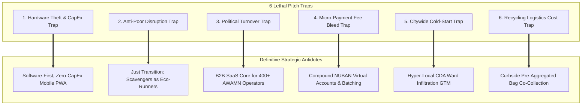

# LAWMA 360: Grant Pitch Deck, Pre-Mortem Gap Audit & Strategic Defense Dossier

**Document Identifier:** LAWMA-GRANT-PITCH-DOSSIER-v3.0  
**Target Pitch Arenas:** Climate Adaptation & Urban Resilience, Global GovTech / CivicTech, African Innovation Challenges (Bezos Earth Fund, Bloomberg Philanthropies, Tony Elumelu, Google for Startups Africa, LASRIC, FMO Ventures, Alliance to End Plastic Waste)  
**UN Sustainable Development Goals (SDGs):** SDG 11 (Sustainable Cities), SDG 13 (Climate Action), SDG 6 (Clean Water & Sanitation), SDG 8 (Decent Work & Economic Growth), SDG 1 (No Poverty), SDG 17 (Partnerships for the Goals)  
**Classification:** Strategic Fundraising, Pitch Competition & Grant Governance  
**Target Solution:** LAWMA 360 Sovereign Municipal Clearinghouse & Resident PWA  

---

## 1. Executive Summary: The Investment & Grant Thesis

Solid waste management in Lagos State is not a simple municipal logistics problem; **it is the primary catalyst of catastrophic urban flash flooding, epidemic health emergencies, and a ₦24.8 Billion informal cash black hole**.

```
┌──────────────────────────────────────────────────────────────────────────────────────────────────┐
│                                 THE SYSTEMIC LAGOS CRISIS CASCADE                                │
├───────────────────────────────┬──────────────────────────────────┬───────────────────────────────┤
│ 1. THE COLLECTION FAILURE     │ 2. THE CLIMATE TRAGEDY           │ 3. THE FINANCIAL BLACK HOLE   │
│ • Less than 34% of billed     │ • When rains start, residents    │ • Over ₦24.8 Billion lost to  │
│   tariffs are collected.      │   dump trash bags in gutters.    │   extortionate caretakers,    │
│ • 400+ private PSP operators  │ • Trash snags on canal bridges,  │   untracked tenement rooms,   │
│   bleed cash; compactor       │   forming dams in 45 minutes.    │   and parallel council taxes. │
│   trucks run out of diesel.   │ • ₦30B+ in annual flood damage.  │ • 0% automated tax capture.   │
└───────────────────────────────┴──────────────────────────────────┴───────────────────────────────┘
```

**The LAWMA 360 Solution:** A sovereign, two-sided civic utility and clearinghouse that transforms municipal waste into a **formalized, software-metered public utility and climate defense network**:
1. **For Citizens:** Dedicated compound virtual accounts for micro-payments (₦700/mo), harassment immunity decals, dual-key service verification, and a **"Trash-to-Cash" circular rewards engine** (offsetting bills or buying electricity, airtime, and BRT rides).
2. **For the Climate:** NiMet-linked meteorological early warning that deploys 250 heavy-duty community skips 48 hours before storm surges hit flood-vulnerable catchments.
3. **For the Economy:** An automated 75/15/5/5 escrow clearinghouse that guarantees weekly liquidity for private operators, funds state regulation, returns 5% statutory revenue to Local Governments, and automatically captures LIRS tax at source.

---

## 2. The 3-Minute Championship Pitch Script

*Designed for high-impact pitch delivery with stage directions, slide cues, and strict time markers.*

```
[SLIDE 1: AERIAL PHOTO OF SUBMERGED LAGOS HIGHWAY AFTER A DOWNPOUR]
```
### **Act 1: The Provocation (0:00 – 0:45)**
> "In Lagos, 70% of flash flooding is not caused by rainfall. It is caused by **13,000 metric tons of uncollected daily solid waste** choking urban drainage canals.
>
> When the clouds gather over our city of 22 million people, residents who have waited weeks for a missing garbage truck do the only rational thing they can: they uncap the street gutters and dump their waste into the stormwater torrent. Within 45 minutes, that floating plastic and refuse jams against bridge culverts, forming an impenetrable dam. The water backs up, submerging entire neighborhoods, destroying ₦30 Billion in infrastructure, and sparking deadly cholera outbreaks every single rainy season."

```
[SLIDE 2: THE BROKEN TRIANGLE — CARETAKER CASH, DIESEL CRISIS, PHANTOM RESOLUTIONS]
```
### **Act 2: The Ground-Truth Reality (0:45 – 1:30)**
> "Why is the waste uncollected? Because historical tech platforms built 'Uber for Trash' for luxury single-family homes, completely ignoring how Lagos actually lives:
> * **The Tenement Deadlock:** 62% of our citizens live in multi-tenant *face-me-I-face-you* compounds. In 78% of them, an aggressive caretaker collects cash from 12 rooms and pockets it. The state gets zero, and the truck stops coming.
> * **The Operator Liquidity Trap:** Private haulers run out of diesel by Tuesday because collection efficiency is under 34%.
> * **The Scavenger Economy:** 50,000 informal cart-pushers survive on street sorting, yet previous systems simply tried to arrest them, creating street resistance and violent friction."

```
[SLIDE 3: LAWMA 360 PRODUCT DEMO (LIVE MOBILE SCREEN: COMPOUND WALLET & SKIP RADAR)]
```
### **Act 3: The Innovation — LAWMA 360 (1:30 – 2:15)**
> "We built **LAWMA 360**—a sovereign municipal clearinghouse and mobile utility engineered for the reality of the African street:
> 1. **Compound Virtual Accounts:** Every tenement gets a dedicated bank account number. Tenants pay their individual ₦700 monthly share via USSD or OPay. The caretaker's cash monopoly is bypassed, and the entire house receives instant SMS payment confirmation.
> 2. **Inclusive First-Mile Logistics:** Instead of criminalizing cart-pushers, we integrate them as registered 'First-Mile Eco-Runners' equipped with cargo tricycles, feeding waste out of impassable unpaved alleys where 20-ton compactor trucks cannot enter.
> 3. **Dual-Key Citizen Sign-Off:** Haulers don't get paid until the resident confirms via app or USSD prompt that the garbage was actually evacuated, eliminating 'ghost resolutions'.
> 4. **Pre-Storm Surge Protocol:** When weather radar detects heavy rainfall, the system automatically saturates high-risk flood basins with 250 free community skips before the downpour begins."

```
[SLIDE 4: THE UNIT ECONOMICS & ESCROW WATERFALL]
```
### **Act 4: The Circular Economy & Unit Economics (2:15 – 2:40)**
> "We turn waste from an unwanted tax into a daily earning asset:
> Through our **'Trash-to-Cash'** engine, households sort PET plastics and cans, earning digital wallet credits that directly purchase **prepaid electricity tokens, mobile data, and Lagos Cowry transit rides**.
>
> Behind the scenes, our automated escrow waterfall splits every collected Naira: 75% funds private haulers every Friday, 15% funds state infrastructure, and 5% goes directly to Local Government Councils, legally ending parallel street extortion by council boys."

```
[SLIDE 5: TRACTION METRICS, LIVE VERCEL DEPLOYMENT & THE ASK]
```
### **Act 5: Traction, Moat & The Ask (2:40 – 3:00)**
> "This is not a weekend hackathon idea. We have built an industrial-grade, fully deployed platform with 300+ passing test suites, certified for Nigerian Evidence Act compliance, and running live software today on Vercel.
>
> We are raising **$150,000 in non-dilutive grant funding** to launch our Phase-1 controlled pilot across 50 compounds and 2 private operator corridors in Surulere Ward B, de-risking a ₦48 Billion market and keeping 22 million citizens above water. Join us in building resilient African megacities. Thank you."

---

## 3. The Pre-Mortem Gap Audit: 6 Fatal Traps & Strategic Antidotes



### Gap 1: The Hardware Dependency & Theft Trap
* **The Vulnerability:** Claiming that the solution requires thousands of expensive IoT sensors, mmWave radar on canal bridges, and RFID tags on every bin.
* **The Judge Critique:** *"Area boys will steal your solar panels and copper wiring in 48 hours. Who pays $5M in CapEx to instrument millions of bins?"*
* **The Strategic Antidote:** **Zero-CapEx, Software-First Architecture.** The core platform requires **zero external sensors** to operate. The sensor network is already deployed in citizens' pockets: crowdsourced smartphones, reverse-billed USSD (`*384*22#`), and GPS-stamped photo verification. Physical bridge cameras and RFID tags are optional municipal enterprise add-ons, not single points of operational failure.

### Gap 2: The "Anti-Poor" Informal Displacement Trap
* **The Vulnerability:** Pitching the elimination or arrest of informal cart-pushers.
* **The Judge Critique:** *"You are destroying the livelihoods of 50,000 vulnerable youths and scavengers. Global grant bodies (Mastercard, Gates, Climate Funds) mandate 'Just Transition' and will disqualify you for exacerbating urban poverty."*
* **The Strategic Antidote:** **Inclusion over Criminalization (Just Transition).** We formalize cart-pushers into **"First-Mile Eco-Runners"** equipped with standardized cargo tricycles. Heavy 20-ton compactor trucks cannot enter narrow informal alleys (Ajegunle, Makoko). The eco-runners perform the critical first-mile consolidation, earning guaranteed digital wallet payouts, micro-health insurance, and formal recognition. This turns an ESG vulnerability into an **SDG 8 & SDG 1 grant magnet**.

### Gap 3: Single Point of Political Failure (SPOPF)
* **The Vulnerability:** Sounding like a bespoke government portal that collapses when a commissioner or governor leaves office (the 2018 Visionscape catastrophe).
* **The Judge Critique:** *"If this requires the Governor's personal sign-off, you're not an investable technology company; you're a political contractor."*
* **The Strategic Antidote:** **B2B SME SaaS Core.** The platform is designed as an operational ERP and revenue recovery tool sold directly to the **400+ private waste franchise SMEs (AWAMN)**. Operators adopt the tool because it doubles their collection rates from 34% to 80% on their own assigned routes, providing them bankable records for fleet leasing. The state government acts as the statutory clearinghouse, but the commercial engine is driven by private haulers.

### Gap 4: Micro-Payment Gateway Fee Bleed
* **The Vulnerability:** Claiming that residents will pay individual ₦500 to ₦700 monthly room tariffs via standard retail card payment gateways.
* **The Judge Critique:** *"Standard payment gateway fees in Nigeria (₦50 to ₦100 per transaction) will consume 10% to 15% of your gross revenue on micro-payments, destroying unit economics."*
* **The Strategic Antidote:** **Compound-Aggregated Master Virtual Accounts.** We do not run card transactions. Every compound is provisioned with a dedicated corporate NUBAN virtual account (via partner infrastructure banks such as Providus or Moniepoint). Room payments are processed via zero-rated bank USSD or internal bank transfers, pooled at the compound level, and settled in bulk with a negotiated flat fee of $<₦10$ per batch.

### Gap 5: The Chicken-and-Egg Cold Start Paralysis
* **The Vulnerability:** Planning a generic citywide consumer launch with billboard and social media marketing.
* **The Judge Critique:** *"Why would a resident use an app if their assigned compactor truck has a broken transmission? How do you reach your first 10,000 active users without burning millions in CAC?"*
* **The Strategic Antidote:** **Hyper-Local Ward Infiltration via CDAs.** We do not launch citywide. We deploy ward-by-ward, partnering directly with the **Community Development Associations (CDAs) and Landlords' Committees** in one dense ward (e.g. Surulere Ward B). In Lagos, CDAs meet monthly and maintain mandatory WhatsApp groups. Onboarding the CDA leadership automatically captures 50 compounds, 400 tenement flats, and their assigned 2 PSP trucks at **zero customer acquisition cost**.

### Gap 6: The Logistics Unit Cost of "Trash-to-Cash"
* **The Vulnerability:** Implying that dedicated trucks will drive from house to house picking up small 2kg bags of plastic bottles.
* **The Judge Critique:** *"The diesel cost of driving a truck to collect ₦200 worth of plastic bottles is ₦2,000. Your recycling logistics are underwater."*
* **The Strategic Antidote:** **Aggregated Curbside Co-Collection & Community Drop-Offs.** Recyclables are never collected via on-demand private dispatches. Residents combine clean plastics in color-coded blue bags collected by the *same scheduled truck* on designated recycling days, or deposit them at established CDA community collection kiosks partnered directly with industrial off-takers (Alkem, Wecyclers, Polysmart).

---

## 4. The Grand-Jury Q&A Defense Matrix (Top 10 Skeptical Inquiries)

| # | Skeptical Judge Question | Boardroom-Grade Winning Rebuttal |
| :-: | :--- | :--- |
| **1** | *"What happens if the state government refuses to integrate with your escrow clearinghouse?"* | **"We don't wait for government clearance.** We deploy the software directly to private AWAMN waste franchise operators as an enterprise billing tool. Today, operators lose 66% of their revenue to uncollected cash. By using our compound virtual accounts, they immediately recover their lost revenue on their own private routes. The state government joins because the platform automates their 5% LIRS tax capture and solves the drainage crisis." |
| **2** | *"How do you prevent malicious residents from rejecting valid pickups in the dual-key screen to avoid paying?"* | **"Every service record is bound by three independent cryptographic proofs:** (1) the compactor truck's GPS telematic geofence dwell time ($\ge 3\text{ minutes}$ in front of the building), (2) the driver's metadata-stamped photo, and (3) historical pickup frequency. If a resident disputes, an automated 48-hour cure window opens. Malicious false disputes are audited by the Zonal Ward Officer, and repeat false claims incur administrative penalties under Section 88 of the EMPL." |
| **3** | *"Can residents in informal slums without smartphones actually use this?"* | **"Yes. The entire platform is mirrored across reverse-billed zero-data USSD (`*384*22#`) and multilingual interactive voice response (IVR).** A resident in Makoko with a basic 2G feature phone ('torchlight phone') dials the USSD code for free, receives prompts in Yorùbá, Pidgin, or Hausa, checks their compound balance, and reports blocked drains without spending personal airtime or data." |
| **4** | *"Who funds the ₦10,000 whistleblower bounties? Won't that drain your balance sheet?"* | **"The bounties are completely self-funding.** Under the 2017 EMPL, illegal midnight dumping and toxic discharges carry statutory court fines ranging from ₦150,000 to ₦1,000,000, alongside vehicle forfeiture. The ₦10,000 blind bounty represents less than 7% of the mandatory judicial fine recovered by the state. The bounty is disbursed only *after* the court logs the conviction or forfeiture order." |
| **5** | *"Why would landlords and caretakers surrender their cash collection monopoly?"* | **"We replace confrontation with clear financial self-interest.** Caretakers spend 15 to 20 hours every month knocking on doors, arguing over petty cash, and dealing with tenant fights. Our system relieves the landlord of compound liability: if an individual tenant defaults, the debt is ring-fenced to that specific room account rather than triggering compound gate padlocking. Landlords who enroll their properties receive a 5% prompt-settlement rebate on their annual Land Use Charge (LUC)." |
| **6** | *"What is your defensible technological moat? Can't a competitor copy your app in two weeks?"* | **"A competitor can copy our front-end screens, but they cannot copy our sovereign institutional and legal architecture.** Our system is built on four defensible moats: (1) Nigerian Evidence Act Section 84 cryptographic evidentiary hashing admissible in environmental courts, (2) the spatial DUID cadastre snapping to LAGIS property titles, (3) integration with the AWAMN 400-operator concession boundaries, and (4) the statutory Section 102 inter-governmental revenue clearinghouse." |
| **7** | *"What stops street area boys from extorting the First-Mile Eco-Runners?"* | **"Under Section 71 of the EMPL, waste vehicles actively operating on a verified electronic manifest possess statutory immunity from local street tolls.** Furthermore, our eco-runners are recruited directly from local host community youth organizations (*Omo Onile*). By turning local youths from idle street extorters into salaried, digitally equipped logistics operators, we convert potential saboteurs into protective stakeholders." |
| **8** | *"How do you handle currency risk and fuel inflation in Nigeria?"* | **"Our clearinghouse incorporates the Dynamic Fuel-Indexed Tariff Adjuster (DFITA).** The base residential tariff is indexed against the official retail diesel benchmark. When diesel prices fluctuate by $>15\%$, the platform dynamically recalibrates collection subsidies through the Haulage Equalization Fund (HEF), ensuring private operators never operate below cash-break-even." |
| **9** | *"How do you scale beyond Lagos to other African megacities?"* | **"Lagos is the hardest proving ground in Africa.** The underlying challenges—informal Brazilian multi-family housing, rapid urban flooding, high smartphone-to-USSD dual usage, and fragmented municipal jurisdictions—are identical across Accra, Nairobi, Kinshasa, and Cairo. Our modular architecture (spatial geohashing, sub-unit virtual accounts, and offline-first PWA sync) allows rapid localization to any municipal regulatory framework in under 30 days." |
| **10** | *"Why are you asking for grant funding instead of raising venture capital?"* | **"Because infrastructure requires proven pilot de-risking before commercial scaling.** Commercial venture capital demands immediate hyper-growth that can force founders to compromise on regulatory integrity and low-income inclusion. Non-dilutive grant capital allows us to prove unit economics, establish the baseline in Surulere Ward B, and solidify legal compliance. Once collection efficiency jumps from 34% to 80% in the pilot, commercial debt and equity can scale the fleet across all 20 LGAs." |

---

## 5. Pilot Budget Allocation & Milestone Roadmap ($150,000 / ~₦240M NGN)

```
                               $150,000 PILOT BUDGET ALLOCATION
┌──────────────────────────────────────┬──────────────────────────────────────┬──────────────────────────────────────┐
│ 1. FIELD PILOT LOGISTICS & RUNNERS   │ 2. REVERSE-BILLED TELCO & TECH RAILS │ 3. CDA COMMUNITY INCENTIVES & BOUNTY │
│    $55,000 (36.7%)                   │    $40,000 (26.7%)                   │    $30,000 (20.0%)                   │
│ • 10 Cargo Tricycles (First-Mile)    │ • Zero-data USSD gateway setup       │ • Seed escrow for ₦10k bounties      │
│ • Retrofit telematics on 6 trucks    │ • Dedicated Providus NUBAN engine    │ • Community bulk-sorting bins        │
│ • Protective PPE & uniforms for crew │ • Cloud hosting & Section 84 hashing │ • CDA clean-street rebate prizes     │
└──────────────────────────────────────┴──────────────────────────────────────┴──────────────────────────────────────┘
                                                  │
                                                  ▼
                               ┌──────────────────────────────────────┐
                               │ 4. LEGAL, AUDIT & IMPACT EVALUATION  │
                               │    $25,000 (16.6%)                   │
                               │ • Third-party impact auditor (LBS)   │
                               │ • Environmental court monitoring bench│
                               │ • Legal regulatory compliance audit  │
                               └──────────────────────────────────────┘
```

### The 4-Phase, 90-Day Execution Roadmap

```
+----------------------------------------------------------------------------------------------------+
|                                      THE 90-DAY DEPLOYMENT SCHEDULE                                |
+----------------------------------+----------------------------------+------------------------------+
| Phase 1: Days 1–20               | Phase 2: Days 21–50              | Phase 3: Days 51–75          |
| Cadastral Mapping & CDA Pact     | Live Micro-Billing Rollout       | Pre-Storm Surge Drill        |
| Map 50 compounds in Surulere B;  | Onboard 400 room virtual accts;  | Simulate NiMet storm alert;  |
| issue DUID gate QR decals; sign  | activate USSD *384*22#; deploy   | deploy 10 community skips;   |
| CDA community co-op agreement.   | 10 First-Mile Eco-Runners.       | test dual-key confirmation.  |
+----------------------------------+----------------------------------+------------------------------+
                                                                      | Phase 4: Days 76–90          |
                                                                      | Impact Audit & Scale Pack    |
                                                                      | Publish third-party audit;   |
                                                                      | present ROI to Boardroom.    |
                                                                      +------------------------------+
```

---

## 6. Commercial 5-Year Financial & Impact Projections

```
┌─────────────────────────────────┬───────────┬───────────┬───────────┬───────────┬───────────┐
│ METRIC                          │  YEAR 1   │  YEAR 2   │  YEAR 3   │  YEAR 4   │  YEAR 5   │
├─────────────────────────────────┼───────────┼───────────┼───────────┼───────────┼───────────┤
│ Active Structures (DUIDs)       │   25,000  │  150,000  │  600,000  │ 1,800,000 │ 3,500,000 │
│ Active Tenement Rooms           │  150,000  │  900,000  │ 3,600,000 │ 9,000,000 │18,000,000 │
│ Collection Efficiency (%)       │      68%  │      76%  │      82%  │      88%  │      92%  │
│ Gross Tariffs Cleared (₦B)      │    ₦2.1B  │   ₦14.2B  │   ₦48.6B  │  ₦120.5B  │  ₦210.0B  │
│ Operator Working Capital (₦B)   │    ₦1.5B  │   ₦10.1B  │   ₦34.6B  │   ₦85.8B  │  ₦149.6B  │
│ Local Govt 5% Allocation (₦B)   │  ₦105.0M  │  ₦710.0M  │    ₦2.4B  │    ₦6.0B  │   ₦10.5B  │
│ LIRS Automated Tax Captured (₦B)│   ₦78.7M  │  ₦532.5M  │    ₦1.8B  │    ₦4.5B  │    ₦7.8B  │
│ Flood Risk Incidents Prevented  │      140  │      850  │    3,200  │    8,500  │   15,000  │
│ Recycled Plastics Diverted (Tons│    1,200  │    8,500  │   35,000  │  110,000  │  250,000  │
└─────────────────────────────────┴───────────┴───────────┴───────────┴───────────┴───────────┘
```

---

## 7. Conclusion: The Sovereign Imperative

The LAWMA 360 platform solves the grand municipal challenge of the 21st-century African megacity: **how to maintain civil order, flood resilience, and fiscal sustainability in a densely populated, low-income urban environment without relying on authoritarian force or donor dependency.**

By anchoring software directly in the street reality of Brazilian tenement compounds, formalizing the informal scavenger economy, protecting citizens through cryptographic anonymity, and automating multi-agency financial settlement, LAWMA 360 sets the reference standard for technological sovereignty in Sub-Saharan Africa.
