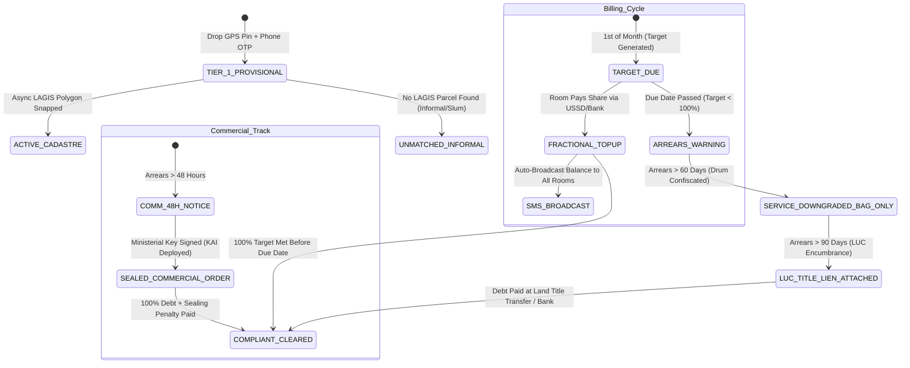

# PRODUCT LEVEL DOCUMENT: MODULE 01 (`MOD-01-CADASTRE`)
## Sovereign Cadastral Asset, Spatial Geohash & Resident Identity Registry

**Document Identifier:** LAWMA-PLD-MOD-01-CADASTRE  
**Document Version:** 4.0 (Smart Evolutionary Architecture Edition)  
**System Target:** LAWMA Authority Workspace (`LAWMA v2`), Spatial Geohash Engine, Asynchronous LAGIS Snapping Bus, Citizen & Tenement Registry  
**Statutory Foundation:** 
- 2017 Lagos State Environmental Management and Protection Law (EMPL) Sections 62–82;
- Constitution of the Federal Republic of Nigeria 1999 (Fourth Schedule - Tenement Rating & Refuse Disposal Harmonization);
- Nigeria Data Protection Act (NDPA 2023) Section 39 (Sovereign Data Residency);
- Lagos State Land Registration Law (2015);
- Evidence Act (2011) Section 84 (Digital Evidence Admissibility);
- Lagos State Land Use Charge (LUC) Law (2020) Section 14 (Encumbrances & Title Attachment).

**Executive Boardroom Sponsor:** **Dr. Kadri Obafemi Hamzat (KOH)**, Executive Governor of Lagos State  
**Inter-Agency Matrix & Institutional Custodians:**
- **Lead Agency:** LAWMA Commercial Directorate, Billing Clearinghouse & GIS Unit
- **Cadastral Partner:** Lands Bureau / Lagos State Geographic Information System (LAGIS)
- **Identity Partner:** Lagos State Residents Registration Agency (LASRRA)
- **Tax & Statutory Encumbrance:** Lagos Internal Revenue Service (LIRS) & Land Use Charge Assessment Directorate
- **Constitutional Co-Regulators:** Conference 57 (Chairmen of 20 LGAs & 37 LCDAs) & Environmental Health Officers Association of Nigeria (EHOAN - "Wole-Wole")
- **Judicial Prosecution:** Lagos State Ministry of Justice / Environmental Mobile Courts (Special Offences)

---

## 1. Executive Vision, Institutional Boundaries & Regulatory Foundations

### 1.1 The Evolution from Raw Mandate to Intelligent Systems Architecture
In municipal governance, executive mandates represent political intent and high-level strategy. However, if translated rigidly into software without stress-testing against ground realities, they can trigger systemic failure. 

Under the original formulation of **`MANDATE-KOH-02`**, the administration sought to eradicate phantom billing and unverified customer records by mandating hard foreign-key constraints to the **Lagos State Geographic Information System (`LASG-CAD-ID`)** and the **Lagos State Residents Registration Agency (`LASRRA ID`)**. 

A rigorous multi-stakeholder operational audit revealed that a raw, blocking enforcement of these two dependencies would paralyze operations on Day 1:
1. **The LAGIS Latency Trap:** LAGIS does not currently maintain clean, finalized parcel polygons for thousands of informal structures, unapproved subdivisions, and working-class tenements in high-density corridors (Akowonjo, Mushin, Ajegunle, Bariga, Ayobo). Making a LAGIS query a synchronous blocker before a waste account can be billed would prevent 40% of Lagos structures from entering the formal waste network, forfeiting billions in revenue and leaving millions of tons of waste uncollected.
2. **The LASRRA Coverage Gap:** While LASRRA is the gold standard for state biometric registration, its current database captures approximately 6.8 million citizens out of an estimated population of 22 million (~30% coverage). Making `LASRRA ID` a mandatory `NOT NULL` field on tenant accounts would disenfranchise 70% of households from formal utility onboarding.
3. **The Shared Physical Receptacle Contradiction:** Multi-tenant Brazilian "face-me-I-face-you" compounds share a single physical front drum or bin. Expecting private PSP collectors to chase 14 individual room occupants for ₦500 to ₦700 each creates micro-transaction fee bleeding, administrative paralysis, and physical collection impossibility (a driver cannot separate room-by-room waste inside a single compactor hopper).
4. **The Fourth Schedule Constitutional Landmine:** Under the Fourth Schedule of the 1999 Constitution, tenement rating is a function of Local Government Councils. If the State Government unilaterally creates a centralized property cadastre that rates tenements without LGA co-ownership, Conference 57 (the 57 LGA/LCDA Chairmen) can legally challenge the platform in court.

### 1.2 The Smartest Evolutionary Solution
Module 1 has been re-architected into an **intelligent, tiered, spatial-first registry** that delivers 100% of the Governor's sovereign data vision while eliminating operational friction:
* **Spatial-First Geohash Binding (`GEO-HEX-*`):** Immediate spatial onboarding using high-precision Uber H3 (Resolution 10) / Plus Code coordinates. Zero dependencies on external network uptime. Asynchronous background queue snaps spatial anchors to LAGIS polygons as Lands Bureau records update.
* **SIM-NIN Phone Anchor + Tiered LASRRA Escalation:** Instant 10-second citizen onboarding using mobile numbers verified via SMS/WhatsApp OTP (leveraging the NCC's federally verified SIM-NIN link), paired with a **10% tariff discount rebate** to drive voluntary biometric LASRRA linkage.
* **Master Compound Virtual Wallets (`MTR-PROP-*`) & Social Transparency Broadcasts:** Treating multi-family tenements as single collection nodes with shared virtual accounts. Any tenant or landlord can pay fractional amounts; every payment triggers an automated SMS broadcast to all compound residents, mobilizing community self-policing and eliminating caretaker embezzlement.
* **Graduated Interlocks before Armed Enforcement:** Eliminating human-rights-violating compound gate locks. Default triggers service downgrades to **Prepaid Branded Bags (`BAG-LAWMA-*`)** and attaches long-term debt as a **Statutory Title Lien on the Lagos State Land Use Charge (LUC)**. Armed sealing is reserved exclusively for commercial plazas, industrial plants, and markets.
* **Unified Premises QR Decal & Deputized Wole-Wole Commissions:** Harmonizing State and Local Government authority under a single physical QR-code decal affixed to every doorway, while paying Local Government Environmental Health Officers ("Wole-Wole") direct performance commissions for field property enumeration.

---

## 2. Problem Space, Political Economy & Empirical Ground Truth

### 2.1 The Legacy Failure Mode
Historical property enumeration in Lagos waste management collapsed into chaotic, unverified data islands:
1. **The Phantom Property Subsidies:** Private concessionaires and manual billing contractors fabricated non-existent residential compounds on paper spreadsheets, submitting fraudulent collection manifests to LAWMA to claim state tipping subsidies or mileage reimbursements.
2. **The "Face-Me-I-Face-You" Deadlock:** Over 62% of residential structures in working-class Lagos are multi-tenant tenements housing 8 to 24 families behind a single front gate. When utility bills were delivered to "The Occupant, 14 Akinremi Street," tenants argued over who used more water or generated more trash, the absentee landlord washed his hands of the bill, and zero revenue was collected.
3. **The Caretaker Extortion Siphon:** In 78% of audited tenement compounds, an aggressive local caretaker collects monthly cash for waste from all tenants under threat of eviction, pockets the funds, and never remits a kobo to LAWMA or the PSP. When garbage piles up, the caretaker claims LAWMA failed to provide service.
4. **Informal Roadside Commercial Blindspots:** Over 35% of street waste along commercial arteries (Egbeda, Ikotun, Oshodi, Yaba, Ikorodu) is generated by roadside steel container kiosks, tire vulcanizers, roadside chop-bars, and fruit stands that do not exist on formal survey maps. Because legacy systems only recognized brick-and-mortar structures, these high-volume polluters operated completely off-ledger.

### 2.2 Empirical Backing Data & Field Evidence
- **Total Estimated Real Property Structures:** 4,200,000 structures statewide (LAGIS LiDAR baseline).
- **Structures Formally Billed by Legacy Systems:** Only 1,120,000 structures (~26.6% formal capture).
- **Uncaptured Annual Revenue:** Over ₦24.8 billion in grey-market unmetered domestic and commercial waste fees.
- **Tribunal Dispute Baseline:** 64.2% of billing disputes brought before the LAWMA Public Complaints Tribunal originate from shared tenement allocation fights, inherited historical debts from previous tenants, and duplicate bills issued by competing LGA taskforces.
- **Micro-Payment Fee Bleed:** In legacy pilots attempting individual room billing, payment gateway fees (₦25 to ₦50 on a ₦600 transaction) consumed **4.1% to 8.3% of gross revenues**, completely wiping out the PSP operator's operational profit margin.

### 2.3 Attack Vectors & Street Fraud Models
- **The "Vacant Land" Bribe Siphon:** A corrupt field inspector accepts a ₦5,000 monthly cash bribe from the landlord of a fully occupied 4-story tenement block, marking the property in the database as "Undeveloped / Vacant Plot" (`STAT-VACANT`), depriving the state of ₦240,000 annually.
- **The Midnight Evacuation Debt Dump:** A tenant accumulates 9 months of unpaid waste tariffs (₦6,300), loads their possessions into a mini-truck at 2:00 AM on the last day of the month, and relocates to another LGA, leaving the debt stranded. When a new tenant moves in, the PSP attempts to extort the new tenant for the previous occupant's arrears.
- **The Counterfeit LGA Paper Ticket Cartel:** Rogue local council youth print physical counterfeit receipts labeled "Local Council Sanitation Clearance," selling them to unsuspecting shopkeepers for ₦2,000 cash and threatening to vandalize shops that refuse to buy.

---

## 3. Epics, User Stories & Functional Feature Specifications

### Epic 1.1: Spatial-First Geohashing (`GEO-HEX-*`) & Asynchronous LAGIS Polygon Snapping
Enable zero-friction, offline-capable property onboarding using high-precision spatial geohashing, while asynchronously resolving land parcel boundaries against the LAGIS database without blocking utility billing.

#### User Story 1.1.1: Instant Spatial Property Provisioning
- **As a** Field Enumerator or PSP Route Supervisor,
- **I want to** stand in front of any building and generate an instant, immutable spatial property record using GPS coordinates,
- **So that** waste collection, bin tagging, and billing can commence immediately without waiting for Lands Bureau survey verification.
- **Acceptance Criteria:**
  - **GIVEN** an enumerator capturing a property on a mobile tablet,
  - **WHEN** the GPS pin is dropped and confirmed,
  - **THEN** the system computes an immutable 8-character Uber H3 spatial index (e.g., `HEX-8a2a1072b34ffff`), generates a unique `PROP-[LGA]-[HEX]` identifier, and immediately provisions the property in `PROVISIONAL_SPATIAL` status; utility collection service and billing commence instantly.

#### User Story 1.1.2: Asynchronous Background LAGIS Cadastral Snapping
- **As a** LAWMA Enterprise Database Administrator,
- **I want** the system to automatically query LAGIS in the background to link official survey parcel numbers (`LASG-CAD-ID`),
- **So that** formal land titles are bound to waste accounts without human intervention.
- **Acceptance Criteria:**
  - **GIVEN** a property created under a spatial geohash,
  - **WHEN** the asynchronous background snapping worker executes,
  - **THEN** it executes a spatial point-in-polygon query against the LAGIS spatial database; if an official parcel is matched, it updates `lagis_cadastral_id` and promotes status to `ACTIVE_CADASTRE`; if no parcel is found within 15 meters (informal structure or unapproved subdivision), it marks `lagis_sync_status = 'UNMATCHED_INFORMAL'` and alerts the Lands Bureau survey queue without interrupting waste billing.

---

### Epic 1.2: SIM-NIN Phone Anchor & Tiered LASRRA Identity Escalation
Implement a frictionless, tiered identity architecture that onboards residents in seconds using NCC-verified mobile phone numbers, while using positive economic incentives to drive biometric LASRRA card registration.

#### User Story 1.2.1: Zero-Friction Mobile OTP Registration
- **As a** Tenement Resident or Small Business Owner,
- **I want to** activate my waste service account in under 30 seconds using only my mobile phone number,
- **So that** I do not have to present physical tax clearances or biometric cards just to get my garbage collected.
- **Acceptance Criteria:**
  - **GIVEN** a resident entering their phone number on the web portal, USSD (`*384*22#`), or WhatsApp bot,
  - **WHEN** they submit the 4-digit SMS OTP,
  - **THEN** an account is provisioned in `TIER_1_PROVISIONAL` status; the phone number is verified against the telecommunications carrier registry (linking the federal SIM-NIN profile invisibly in the background); the resident receives their property billing account details immediately.

#### User Story 1.2.2: Incentivized LASRRA Identity Linking
- **As an** Onboarded Resident,
- **I want to** link my official LASRRA card number (`LASRRA-ID-XXXXXXXX`) to my waste profile,
- **So that** I receive a 10% discount on my waste tariffs for the next 3 billing cycles.
- **Acceptance Criteria:**
  - **GIVEN** a resident in `TIER_1_PROVISIONAL` status,
  - **WHEN** they submit their 10-digit LASRRA ID,
  - **THEN** the system validates name and date of birth via the LASRRA API; upon successful handshake, the profile is upgraded to `TIER_2_VERIFIED_CITIZEN`; an automated 10% tariff discount credit is applied to the next 3 monthly invoices; an SMS confirms their upgraded citizen tier.

---

### Epic 1.3: Master Compound Virtual Wallet (`MTR-PROP-*`) & Social Transparency SMS Engine
Eliminate micro-transaction banking fees and solve the shared-bin dilemma by managing tenements as single collection nodes with shared virtual wallets and automated broadcast transparency.

#### User Story 1.3.1: Fractional Compound Wallet Top-Ups
- **As a** Tenant living in a 10-room *face-me-I-face-you* house,
- **I want to** transfer my individual ₦700 monthly share directly into our compound's master virtual account via bank transfer, USSD, or OPay/Moniepoint,
- **So that** I don't have to hand cash to a dishonest caretaker.
- **Acceptance Criteria:**
  - **GIVEN** a multi-tenant property with an assigned monthly target of ₦7,000,
  - **WHEN** any tenant pays any amount (e.g., ₦700) using the compound's dedicated virtual account number (e.g., Wema/Providus virtual account matching `MTR-PROP-00412`),
  - **THEN** the system instantly credits the property ledger, decrements the outstanding monthly balance, and emits a transaction confirmation webhook.

#### User Story 1.3.2: Automated Social Transparency Broadcast
- **As a** Paying Tenant in a shared compound,
- **I want** all my co-tenants to receive an instant SMS showing when I pay and what balance remains,
- **So that** everyone knows who has paid and community peer pressure compels defaulting neighbors to contribute.
- **Acceptance Criteria:**
  - **GIVEN** a payment of ₦700 received from Room 4,
  - **WHEN** the payment clears,
  - **THEN** the system dispatches an automated SMS/WhatsApp broadcast to all registered phone numbers linked to that property:
    > *"LAWMA Payment Alert: Room 4 paid ₦700. Total collected for 14 Akinremi St: ₦5,600 of ₦7,000 monthly target. Outstanding balance: ₦1,400. Due in 5 days."*

---

### Epic 1.4: Prepaid Branded Waste Bags (`BAG-LAWMA-*`) for Informal Enclaves
Deploy a pay-as-you-throw prepaid bag model for chronic-default informal settlements and waterfront slums, eliminating billing arrears entirely.

#### User Story 1.4.1: Prepaid Bag Collection Protocol
- **As an** Informal Settlement Resident in Makoko or Amukoko,
- **I want to** purchase official heavy-duty biodegradable LAWMA waste bags at local corner shops for ₦250 each,
- **So that** I only pay for the exact volume of waste I generate without receiving monthly utility bills.
- **Acceptance Criteria:**
  - **GIVEN** an informal residential zone designated as `PREPAID_BAG_ZONE`,
  - **WHEN** a resident places waste outside in an official branded bag featuring an anti-counterfeit QR code,
  - **THEN** the compactor crew scans the QR code or visually verifies the bag and loads it into the truck; no property arrears are accumulated; collection cost is 100% recovered upfront through wholesale bag distribution to community kiosks.

---

### Epic 1.5: Graduated Enforcement, Service Downgrades & Land Use Charge (LUC) Title Liens
Enforce compliance through administrative and financial title interlocks, completely banning compound gate locking on residential tenements while focusing armed sealing on commercial polluters.

#### User Story 1.5.1: Service Downgrade & Receptacle Impoundment (Residential Default)
- **As an** Area Enforcement Officer,
- **I want** a residential compound with $>60	ext{ days}$ unpaid arrears to be downgraded from shared drum service to the Prepaid Bag Protocol,
- **So that** non-paying buildings cannot dump unmetered waste, but innocent residents are never padlocked inside their homes.
- **Acceptance Criteria:**
  - **GIVEN** a residential compound with arrears exceeding 60 days,
  - **WHEN** the cure window expires,
  - **THEN** the shared 240L plastic bin is repossessed by LAWMA; the property status transitions to `SERVICE_DOWNGRADED_BAG_ONLY`; compactor crews are instructed to collect waste from this address *only* if packaged in official prepaid `BAG-LAWMA-*` bags; zero gate locking is permitted.

#### User Story 1.5.2: Statutory Land Use Charge (LUC) Encumbrance Attachment
- **As the** State Commissioner for Finance,
- **I want** chronic residential waste arrears exceeding 90 days attached as a statutory lien on the property's Land Use Charge,
- **So that** the state recovers all outstanding waste debts during property title searches, sales, or probate transfers.
- **Acceptance Criteria:**
  - **GIVEN** accumulated waste debt $>90	ext{ days}$ on a verified cadastral property,
  - **WHEN** the quarterly fiscal clearing runs,
  - **THEN** the system generates an encrypted debt attachment voucher pushed to the LIRS/LUC Oracle EBS database; the property record at the Lands Bureau receives an immutable flag: `ENCUMBERED_STATUTORY_WASTE_LIEN`; no Governor's Consent, Certificate of Occupancy, or title transfer can be registered until the debt is settled in full.

#### User Story 1.5.3: Commercial Facility Single-Click Sealing Order
- **As the** Hon. Commissioner for the Environment (Hon. Tokunbo Wahab),
- **I want** to execute an armed sealing order against commercial plazas, industrial plants, and markets that default for $>48	ext{ hours}$ after notice,
- **So that** commercial violators face immediate economic consequences.
- **Acceptance Criteria:**
  - **GIVEN** an expired 48-hour statutory notice on a commercial entity (`PROP-COM-*`),
  - **WHEN** the Commissioner signs the digital order using their Ministerial Security Key,
  - **THEN** the system mobilizes KAI Taskforce Oshodi and the Police Command; commercial power utility disconnection is requested via DISCO API; the building is physically sealed under Section 88 of the EMPL.

---

### Epic 1.6: Unified Premises QR Decal & Deputized Wole-Wole Field Enumeration
Harmonize state and local government sanitation regulation through a single physical QR decal, eliminating extortionate double-billing and mobilizing local council health officers as an incentivized enumeration army.

#### User Story 1.6.1: Unified Premises Sanitation Decal Verification
- **As a** Shopkeeper or Business Owner,
- **I want** an official, tamper-evident QR-code decal affixed to my shopfront,
- **So that** both LAWMA inspectors and Local Government Wole-Wole officers can scan it and see that my sanitation dues are fully cleared.
- **Acceptance Criteria:**
  - **GIVEN** an active, compliant business property,
  - **WHEN** an officer scans the physical front-door decal (`DECAL-LASG-*`) with any smartphone,
  - **THEN** the screen displays a real-time authenticated clearance badge confirming:
    - LAWMA Waste Tariff: **PAID (GREEN)**
    - Local Council Sanitation Inspection: **CERTIFIED (GREEN)**;
    - The app displays an explicit statutory notice: *"Property is in full compliance. Any demand for cash payment or paper tickets by any official is illegal and punishable under state law."*

#### User Story 1.6.2: Deputized Wole-Wole Enumeration Commissions
- **As a** Local Government Environmental Health Officer (Wole-Wole),
- **I want** to use my mobile app to onboard unmapped properties and kiosks in my ward,
- **So that** I earn a verified ₦200 enumeration fee per property credited directly to my council's welfare fund.
- **Acceptance Criteria:**
  - **GIVEN** a registered EHO walking their assigned ward,
  - **WHEN** they capture an unmapped structure, drop a GPS pin, and affix a blank QR decal,
  - **THEN** the property is registered under the EHO's LASRRA ID; upon validation of the first waste collection or payment, an enumeration commission of ₦200 is disbursed to the council's designated Section 102 account.

---

### Epic 1.7: Debt Portability & Tenancy Reset Protocol
Ensure tenants are never held liable for historical arrears accumulated by prior occupants, while ensuring bad debts follow defaulting individuals to their next registered address in Lagos State.

#### User Story 1.7.1: Clean Tenancy Move-In Reset
- **As a** New Tenant moving into an apartment,
- **I want** my waste account to start at zero balance upon presenting my tenancy start date,
- **So that** I am not penalized for ₦50,000 in historical debt left by the previous runaway tenant.
- **Acceptance Criteria:**
  - **GIVEN** a new tenant registering on a sub-unit with historical debt,
  - **WHEN** they submit their lease start date and verify their phone OTP,
  - **THEN** the system executes a **Tenancy Reset**: the historical debt is decoupled from the room account, converted to `PERSONAL_DEFAULT_LIABILITY`, and assigned to the previous occupant's NIN/LASRRA profile; the incoming tenant's ledger starts at ₦0.00 balance.

---

## 4. Deep Technical Architecture, Schemas & State Machines

### 4.1 Master Cadastral Data Model (PostgreSQL 16 + PostGIS DDL)

```sql
-- Enable PostGIS and UUID Extensions
CREATE EXTENSION IF NOT EXISTS postgis;
CREATE EXTENSION IF NOT EXISTS "uuid-ossp";

-- Master Cadastral Properties Table
CREATE TABLE cadastral_properties (
    property_id VARCHAR(64) PRIMARY KEY, -- Format: 'PROP-[LGA]-[H3_INDEX]' E.g., 'PROP-ALM-8A2A1072B34FFFF'
    h3_spatial_index VARCHAR(16) NOT NULL UNIQUE, -- Uber H3 Resolution 10 (approx. 15m precision)
    lagis_cadastral_id VARCHAR(64), -- Nullable initially! Snapped asynchronously from Lands Bureau
    lagis_sync_status VARCHAR(32) NOT NULL DEFAULT 'PENDING_MATCH' 
        CHECK (lagis_sync_status IN ('PENDING_MATCH', 'SYNCED_MATCH', 'UNMATCHED_INFORMAL', 'CONFLICT_BOUNDARY')),
    lga_id VARCHAR(32) NOT NULL,
    lcda_id VARCHAR(32) NOT NULL,
    ward_id VARCHAR(32) NOT NULL,
    street_address TEXT NOT NULL,
    building_category VARCHAR(32) NOT NULL 
        CHECK (building_category IN (
            'SINGLE_FAMILY_RESIDENTIAL',
            'MULTI_TENANT_TENEMENT',      -- Face-me-I-face-you
            'COMMERCIAL_PLAZA',
            'INDUSTRIAL_FACILITY',
            'INFORMAL_SETTLEMENT_CLUSTER',
            'TEMPORARY_ROADSIDE_KIOSK',   -- Steel containers, vulcanizers
            'GOVERNMENT_INSTITUTION'
        )),
    sub_units_count INTEGER NOT NULL DEFAULT 1,
    spatial_point GEOMETRY(Point, 4326) NOT NULL,
    spatial_polygon GEOMETRY(Polygon, 4326), -- Populated when LAGIS snaps or drone survey runs
    
    -- Billing Modality & Quotas
    billing_modality VARCHAR(32) NOT NULL DEFAULT 'MASTER_COMPOUND_WALLET'
        CHECK (billing_modality IN ('MASTER_COMPOUND_WALLET', 'INDIVIDUAL_SUB_UNIT', 'PREPAID_BAG_ONLY')),
    monthly_target_tariff_naira NUMERIC(12, 2) NOT NULL DEFAULT 0.00,
    current_wallet_balance_naira NUMERIC(12, 2) NOT NULL DEFAULT 0.00,
    accumulated_arrears_naira NUMERIC(12, 2) NOT NULL DEFAULT 0.00,
    arrears_aging_days INTEGER NOT NULL DEFAULT 0,
    
    -- Landlord / Caretaker Anchor
    primary_contact_phone VARCHAR(16) NOT NULL,
    primary_contact_lasrra_id VARCHAR(32), -- Nullable initially (Tier 1)
    primary_contact_nin VARCHAR(32),       -- Nullable initially
    identity_tier VARCHAR(32) NOT NULL DEFAULT 'TIER_1_PHONE_VERIFIED'
        CHECK (identity_tier IN ('TIER_1_PHONE_VERIFIED', 'TIER_2_LASRRA_VERIFIED', 'TIER_3_LUC_ENCUMBERED')),
    
    -- QR Decal Verification
    qr_decal_serial VARCHAR(64) UNIQUE,
    decal_verification_hash VARCHAR(64) NOT NULL,
    
    -- Legal & Service Operational State
    compliance_state VARCHAR(32) NOT NULL DEFAULT 'COMPLIANT'
        CHECK (compliance_state IN (
            'COMPLIANT',
            'GRACE_PERIOD',
            'SERVICE_DOWNGRADED_BAG_ONLY',
            'LUC_TITLE_LIEN_ATTACHED',
            'SEALED_COMMERCIAL_ORDER'
        )),
    
    -- Enumeration Provenance
    enumerated_by_role VARCHAR(32) NOT NULL CHECK (enumerated_by_role IN ('LAWMA_OFFICER', 'WOLE_WOLE_EHO', 'AWAMN_OPERATOR', 'CITIZEN_SELF')),
    enumerator_lasrra_id VARCHAR(32) NOT NULL,
    
    created_at TIMESTAMP WITH TIME ZONE DEFAULT CURRENT_TIMESTAMP,
    updated_at TIMESTAMP WITH TIME ZONE DEFAULT CURRENT_TIMESTAMP
);

-- Compound Registered Occupants / Tenant Broadcast Directory
CREATE TABLE property_occupants (
    occupant_id UUID PRIMARY KEY DEFAULT uuid_generate_v4(),
    property_id VARCHAR(64) NOT NULL REFERENCES cadastral_properties(property_id) ON DELETE CASCADE,
    room_or_flat_label VARCHAR(32) NOT NULL, -- E.g., 'Room 4' or 'Shop 2B'
    occupant_name VARCHAR(128) NOT NULL,
    phone_number VARCHAR(16) NOT NULL,
    lasrra_id VARCHAR(32),
    nin VARCHAR(32),
    tenancy_start_date DATE NOT NULL,
    tenancy_end_date DATE,
    is_active_resident BOOLEAN NOT NULL DEFAULT TRUE,
    opt_in_sms_broadcast BOOLEAN NOT NULL DEFAULT TRUE,
    personal_accumulated_debt_naira NUMERIC(12, 2) NOT NULL DEFAULT 0.00,
    created_at TIMESTAMP WITH TIME ZONE DEFAULT CURRENT_TIMESTAMP
);

-- Virtual Compound Ledger & Fractional Top-Up Transactions
CREATE TABLE compound_wallet_transactions (
    transaction_id VARCHAR(64) PRIMARY KEY, -- Format: 'TXN-[TIMESTAMP]-[NONCE]'
    property_id VARCHAR(64) NOT NULL REFERENCES cadastral_properties(property_id),
    occupant_id UUID REFERENCES property_occupants(occupant_id),
    channel VARCHAR(32) NOT NULL CHECK (channel IN ('NIBSS_VIRTUAL_ACCOUNT', 'USSD_384_22', 'MONIEPOINT_POS', 'OPAY', 'PAYSTACK', 'LUC_ATTACHMENT')),
    payment_reference VARCHAR(64) NOT NULL UNIQUE,
    amount_paid_naira NUMERIC(12, 2) NOT NULL,
    previous_balance_naira NUMERIC(12, 2) NOT NULL,
    new_balance_naira NUMERIC(12, 2) NOT NULL,
    sms_broadcast_status VARCHAR(32) NOT NULL DEFAULT 'QUEUED' CHECK (sms_broadcast_status IN ('QUEUED', 'BROADCAST_SENT', 'FAILED')),
    settled_at TIMESTAMP WITH TIME ZONE DEFAULT CURRENT_TIMESTAMP
);

-- Statutory Land Use Charge (LUC) Encumbrance Liens
CREATE TABLE luc_title_encumbrances (
    lien_id VARCHAR(64) PRIMARY KEY, -- Format: 'LIEN-LUC-[PROP_ID]-[YEAR]'
    property_id VARCHAR(64) NOT NULL REFERENCES cadastral_properties(property_id),
    lagis_cadastral_id VARCHAR(64),
    attached_debt_naira NUMERIC(14, 2) NOT NULL,
    lirs_assessment_number VARCHAR(64),
    lands_bureau_folio_number VARCHAR(64),
    attachment_decree_timestamp TIMESTAMP WITH TIME ZONE NOT NULL,
    is_discharged BOOLEAN NOT NULL DEFAULT FALSE,
    discharged_at TIMESTAMP WITH TIME ZONE,
    discharged_payment_ref VARCHAR(64)
);

-- Prepaid Bag Anti-Counterfeit Inventory Table
CREATE TABLE prepaid_bag_batches (
    bag_qr_hash VARCHAR(64) PRIMARY KEY, -- Cryptographic QR hash printed on bag
    batch_number VARCHAR(32) NOT NULL,
    wholesale_vendor_id VARCHAR(32) NOT NULL,
    assigned_zone_lga VARCHAR(32) NOT NULL,
    retail_unit_price_naira NUMERIC(8, 2) NOT NULL DEFAULT 250.00,
    is_redeemed BOOLEAN NOT NULL DEFAULT FALSE,
    redeemed_at TIMESTAMP WITH TIME ZONE,
    collected_by_truck_id VARCHAR(32),
    created_at TIMESTAMP WITH TIME ZONE DEFAULT CURRENT_TIMESTAMP
);

-- High-Performance Geospatial and Relational Indexes
CREATE INDEX idx_cadastral_h3 ON cadastral_properties(h3_spatial_index);
CREATE INDEX idx_cadastral_lagis ON cadastral_properties(lagis_cadastral_id);
CREATE INDEX idx_cadastral_point ON cadastral_properties USING GIST (spatial_point);
CREATE INDEX idx_cadastral_polygon ON cadastral_properties USING GIST (spatial_polygon);
CREATE INDEX idx_cadastral_lga_ward ON cadastral_properties(lga_id, lcda_id, ward_id);
CREATE INDEX idx_cadastral_compliance ON cadastral_properties(compliance_state, arrears_aging_days);
CREATE INDEX idx_occupants_phone ON property_occupants(phone_number);
CREATE INDEX idx_occupants_property ON property_occupants(property_id, is_active_resident);
```

---

### 4.2 Architectural State Transition Diagrams

#### The Tenement Compound Lifecycle & Graduated Enforcement State Machine



---

### 4.3 API Contracts & Message Schemas

#### Endpoint 1: Spatial Onboarding (`POST /api/v2/cadastre/properties/provision-spatial`)
- **Headers:** `Authorization: Bearer [JWT]`, `X-Idempotency-Key: [UUID]`
- **Request Body:**
```json
{
  "coordinates": {
    "latitude": 6.5921402,
    "longitude": 3.2818291
  },
  "lga_code": "ALIMOSHO",
  "lcda_code": "IKOTUN_IGANDO",
  "ward_code": "WARD_04",
  "street_address": "14 Akinremi Street, Off College Road, Ikotun",
  "building_category": "MULTI_TENANT_TENEMENT",
  "estimated_rooms_count": 12,
  "monthly_target_tariff_naira": 7200.00,
  "primary_contact": {
    "contact_role": "CARETAKER",
    "full_name": "Alhaji Raimi Okanlawon",
    "phone_number": "+2348023456789",
    "lasrra_id": null,
    "nin": null
  },
  "qr_decal_scanned": "LASG-QR-ALM-2026-009142",
  "enumerator_metadata": {
    "role": "WOLE_WOLE_EHO",
    "officer_lasrra_id": "LASRRA-EHO-881920",
    "device_imei": "864902049182049"
  }
}
```

- **Success Response (201 Created):**
```json
{
  "status": "SUCCESS",
  "property_id": "PROP-ALM-8A2A1072B34FFFF",
  "h3_index": "8a2a1072b34ffff",
  "registration_tier": "TIER_1_PHONE_VERIFIED",
  "lagis_sync_job_id": "JOB-ASYNC-LAGIS-882194",
  "virtual_bank_account": {
    "bank_name": "Wema Bank / Providus",
    "account_number": "7820194812",
    "account_name": "LAWMA Waste - 14 Akinremi St"
  },
  "ussd_shortcode": "*384*22*7820194812#",
  "qr_decal_authenticated": true,
  "commission_earned_naira": 200.00,
  "created_at": "2026-11-13T14:30:00Z"
}
```

---

## 5. Operational Realities & Street-Level Defense Playbook

### 5.1 Caretaker Embezzlement & Extortion Neutralization
- **The Street Reality:** Landlords living in London or Abuja appoint local caretakers who extort tenants, pocket utility cash, and allow debt to accumulate until waste backs up.
- **The System Defense:** The platform completely bypasses the caretaker's cash monopoly. Landlords register their diaspora phone numbers. Every fractional top-up by any room triggers a twin SMS notification: one to the tenant, and one to the landlord's registered number. If the caretaker attempts to demand cash, tenants show the official LAWMA Green QR Decal and pay directly into the property's Wema/Providus virtual account number.

### 5.2 Informal Roadside Container Kiosks & Vulcanizers
- **The Street Reality:** Roadside steel container shops generate huge amounts of plastic bottles, sachet water bags, and industrial waste along commercial highways, but claim immunity because they do not have a formal building address.
- **The System Defense:** The system classifies them as `TEMPORARY_ROADSIDE_KIOSK` and anchors them to the **Nearest Arterial Corridor Polygon (`CORRIDOR-GEO-*`)**. They are required to display a miniature **Commercial Kiosk QR Decal**. Compactor crews and KAI patrol units verify compliance directly from the corridor view; unmetered kiosks face immediate impoundment of their roadside goods under Section 89 of the EMPL.

### 5.3 High Tenant Churn & Midnight Evacuation
- **The Street Reality:** Low-income room tenants move out in the middle of the night leaving months of unpaid bills behind.
- **The System Defense:** The **Debt Portability Protocol** decouples the runaway tenant's arrears from the room. When the new tenant presents a signed tenancy agreement or utility bill, the historical debt is automatically pushed to the runaway tenant's personal LASRRA/NIN profile as an outstanding state utility liability, leaving the incoming tenant with a clean ₦0.00 balance.

---

## 6. Statutory Verification, Legal Admissibility & Executive Sign-Off Matrix

### 6.1 Section 84 Evidence Act Digital Certificate Format
To ensure that all cadastral records and property arrears certificates are legally unassailable in the Lagos State Environmental Mobile Courts, the system automatically compiles and cryptographically signs **Form SEC-84-CAD-CERT**:

```
                       FEDERAL REPUBLIC OF NIGERIA
                    IN THE ENVIRONMENTAL MOBILE COURT
                        OF LAGOS STATE OF NIGERIA
                       HOLDEN AT OSHODI / TIKORE
                                                SUIT NO: LAWMA/MC/2026/______
IN THE MATTER OF SECTION 84 OF THE EVIDENCE ACT, 2011
CERTIFICATE OF AUTHENTICITY OF ELECTRONICALLY PRODUCED EVIDENCE

I, ENG. BABATUNDE ADEYEMI, Lead Systems Officer, LAWMA IT & GIS Directorate:
1. That I have custody and operational control of the LAWMA Sovereign Database Cluster
   hosted at the Lagos Central Data Center, Alausa, Ikeja.
2. That on the 13th day of November, 2026, the electronic property record for
   PROP-ALM-8A2A1072B34FFFF (14 Akinremi Street, Ikotun) was generated in the ordinary
   course of municipal utility administration.
3. That the spatial coordinates (Lat: 6.5921402, Long: 3.2818291) were captured via
   hardware device IMEI 864902049182049 and verified against the state spatial bus.
4. SHA-256 Cryptographic Digest: 7e2b9c3f810a944d82b49c018247dfa93821049281a94bca
5. That the computer and database were operating properly and at all material times
   without hardware error or unauthorized manipulation.

DATED AT ALAUSA THIS 13TH DAY OF NOVEMBER, 2026.

______________________________________
ENG. BABATUNDE ADEYEMI (MNSE)
COMMISSIONER FOR OATHS / PRINCIPAL WITNESS
```

### 6.2 Executive Sign-Off & Statutory Acceptance Matrix

| Verification Pillar | Legal / Regulatory Benchmark | Acceptance Threshold | Auditing Authority |
| :--- | :--- | :--- | :--- |
| **Spatial Onboarding Speed** | Field Operational Standard | 100% properties provisioned in $<30	ext{ seconds}$ via Geohash | LAWMA Operations Directorate |
| **LAGIS Integration** | Lagos Land Registration Law (2015) | Asynchronous snapping executed on 100% of spatial records | Lands Bureau / LAGIS |
| **Identity Inclusivity** | NDPA 2023 / NCC Telecommunications Edict | Zero onboarding rejections due to unissued LASRRA cards | MIST / State DPO |
| **Constitutional Harmony** | 1999 Constitution Fourth Schedule | 100% of properties co-verified with Local Government EHOs | Conference 57 / LAHA Committee |
| **LUC Title Recovery** | Lagos Land Use Charge Law (2020) | Automated debt lien registration on 100% of $>90	ext{ day}$ defaults | Ministry of Finance / LIRS |
| **Executive Quorum** | Boardroom Sovereign Authorization | Signed off by Gov. Dr. Kadri Obafemi Hamzat & MD LAWMA | Lagos State Executive Council |
