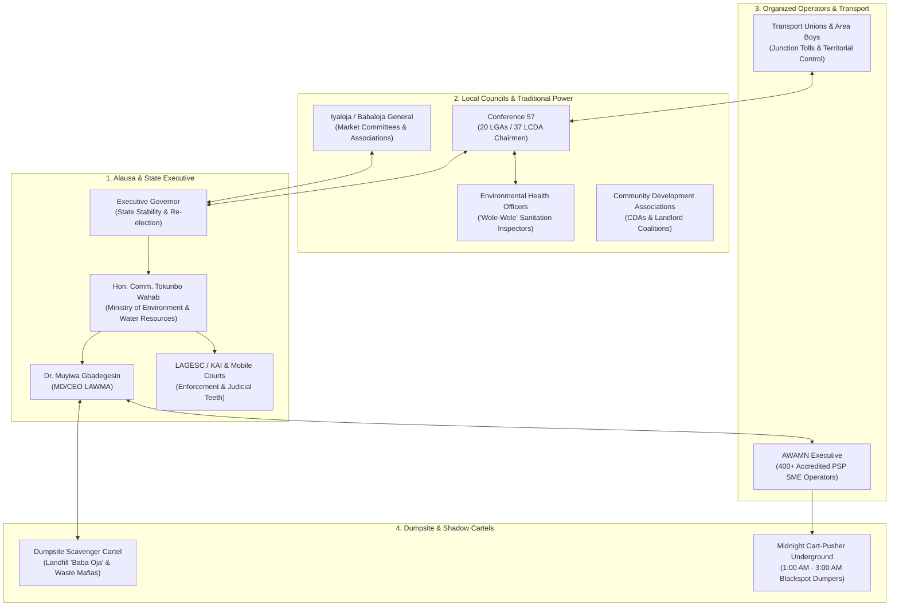

# The Political Economy of the Streets: Power, Cash, Turf, and Informal Cartels in Lagos Solid Waste Management

**Document Status:** Confidential Executive Intelligence Dossier  
**Target Audience:** System Architects, Product Leads, State Policy Advisors, and C-Suite Stakeholders presenting to:
- **Mr. Babajide Olusola Sanwo-Olu**, Executive Governor of Lagos State
- **Hon. Tokunbo Wahab**, Commissioner for the Environment and Water Resources
- **Dr. Muyiwa Gbadegesin**, MD/CEO, Lagos Waste Management Authority (LAWMA)
- **Association of Waste Managers of Nigeria (AWAMN)** Leadership
- **Conference 57** (Local Government and LCDA Executive Chairmen)

---

## 1. Executive Manifesto: Why Pure Software Fails on Lagos Streets

In technology hubs, solid waste management is viewed as a routing and billing optimization problem—an algorithm connecting supply (trucks) with demand (bins) mediated by an electronic payment gateway.

**In Lagos State, solid waste is fundamentally an exercise in political economy, territorial sovereignty, and informal power negotiations.** 

Lagos generates between **12,000 and 15,000 metric tons of refuse every single day**. The movement of this waste across a city of 22 to 24 million people is governed by a delicate balance between formal statutory law (the **2017 Environmental Management and Protection Law [EMPL]**) and deeply entrenched informal power blocs:
1. **The Market Sovereignty Bloc:** Iyalojas, Babalojas, and Market Development Boards who control cash levies and refuse clearance inside commercial nodes.
2. **The Street Territorial Bloc:** Informal transport unions (*NURTW / RTEAN*) and street-level youth vanguards (*Area Boys*) who levy informal tolls on movement.
3. **The Constitutional Turf Bloc:** The 20 Local Government Areas (LGAs) and 37 Local Council Development Areas (LCDAs), whose constitutional mandates under the Fourth Schedule of Nigeria’s 1999 Constitution frequently grind against state-level centralization.
4. **The Haulage SME Bloc:** Over 400 private PSP operators organized under the **Association of Waste Managers of Nigeria (AWAMN)**, caught between regulated tariffs and astronomical diesel/FX inflation.
5. **The Informal Dumpsite Scrap Cartel:** Entrenched scavenger syndicates at Olusosun, Solous II, and Epe, governed by informal chairmen (*Baba Oja*) who control secondary raw material extraction.
6. **The Midnight Shadow Economy:** Banned cart-pushers and predatory midnight dumpers who exploit the 1:00 AM to 3:00 AM darkness to feed arterial canals and road medians.

```
                    ┌──────────────────────────────────────────────┐
                    │      THE VISIONSGAPE LESSON (2017-2018)      │
                    │   When the State ignored the political       │
                    │   economy and replaced 350+ local PSPs with  │
                    │   a single foreign concessionaire, the street│
                    │   pushed back: trucks were sabotaged, debt   │
                    │   defaulted, mountains of trash piled up,    │
                    │   and the entire political coalition shook.  │
                    └──────────────────────────────────────────────┘
```

Any software suite that ignores these six informal and constitutional vectors will fail within six weeks of deployment. This document details the **raw operational reality of the streets**, explains the hidden failure modes tech teams overlook, and provides the **hard-nosed system mitigations** required to make LAWMA 360 unbreakable.

---

## 2. The Five Power Blocs: Anatomy of Lagos Waste Governance



---

## 3. Pillar-by-Pillar Deconstruction of Street Realities

---

### Pillar 1: Market Governance & The "Iyaloja/Babaloja" Sovereignty

```
   TRADITIONAL VIEW: "We will register market stalls in an app and send digital invoices."
   STREET REALITY:   "Try that in Ikotun or Ile-Epo, and your enumerators will be chased
                      out of the market within 30 minutes."
```

#### The Ground Mechanism
Lagos wet markets (e.g., Ikotun, Ile-Epo, Igando, Ojuwoye, Mile 12) generate between **1,500 and 2,500 metric tons of wet organic waste daily**. These markets are not managed by municipal bureaucrats or facility management firms; they are governed by traditional trading hierarchies headed by the **Iyaloja** (Mother of the Market) and **Babaloja** (Father of the Market), operating under the umbrella of the Lagos State Market Development Board.

- **Cash Collection is Centralized and Political:** Market levies (*Owo Oja*) are collected daily or weekly by market executives. This levy covers security, electricity, local council dues, and informal sanitation. 
- **Stall-by-Stall Billing Causes Instability:** A pepper seller or yam trader earning daily cash does not maintain a commercial utility account. If a state agency attempts to bypass the Iyaloja to bill stallholders individually, it is interpreted as an assault on the market leadership's authority and an attempt at double-taxation.
- **The Market Perimeter Dynamic:** Market waste spills beyond the stalls into surrounding streets, choking transit lanes. When PSP trucks arrive during the day, traffic gridlock prevents compaction.

#### The Technical & Policy Counter-Measure
1. **The Institutional Account Model (`MKT-CORP-*`):** The software must never attempt stall-by-stall enumeration in traditional markets. Instead, onboard the **Market Development Association** as a single corporate entity.
2. **Gate-Scale Manifesting:** Waste clearance is measured by **bulk skip bins** or **night compactor sweeps**. The Iyaloja’s executive committee receives a digital dashboard or SMS ledger showing:
   - Volume of bulk waste evacuated (in metric tons).
   - Time of night sweep (e.g., 23:00–04:00).
   - Status of organic diversion to compost/BSF hubs.
3. **Co-Managed Sanitation Levy:** The market leadership collects the daily micro-contributions internally and settles a consolidated monthly LAWMA/PSP invoice through their commercial cooperative account.

#### Market Operating Matrix
| Market Name | Estimated Daily Tonnage | Dominant Waste Type | Governance Structure | Street Risk Factor |
| :--- | :--- | :--- | :--- | :--- |
| **Ile-Epo (Agbado/Oke-Odo)** | 350–500 MT/day | Wet fruits, vegetables, tubers | Agricultural Commodity Union + Iyaloja | Spillover onto Lagos-Abeokuta Expressway; chronic drain blockages. |
| **Ikotun Market** | 200–300 MT/day | Food waste, plastic packaging, offal | Central Market Association Executive | Extreme daytime gridlock; night evacuation mandatory. |
| **Igando Market** | 120–180 MT/day | Mixed municipal & food waste | Local Council Market Committee | Proximity to Solous II; prone to illegal perimeter dumping. |
| **Ojuwoye / Mushin** | 300–450 MT/day | Organic scraps, packaging, textiles | Traditional Traders Guild | Dense, unpaved alleyways; inaccessible to 20-tonne compactors. |

---

### Pillar 2: The Agbero / Street Urchin Toll Architecture

```
   TRADITIONAL VIEW: "Tricycle micro-collectors will freely navigate narrow inner lanes."
   STREET REALITY:   "Local street boys will halt every tricycle at the junction and demand
                      cash for 'Owo Loading', 'Owo Junction', and 'Owo Chairman'."
```

#### The Ground Mechanism
Lagos inner streets (especially across high-density corridors like Alimosho, Mushin, Agege, and Ajegunle) are governed by informal territorial syndicates (*Area Boys* and transport union field collectors). When an unauthorized commercial three-wheeler or light vehicle moves through these corridors, it is intercepted at every major junction:

```
  [Inner Lane Compound]
          │
          ▼
   (Tricycle Loads Waste)
          │
          ▼ 50 meters
  [Junction Point A] ────► [Local Street Urchins]  ──► Demands ₦200 ("Owo Junction")
          │
          ▼ 200 meters
  [Arterial Road Turn] ──► [Union Field Collector] ──► Demands ₦500 ("Owo Loading")
          │
          ▼
  [Total Daily Tolls]  ──► ₦1,500 - ₦2,500/day per tricycle (Destroys Operating Margin!)
```

If a driver refuses to pay, tyres are deflated, mirrors are smashed, or physical violence ensues. If a micro-collector cannot turn a profit, they abandon the inner lanes, forcing residents back to illegal midnight dumping.

#### The Technical & Policy Counter-Measure
1. **Sovereign Inter-Ministerial Livery:** Tricycle compactors must not look like commercial Keke Napeps. They must carry official **Lagos State Green-and-Orange Sovereign Livery** with bold, embossed state crests: *"OFFICIAL SERVICE — LAGOS STATE GOVERNMENT / LAWMA"*.
2. **Encrypted Digital Asset QR Plates:** Affix an uncloneable, reflective QR plate to every micro-collector. Street-level union executives (*NURTW / RTEAN*) are engaged at the state level by the Commissioner through an **Inter-Ministerial Waste Transit Accord**.
3. **Rapid Harassment Distress Trigger (`Operator` App):** The `Operator` terminal contains a one-touch **Emergency Distress Button**. If intercepted by extortionists, a geofenced distress ping alerts:
   - The nearest **LAGESC / KAI Rapid Response Squad**.
   - The Local Government Monitoring Officer.
   - The Area Police Command.

---

### Pillar 3: The LGA "Wole-Wole" Constitutional Turf War

```
   TRADITIONAL VIEW: "LAWMA handles all waste; local councils simply cooperate."
   STREET REALITY:   "Local Government Environmental Health Officers will show up with
                      summonses and charge your paying residents with illegal sanitation!"
```

#### The Ground Mechanism
Under the **Fourth Schedule, Section 7 of the 1999 Constitution of the Federal Republic of Nigeria**, the establishment, maintenance, and regulation of public conveniences, sewage, and refuse disposal is a function conferred directly upon **Local Government Councils**. 

In Lagos, while the **2017 EMPL** centralizes regulatory authority under the Ministry of Environment and LAWMA, local council chairmen (Conference 57) and their cadre of **Environmental Health Officers (historically known as *Wole-Wole*)** fiercely protect their constitutional revenue base.
- If an LCDA feels that Alausa has deployed a digital system that absorbs all sanitation revenue without council allocation, they strike back using statutory health bylaws.
- *Wole-Wole* inspectors visit multi-tenant compounds, declare the state-approved bin *'non-compliant under Local Council Health Bylaws'*, and issue a court summons to the landlord, demanding court fines payable only to the council treasury.

#### Constitutional & Operational Balance Matrix
| Entity | Constitutional / Statutory Anchor | Operational Mandate | Revenue Interest |
| :--- | :--- | :--- | :--- |
| **State Government (LAWMA / Ministry)** | 2017 EMPL; Polluter-Pay Policy; State Executive Power | Arterial highways, Transfer Stations, Landfills, Specialized Waste, PSP Regulation | Regulatory share (20%), Concession fees, Environmental levies |
| **Local Governments (20 LGAs / 37 LCDAs)** | 1999 Constitution (Fourth Schedule); Council Health Bylaws | Public conveniences, tenement inspection, market sanitation, street drainage | Tenement rates, local sanitation permits, health summons fines |
| **Accredited PSP Operators** | LAWMA Ward Franchise Contracts; AWAMN Charter | Door-to-door residential and commercial collection and mid-mile haulage | Net collection fees (80% tariff share) |

#### The Technical & Policy Counter-Measure
1. **The Dedicated LGA Sanitary Inspection Portal:** Do not fight the *Wole-Wole*—arm them. Integrate the Local Council Environmental Health Department directly into `Workspace`.
2. **Accredited Digital Tenement Health Passports:** When a *Wole-Wole* officer visits an Alimosho compound, they scan the `TAG-*` gate code using an LGA inspection mode. They verify the physical bin condition, inspect compound soakaways, and log compliance.
3. **The Cleanliness Competition Incentive Structure:** Instead of competing for cash fines, the council’s performance feeds directly into **Hon. Comm. Tokunbo Wahab's 20 LGA / 37 LCDA Cleanliness Competition**, unlocking state capital grants, road maintenance priority, and administrative recognition for the council chairman.

---

### Pillar 4: Landfill Scavenger Unions & The Dumpsite Cartel ("Baba Oja")

```
   TRADITIONAL VIEW: "We will divert all plastic and recyclables upstream to private plants."
   STREET REALITY:   "If you starve the dumpsite of scrap value overnight, the scavengers
                      will blockade the tipping face and set the landfill on fire."
```

#### The Ground Mechanism
At major disposal sites like **Olusosun (Ojota)** and **Solous II (Igando)**, the scrap economy is an organized, self-policing, multi-million Naira informal industry. 
- The tipping face is governed by an informal executive hierarchy known as the **Dumpsite Scavengers' Association**, headed by a **Baba Oja** (Market Father) or Chairman.
- Thousands of informal pickers work in specialized shifts: one faction extracts PET plastics; another claims copper and electrical wiring; another packs cardboard; another extracts aluminum cans.
- Middlemen buyers park 10-tonne trucks outside the landfill gates to buy scrap directly with cash.

```
                  ┌──────────────────────────────────────────────┐
                  │          THE UPSTREAM DIVERSION THREAT       │
                  │   If LAWMA 360 aggressively diverts 70% of   │
                  │   clean plastics and metals at upstream MRFs │
                  │   and estate buyback hubs, the trucks        │
                  │   reaching Solous II carry only worthless    │
                  │   sludge. The dumpsite scrap economy faces   │
                  │   sudden collapse.                           │
                  └──────────────────────────────────────────────┘
```

When scavenger livelihoods are threatened without transition planning, the consequences are immediate:
- Compactors are delayed at the tipping face (extending turnaround from 45 minutes to 4 hours).
- Hostile confrontations occur between pickers and truck drivers.
- **Suspicious Subsurface Fires:** Landfills contain trapped methane. A single lit cigarette or deliberate spark in dry refuse can ignite a subsurface fire that blankets half the city in toxic smoke and closes the landfill for weeks, crippling collection across entire zones.

#### The Technical & Policy Counter-Measure
1. **Perimeter Sorting Cooperative Integration:** The scavenger leadership must be transitioned from hazardous open-tipping-face pickers into formalized **Perimeter Sorting Cooperatives (`REC-PICK-*`)**.
2. **First Right of Employment at Transfer Stations (TLS):** At modernized facilities like **Agege TLS** and planned 5,000 MT MRFs, formal sorting conveyor belts must hire vetted union pickers, providing protective PPE, health insurance, and structured scrap offtake arrangements.
3. **Decentralized Buyback Hub Revenue Share:** Informal collectors are accredited as localized collection agents for upstream aggregators (*Wecyclers, Pakam, Scrapays*), preserving their scrap income while removing them from hazardous landfill tipping faces.

---

### Pillar 5: Macro-Inflation & The Diesel Shock Absorber (PSP Unit Economics)

```
   TRADITIONAL VIEW: "PSPs must collect every street weekly according to their fixed contract."
   STREET REALITY:   "When diesel spikes to ₦1,400/L, a fixed ₦2,000 tariff means every trip
                      runs at a cash loss. The PSP parks the truck to avoid bankruptcy."
```

#### The Ground Reality of Compactor Haulage
The average Lagos PSP compactor is a 15- to 20-year-old refurbished European truck (Mercedes Actros, MAN, or DAF). Operating on unpaved, potholed inner streets and crawling through chronic Lagos traffic imposes punishing maintenance and fuel costs:

#### Compactor Shift Economics (Alimosho to Solous II / Epe Corridor)
| Operating Cost Element | Baseline (2021) | Current Reality (2024–2026) | Operational Impact |
| :--- | :--- | :--- | :--- |
| **Automotive Gas Oil (Diesel)** | ₦280 / liter | **₦1,250 – ₦1,450 / liter** | Single shift consumption (40–60 liters) jumps from ₦14,000 to **₦75,000+ per trip**. |
| **Engine Oil & Fluid Service** | ₦18,000 / month | **₦75,000 – ₦110,000 / month** | Scheduled servicing is postponed, causing catastrophic engine seizures. |
| **Tyre Replacement (315/80 R22.5)** | ₦65,000 / tyre | **₦280,000 – ₦360,000 / tyre** | Trucks run on bald, wire-exposed tyres, causing frequent blowouts on transit routes. |
| **Hydraulic Hose & Valve Crimp** | ₦12,000 | **₦65,000 – ₦95,000** | Compactor packer blades jam, forcing trucks to run with open, uncompacted loads. |
| **Crew Wages (Driver + 3 Packers)** | ₦4,000 / shift total | **₦12,000 – ₦18,000 / shift total** | Crew shortages; packers abandon shifts for informal scrap scavengering. |

When diesel spikes, an operator face two choices:
1. Run the route and lose ₦30,000 in cash per day.
2. Secretly stretch weekly pickups into bi-weekly or monthly rounds.

**This is the true structural root of the 5-month collection backlog.** It is not laziness; it is negative operating cash flow.

#### The Technical & Policy Counter-Measure
1. **The Dynamic Fuel Variance Adjustment (FVA) Formula:** The platform must eliminate static tariffs. Incorporate an automated regulatory index approved by LAWMA:
   $$\text{Current Tariff} = \text{Base Tariff} \times \left[ 1 + \alpha \left( \frac{\text{Current Diesel Price} - \text{Base Diesel Price}}{\text{Base Diesel Price}} \right) \right]$$
   *(Where $\alpha$ represents the fuel-to-operating-cost coefficient, typically 0.35 in Lagos waste logistics).*
2. **Bankable Digital Remittance Ledgers:** PSPs cannot access bank loans because their paper ledgers are un-auditable. The platform generates signed, LAWMA-countersigned **Predictable Revenue Slips** based on verified compound scans. PSPs present these digital statements to commercial banks (e.g., Sterling Bank, Wema, First Bank) to unlock **low-interest working-capital diesel lines** and fleet leasing.

---

### Pillar 6: The Agency Banking / POS Merchant Reality (How Lagos Actually Pays)

```
   TRADITIONAL VIEW: "Residents will pay their waste bills via in-app cards and direct debits."
   STREET REALITY:   "Over 60% of informal landlords and elderly compound managers pay through
                      the neighbourhood POS girl under the yellow umbrella."
```

#### The Ground Mechanism
Lagos has experienced a profound fintech transformation, but it did not happen through consumer web portals. It happened through **Agency Banking POS Terminals** (*Moniepoint, OPay, PalmPay, Firstmonie*).

```
 [Elderly Compound Landlord]
          │ (Carries ₦3,000 cash)
          ▼
 [Street Junction POS Kiosk] (Moniepoint / OPay Agent)
          │
          ├─────────────────────────┬─────────────────────────┐
          ▼                         ▼                         ▼
   [Option A: Normal Tech]   [Option B: Street Tech]   [Option C: Failure Mode]
   "Log into web portal      Agent enters compound ID  Agent takes cash, transfers
   to enter card details."   CMP-042 into POS terminal to personal bank, gives
   (Fails: User walks away)  (Prints thermal receipt)  handwritten slip (Leaks!)
```

If your platform requires downloading a 45MB React Native mobile app and linking a debit card, you instantly disenfranchise millions of multi-tenant compound heads, market women, and elderly property owners who control premise utilities.

#### The Technical & Policy Counter-Measure
1. **POS Agency Banking Network Integration:** Partner directly with major Super-Agents (Moniepoint, OPay). Build a dedicated **'LAWMA Utility Bill'** application tier directly into terminal firmware.
2. **The 6-Digit Compound Paycode (`CMP-*`):** Every premise has a visible stamped alphanumeric code on the front wall or gate. The landlord gives the code and cash to the POS agent.
3. **Instant Thermal Printout & Webhook Sync:** The POS terminal prints an official physical paper slip carrying the state crest, premise address, and payment reference, while firing a webhook to `hub-contract.ts` that immediately unlocks that compound's collection clearance for the billing cycle.

---

### Pillar 7: The Banned Cart-Pusher Underground & Midnight Dumpers

```
   TRADITIONAL VIEW: "We will ban cart-pushers and fine anyone caught dumping ₦250,000."
   STREET REALITY:   "Cart-pushers operate at 1:30 AM in total darkness, charging ₦300 per bag.
                      When arrested, they abandon the wooden cart and run into the swamp."
```

#### The Underground Supply Chain
The banned cart-pusher is not an anomaly; they are a structural market response to three unsolved problems:
1. **Hyper-Affordability:** A destitute tenant with ₦300 cash cannot pay an aggregated ₦2,500 monthly utility bill. The cart-pusher provides micro-transactions (*Pay-Per-Bag*).
2. **Extreme Physical Inaccessibility:** Inner streets in places like Papa Ashafa (Orile Agege) or Amukoko are unpaved alleys crisscrossed by low-hanging wires, open gutters, and deep potholes where a 20-tonne compactor cannot enter.
3. **The Midnight Disposal Nexus:** The cart-pusher collects refuse between 7:00 PM and 10:00 PM, stores it on the cart until the streets are empty, and between 1:00 AM and 2:30 AM dumps it into:
   - Secondary and tertiary drainage channels (causing wet-season floods).
   - Highway road medians (e.g., Lagos-Abeokuta Expressway, Oshodi-Apapa Expressway).
   - Uncompleted building plots and public school perimeters.

```
                  ┌──────────────────────────────────────────────┐
                  │          THE 3-HOUR CLEARANCE PARADOX        │
                  │   LAWMA emergency compactors clear an illegal│
                  │   median blackspot in Mushin at 23:00. By    │
                  │   03:00 AM, the midnight cartels have refilled│
                  │   it with fresh refuse. To passing motorists │
                  │   at 07:00 AM, it looks like the State did   │
                  │   no work at all!                            │
                  └──────────────────────────────────────────────┘
```

#### The Technical & Policy Counter-Measure
1. **Replace the Cart-Pusher with Regulated Micro-Franchises:** You cannot eradicate the cart-pusher with police raids alone without providing an accessible alternative. Formalize inner-lane micro-routes under accredited PSPs using **sub-franchised tricycle compactors**.
2. **Night Waste Police Corridor Geofencing:** In `PRD-Workspace`, map known blackspot corridors into **Tactical Night Patrol Zones (00:30–03:30)**.
3. **Special Offences Mobile Court Integration:** Captured offenders cannot be released on informal bail. The `Operator` enforcement terminal logs photographic proof directly into the **Lagos State Special Offences Court (Mobile Court)** registry, leading to immediate asset forfeiture (confiscation of carts/vehicles) and mandatory community sanitation service.

---

### Pillar 8: Biohazards, Unclaimed Remains & Criminal Tipping

```
   TRADITIONAL VIEW: "If illegal waste is detected, the crew taps 'hazard-reject'."
   STREET REALITY:   "Crews routinely find clinic sharps, butchered animal offal, or even
                      human remains dumped in public skips. Tapping 'reject' is useless."
```

#### The Ground Reality
In high-density commercial and residential corridors, municipal waste skips are frequently used for illicit disposal:
- **Unregulated Maternity Clinics & Traditional Bone-Setters:** Dump placenta bags, surgical bandages, needles, and amputated tissue into municipal domestic bins at night to avoid paying medical waste incinerator fees.
- **Illegal Abattoirs & Meat Markets:** Dump rotting cow intestines, blood, and carcasses directly into communal bins, creating unbearable stenches and biohazard risks.
- **Homicide & Abandoned Newborns:** Unclaimed human remains or abandoned infants are occasionally found inside public bins or canal banks.

A software button that simply says *'Reject Load'* leaves an infectious biohazard or a criminal crime scene abandoned on a public pedestrian walkway.

#### The Technical & Policy Counter-Measure
1. **The Red-Flag Emergency Protocol:** When an operator identifies anatomical, medical, or criminal waste, they activate the **Red-Flag Biohazard Trigger** on `waste-scan-mate`.
2. **Automated Inter-Agency Dispatch Triad:**
   - **LAWMA Medical Waste Directorate (`SPL-*`):** Dispatches specialized biohazard containment vans equipped with incinerator-bound sealed containers.
   - **Lagos State Ministry of Health (Epidemiology Unit):** Logs potential disease outbreaks or hospital origin tracking.
   - **Lagos State Police Command:** Mobilizes homicide/forensic investigators if human remains are detected.
3. **Chain of Custody Sealing:** The stop is isolated, coordinates are frozen, and surrounding CCTV/camera feeds are preserved for state enforcement prosecution.

---

### Pillar 9: Laterite Soil Cover & The Physical Survival of Solous II

```
   TRADITIONAL VIEW: "Solous II can accept 100 trucks daily if we speed up the weighbridge."
   STREET REALITY:   "If you dump 1,500 tonnes of wet garbage daily without laterite soil,
                      the dumpsite will catch fire, collapse, and shut down within weeks."
```

#### The Engineering & Physical Mechanics
A dumpsite is not a bottomless pit; it is a live biological reactor.
- When 100 compactors dump **1,500 metric tons** of fresh municipal refuse (over 50% wet food) at Solous II every day, anaerobic decomposition begins within 48 hours.
- Subsurface temperatures rise rapidly to **65°C–75°C**.
- Massive volumes of volatile **methane gas ($CH_4$)** and highly toxic, corrosive **leachate** are generated.

```
                      [100 Trucks / 1,500 Tonnes Daily]
                                     │
                                     ▼
                      ┌──────────────────────────────┐
                      │    FRESH COMPACTED GARBAGE   │
                      └──────────────────────────────┘
                                     │
           NO COVER:                 │           WITH DAILY COVER:
   ┌───────────────────────┐         │   ┌──────────────────────────────┐
   │ • Methane escapes     │         └──►│ • 150-200 Tonnes Laterite   │
   │ • Fires ignite        │             │   Clay Capping               │
   │ • Flies & odour burst │             │ • Methane suppressed         │
   │ • Community riots     │             │ • Bulldozers can drive       │
   │ • SITE COLLAPSES      │             │ • SITE STAYS OPERATIONAL     │
   └───────────────────────┘             └──────────────────────────────┘
```

Without daily soil cover, the bulldozers sink into the rotting sludge, compactor tyres get punctured, and the site becomes physically impassable, leading to **3-day queues on LASU-Isheri Road**.

#### The Technical & Policy Counter-Measure
1. **The Inbound Capping Manifest (`MAT-CAP-*`):** In `PRD-Workspace`, the facility lifecycle module must record incoming **Laterite Clay and Construction Demolition Rubble** with the same rigor as incoming waste.
2. **The Mandatory Waste-to-Cover Ratio:** Enforce a strict volumetric rule: for every **6 metric tons of waste tipped**, the facility operator must verify and log **1 metric ton of compacted laterite cover**.
3. **Automated Landfill Health Alarms:** If Solous II receives 200 compactor loads over 48 hours but logs fewer than 20 capping loads, `Workspace` immediately triggers a **Tier-1 Landfill Integrity Alarm**, warning the MD and Commissioner that methane flare-ups and tipping face collapse are imminent.

---

## 4. Master Political-Economy Matrix

| Street Reality | Who Controls It? | What Tech Teams Usually Build (Failure Mode) | What LAWMA 360 Must Build (Street-Hardened Solution) |
| :--- | :--- | :--- | :--- |
| **Market Sanitation** | Iyaloja, Babaloja, Market Dev. Board | Individual stallholder accounts & digital invoicing | **Aggregated `MKT-CORP-*` Institutional Accounts**; bulk skip manifesting; co-managed night sweeps. |
| **Street Transit Tolls** | NURTW, RTEAN, Local Area Boys | Standard GPS routing for tricycles | **Sovereign State Livery**; Encrypted Exemption QR Plates; **One-Touch Extortion Distress Trigger**. |
| **Sanitary Inspection Turf** | Council Health Officers (*Wole-Wole*) | Direct state enforcement ignoring local councils | **Dedicated LGA Health Inspector Portal**; compound health passports; Cleanliness Competition credit. |
| **Landfill Scrap Monopoly** | Dumpsite Scavenger Cartels (*Baba Oja*) | Complete upstream diversion bypassing landfills | **Perimeter Sorting Cooperatives (`REC-PICK-*`)**; first right of hire on TLS conveyor belts; buyback revenue share. |
| **Haulage Cash-Flow Bleed** | Diesel Wholesalers, Truck Parts Importers | Static monthly residential tariffs | **Dynamic Fuel Variance Formula (FVA)**; Bankable LAWMA-countersigned working capital revenue statements. |
| **Informal Cash Payments** | Street-corner POS Operators (*Moniepoint, OPay*) | Consumer mobile app with debit card gating | **Agency Banking POS App Shortcuts**; 6-digit `CMP-*` premise paycode; instant thermal paper receipting. |
| **Midnight Canal Dumping** | Banned Cart-Pushers & Night Cartels | Daytime-only routing & unenforceable fines | **Regulated Tricycle Sub-Franchises**; 00:30–03:30 Tactical Patrol Geofences; **Mobile Court Asset Forfeiture**. |
| **Street Biohazards** | Clandestine Clinics, Illegal Abattoirs | A passive *'Hazard-Reject'* button on mobile | **Red-Flag Inter-Agency Dispatch Triad** (Specialized Waste `SPL-*`, Ministry of Health, Police Command). |
| **Dumpsite Methane Fires** | Subsurface Heat, Volatile Gases | Weighbridge tonnage recording only | **Mandatory Laterite Capping Ratio (`MAT-CAP-*`)**; daily soil compaction tracking; thermal collapse warnings. |

---

## 5. The Stakeholder Battleground: Executive Q&A Defense Matrix

When presenting this architectural vision to state leadership, prepare for these pointed, high-stakes questions:

---

### Question 1 (From the Executive Governor):
> *"Will this platform destabilize my relationship with market women, Local Government Chairmen, and transport unions who form the core of our political mobilization?"*

**Your Answer:**
> *"No, Your Excellency. In fact, it protects and strengthens those partnerships. 
> Previous failed reforms—like Visionscape in 2017—collapsed precisely because they tried to erase local councils, market leadership, and local PSPs in favor of an opaque, foreign concessionaire. 
> Our architecture respects the established social order: 
> 1. It honors the **Iyaloja and Babaloja leadership** by keeping market revenue aggregated under their associations rather than harassing individual stallholders.
> 2. It integrates the **20 LGAs and 37 LCDA Chairmen** through the Cleanliness Competition, arming their health officers (*Wole-Wole*) with digital tools rather than stripping their constitutional relevance.
> 3. It protects the **400+ local PSP SMEs** under AWAMN by ensuring predictable escrow payouts and bankable ledgers for fuel credit. 
> This is not a disruptive Silicon Valley experiment; it is the digital modernization of the existing Lagos political coalition."*

---

### Question 2 (From Hon. Commissioner Tokunbo Wahab):
> *"Under the 2017 EMPL, paying for waste is a criminal offense if defaulted. How does this system help me enforce compliance and stop illegal dumping without my officers being accused of extortion?"*

**Your Answer:**
> *"Honorable Commissioner, the platform provides the two things your enforcement regime currently lacks: **objective evidence** and **cashless transparency**.
> 1. Today, when LAGESC (KAI) or the Waste Police arrest an offender on the median at 2:00 AM, it frequently degenerates into an unrecorded cash confrontation, fueling public accusations of extortion. Under our `Operator` terminal, every citation requires a **mandatory geotagged photo, officer ID, and timestamp**, generating an instant, tamper-proof **LASG/Remita Bill Reference**. Zero cash is permitted.
> 2. For premises, the system links proof of service to proof of payment: when an authorized PSP scans a compound gate, that scan is legally admissible evidence. If a resident refuses to register or pay, the system compiles a complete digital infraction dossier that feeds directly into the **Lagos State Special Offences Court at Oshodi** for rapid prosecution under the 2017 EMPL."*

---

### Question 3 (From Dr. Muyiwa Gbadegesin, MD LAWMA):
> *"My biggest nightmare is landfill collapse and PSP strikes. If diesel hits ₦1,600 tomorrow, how does this software prevent trucks from parking?"*

**Your Answer:**
> *"Dr. Gbadegesin, we solve this on both the haulage side and the disposal side:
> 1. **On Haulage:** We introduce the **Dynamic Fuel Variance Adjustment (FVA)**. The software continuously calculates fuel indices so you have real-time, empirical data to adjust commercial tariffs or provide targeted state fuel subsidies to compliant operators, eliminating their excuse to skip routes. Furthermore, our **Bankable Remittance Statements** give AWAMN operators the digital auditability required to secure commercial fuel credit facilities from partner banks.
> 2. **On Disposal:** We protect Solous II by enforcing the **Laterite Capping Ratio (`MAT-CAP-*`)** on your weighbridge and pacing compactor arrivals via **Dynamic Inbound Slot Allocation** linked with LASTMA traffic feeds. This prevents the single-lane gridlock on LASU-Isheri Road and keeps the facility operational even during peak rainfall."*

---

### Question 4 (From the AWAMN President / PSP Association):
> *"Why should our 450 members trust this system when previous software projects just took our data, delayed our remittances, and gave contracts to foreign favorites?"*

**Your Answer:**
> *"Because this platform is built around **PSP commercial survival**:
> 1. **We Solve Your Arrears Crisis:** Right now, your members suffer 6–7 months of unpaid bills because compounds have multi-tenant defaulters. Our **Compound Split-Pay Ledger** and **Agency Banking POS integration** allow individual flats to pay small shares via Moniepoint or OPay, recovering the 40% of revenue you currently lose.
> 2. **No Arbitrary Fines:** Payouts are not frozen arbitrarily. We built a **75% Operational Floor** that releases fuel and crew capital immediately upon route execution, backed by a **72-Hour Human Mediation Buffer** for contested stops.
> 3. **Protection of Your Franchise Wards:** When you perform, your digital scorecard makes your franchise renewal untouchable. The state cannot arbitrarily revoke a performing PSP whose metrics are logged transparently on the ledger."*

---

## 6. Conclusion: The Sovereign Digital Waste Machine

```
              ┌──────────────────────────────────────────────────┐
              │             THE COMPLETE OPERATING LOOP          │
              │                                                  │
              │    [The Resident]                                │
              │          │ Pays easily via Moniepoint/OPay POS   │
              │          ▼                                       │
              │    [The Compound]                                │
              │          │ Scanned in < 3 secs by Crew Handheld  │
              │          ▼                                       │
              │    [The Street Crew]                             │
              │          │ Tricycles & Compactors move freely    │
              │          │ with Sovereign State Badging          │
              │          ▼                                       │
              │    [The Mid-Mile Facility]                       │
              │          │ Solous II & Agege TLS balance loads   │
              │          │ with Laterite Cover tracking          │
              │          ▼                                       │
              │    [The Authority Command Room]                  │
              │            LAWMA & The Ministry enforce 2017 EMPL│
              │            with total transparency and zero      │
              │            extortion.                            │
              └──────────────────────────────────────────────────┘
```

By engineering directly for the **Iyaloja, the Area Boy, the Wole-Wole, the Scavenger Chairman, the POS Agent, and the Compactor Diesel Tank**, LAWMA 360 ceases to be a speculative software demo. It becomes what Lagos State has needed for two decades: **the definitive operating system for environmental resilience, social peace, and commercial sustainability in Africa’s largest megacity.**
